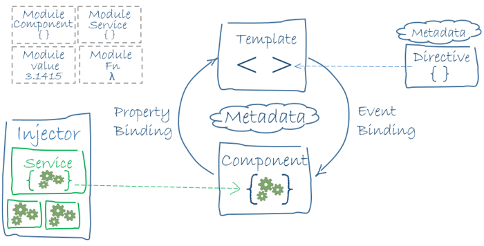
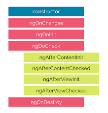
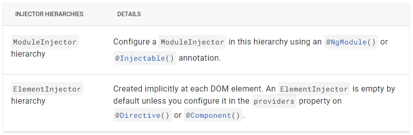
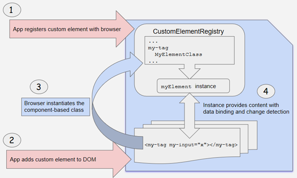
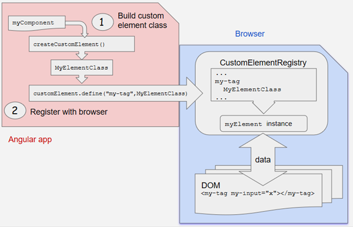
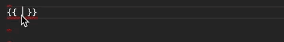
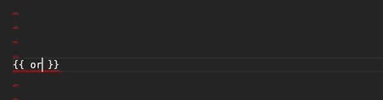
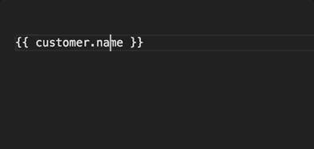
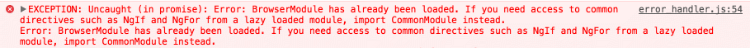

# Angular Interview Questions & Answers

> **Version note:** This guide keeps framework fundamentals that remain valid, while version-sensitive answers reflect Angular 21 (the current LTS release) and call out Angular 22 (the latest release) where relevant. Angular releases and support status change; check the official [release policy](https://angular.dev/reference/releases) and [version compatibility table](https://angular.dev/reference/versions) before applying version-specific guidance.

> Click :star: if you like the project and follow [@SudheerJonna](https://twitter.com/SudheerJonna) for technical updates.

---

<div>
<p align="center">
  <a href="https://zerotomastery.io/?utm_source=github&utm_medium=sponsor&utm_campaign=angular-interview-questions">
      
  </a>
</p>
</div>

> I recommend this [Angular course](https://zerotomastery.io/courses/learn-angular/?utm_source=github&utm_medium=sponsor&utm_campaign=angular-interview-questions) to become top 10% at Angular (and build enterprise-level apps) and [this coding interview bootcamp](https://zerotomastery.io/courses/learn-data-structures-and-algorithms/?utm_source=github&utm_medium=sponsor&utm_campaign=angular-interview-questions) to ace your coding interview and actually get hired.

---

### Table of Contents

| No.       | Questions                                                                                                                                                                                    |
| --------- | -------------------------------------------------------------------------------------------------------------------------------------------------------------------------------------------- |
| 1         | [What is Angular Framework?](#what-is-angular-framework)                                                                                                                                     |
| 2         | [What is the difference between AngularJS and Angular?](#what-is-the-difference-between-angularjs-and-angular)                                                                               |
| 3         | [What is TypeScript?](#what-is-typescript)                                                                                                                                                   |
| 4         | [Write a pictorial diagram of Angular architecture?](#write-a-pictorial-diagram-of-angular-architecture)                                                                                     |
| 5         | [What are the key components of Angular?](#what-are-the-key-components-of-angular)                                                                                                           |
| 6         | [What are directives?](#what-are-directives)                                                                                                                                                 |
| 7         | [What are components?](#what-are-components)                                                                                                                                                 |
| 8         | [What are the differences between Component and Directive?](#what-are-the-differences-between-component-and-directive)                                                                       |
| 9         | [What is a template?](#what-is-a-template)                                                                                                                                                   |
| 10        | [What is a module?](#what-is-a-module)                                                                                                                                                       |
| 11        | [What are lifecycle hooks available?](#what-are-lifecycle-hooks-available)                                                                                                                   |
| 12        | [What is a data binding?](#what-is-a-data-binding)                                                                                                                                           |
| 13        | [What is metadata?](#what-is-metadata)                                                                                                                                                       |
| 14        | [What is Angular CLI?](#what-is-angular-cli)                                                                                                                                                 |
| 15        | [What is the difference between constructor and ngOnInit?](#what-is-the-difference-between-constructor-and-ngoninit)                                                                         |
| 16        | [What is a service](#what-is-a-service)                                                                                                                                                      |
| 17        | [What is dependency injection in Angular?](#what-is-dependency-injection-in-angular)                                                                                                         |
| 18        | [How is Dependency Hierarchy formed?](#how-is-dependency-hierarchy-formed)                                                                                                                   |
| 19        | [What is the purpose of async pipe?](#what-is-the-purpose-of-async-pipe)                                                                                                                     |
| 20        | [What is the option to choose between inline and external template file?](#what-is-the-option-to-choose-between-inline-and-external-template-file)                                           |
| 21        | [What is the purpose of \*ngFor directive?](#what-is-the-purpose-of-ngfor-directive)                                                                                                         |
| 22        | [What is the purpose of ngIf directive?](#what-is-the-purpose-of-ngif-directive)                                                                                                             |
| 23        | [What happens if you use script tag inside template?](#what-happens-if-you-use-script-tag-inside-template)                                                                                   |
| 24        | [What is interpolation?](#what-is-interpolation)                                                                                                                                             |
| 25        | [What are template expressions?](#what-are-template-expressions)                                                                                                                             |
| 26        | [What are template statements?](#what-are-template-statements)                                                                                                                               |
| 27        | [How do you categorize data binding types?](#how-do-you-categorize-data-binding-types)                                                                                                       |
| 28        | [What are pipes?](#what-are-pipes)                                                                                                                                                           |
| 29        | [What is a parameterized pipe?](#what-is-a-parameterized-pipe)                                                                                                                               |
| 30        | [How do you chain pipes?](#how-do-you-chain-pipes)                                                                                                                                           |
| 31        | [What is a custom pipe?](#what-is-a-custom-pipe)                                                                                                                                             |
| 32        | [Give an example of custom pipe?](#give-an-example-of-custom-pipe)                                                                                                                           |
| 33        | [What is the difference between pure and impure pipe?](#what-is-the-difference-between-pure-and-impure-pipe)                                                                                 |
| 34        | [What is a bootstrapping module?](#what-is-a-bootstrapping-module)                                                                                                                           |
| 35        | [What are observables?](#what-are-observables)                                                                                                                                               |
| 36        | [What is HttpClient and its benefits?](#what-is-httpclient-and-its-benefits)                                                                                                                 |
| 37        | [Explain on how to use HttpClient with an example?](#explain-on-how-to-use-httpclient-with-an-example)                                                                                       |
| 38        | [How can you read full response?](#how-can-you-read-full-response)                                                                                                                           |
| 39        | [How do you perform Error handling?](#how-do-you-perform-error-handling)                                                                                                                     |
| 40        | [What is RxJS?](#what-is-rxjs)                                                                                                                                                               |
| 41        | [What is subscribing?](#what-is-subscribing)                                                                                                                                                 |
| 42        | [What is an observable?](#what-is-an-observable)                                                                                                                                             |
| 43        | [What is an observer?](#what-is-an-observer)                                                                                                                                                 |
| 44        | [What is the difference between promise and observable?](#what-is-the-difference-between-promise-and-observable)                                                                             |
| 45        | [What is multicasting?](#what-is-multicasting)                                                                                                                                               |
| 46        | [How do you perform error handling in observables?](#how-do-you-perform-error-handling-in-observables)                                                                                       |
| 47        | [What is the shorthand notation for subscribe method?](#what-is-the-shorthand-notation-for-subscribe-method)                                                                                 |
| 48        | [What are the utility functions provided by RxJS?](#what-are-the-utility-functions-provided-by-rxjs)                                                                                         |
| 49        | [What are observable creation functions?](#what-are-observable-creation-functions)                                                                                                           |
| 50        | [What will happen if you do not supply handler for the observer?](#what-will-happen-if-you-do-not-supply-handler-for-the-observer)                                                           |
| 51        | [What are Angular elements?](#what-are-angular-elements)                                                                                                                                     |
| 52        | [What is the browser support of Angular Elements?](#what-is-the-browser-support-of-angular-elements)                                                                                         |
| 53        | [What are custom elements?](#what-are-custom-elements)                                                                                                                                       |
| 54        | [Do I need to bootstrap custom elements?](#do-i-need-to-bootstrap-custom-elements)                                                                                                           |
| 55        | [Explain how custom elements works internally?](#explain-how-custom-elements-works-internally)                                                                                               |
| 56        | [How to transfer components to custom elements?](#how-to-transfer-components-to-custom-elements)                                                                                             |
| 57        | [What are the mapping rules between Angular component and custom element?](#what-are-the-mapping-rules-between-angular-component-and-custom-element)                                         |
| 58        | [How do you define typings for custom elements?](#how-do-you-define-typings-for-custom-elements)                                                                                             |
| 59        | [What are dynamic components?](#what-are-dynamic-components)                                                                                                                                 |
| 60        | [What are the various kinds of directives?](#what-are-the-various-kinds-of-directives)                                                                                                       |
| 61        | [How do you create directives using CLI?](#how-do-you-create-directives-using-cli)                                                                                                           |
| 62        | [Give an example for attribute directives?](#give-an-example-for-attribute-directives)                                                                                                       |
| 63        | [What is Angular Router?](#what-is-angular-router)                                                                                                                                           |
| 64        | [What is the purpose of base href tag?](#what-is-the-purpose-of-base-href-tag)                                                                                                               |
| 65        | [What are the router imports?](#what-are-the-router-imports)                                                                                                                                 |
| 66        | [What is router outlet?](#what-is-router-outlet)                                                                                                                                             |
| 67        | [What are router links?](#what-are-router-links)                                                                                                                                             |
| 68        | [What are active router links?](#what-are-active-router-links)                                                                                                                               |
| 69        | [What is router state?](#what-is-router-state)                                                                                                                                               |
| 70        | [What are router events?](#what-are-router-events)                                                                                                                                           |
| 71        | [What is activated route?](#what-is-activated-route)                                                                                                                                         |
| 72        | [How do you define routes?](#how-do-you-define-routes)                                                                                                                                       |
| 73        | [What is the purpose of Wildcard route?](#what-is-the-purpose-of-wildcard-route)                                                                                                             |
| 74        | [Do I need a Routing Module always?](#do-i-need-a-routing-module-always)                                                                                                                     |
| 75        | [What is Angular Universal?](#what-is-angular-universal)                                                                                                                                     |
| 76        | [What are different types of compilation in Angular?](#what-are-different-types-of-compilation-in-angular)                                                                                   |
| 77        | [What is JIT?](#what-is-jit)                                                                                                                                                                 |
| 78        | [What is AOT?](#what-is-aot)                                                                                                                                                                 |
| 79        | [Why do we need compilation process?](#why-do-we-need-compilation-process)                                                                                                                   |
| 80        | [What are the advantages with AOT?](#what-are-the-advantages-with-aot)                                                                                                                       |
| 81        | [What are the ways to control AOT compilation?](#what-are-the-ways-to-control-aot-compilation)                                                                                               |
| 82        | [What are the restrictions of metadata?](#what-are-the-restrictions-of-metadata)                                                                                                             |
| 83        | [What are the three phases of AOT?](#what-are-the-three-phases-of-aot)                                                                                                                       |
| 84        | [Can I use arrow functions in AOT?](#can-i-use-arrow-functions-in-aot)                                                                                                                       |
| 85        | [What is the purpose of metadata json files?](#what-is-the-purpose-of-metadata-json-files)                                                                                                   |
| 86        | [Can I use any javascript feature for expression syntax in AOT?](#can-i-use-any-javascript-feature-for-expression-syntax-in-aot)                                                             |
| 87        | [What is folding?](#what-is-folding)                                                                                                                                                         |
| 88        | [What are macros?](#what-are-macros)                                                                                                                                                         |
| 89        | [Give an example of few metadata errors?](#give-an-example-of-few-metadata-errors)                                                                                                           |
| 90        | [What is metadata rewriting?](#what-is-metadata-rewriting)                                                                                                                                   |
| 91        | [How do you provide configuration inheritance?](#how-do-you-provide-configuration-inheritance)                                                                                               |
| 92        | [How do you specify angular template compiler options?](#how-do-you-specify-angular-template-compiler-options)                                                                               |
| 93        | [How do you enable binding expression validation?](#how-do-you-enable-binding-expression-validation)                                                                                         |
| 94        | [What is the purpose of any type cast function?](#what-is-the-purpose-of-any-type-cast-function)                                                                                             |
| 95        | [What is Non null type assertion operator?](#what-is-non-null-type-assertion-operator)                                                                                                       |
| 96        | [What is type narrowing?](#what-is-type-narrowing)                                                                                                                                           |
| 97        | [How do you describe various dependencies in angular application?](#how-do-you-describe-various-dependencies-in-angular-application)                                                         |
| 98        | [What is zone?](#what-is-zone)                                                                                                                                                               |
| 99        | [What is the purpose of common module?](#what-is-the-purpose-of-common-module)                                                                                                               |
| 100       | [What is codelyzer?](#what-is-codelyzer)                                                                                                                                                     |
| 101       | [What is angular animation?](#what-is-angular-animation)                                                                                                                                     |
| 102       | [What are the steps to use animation module?](#what-are-the-steps-to-use-animation-module)                                                                                                   |
| 103       | [What is State function?](#what-is-state-function)                                                                                                                                           |
| 104       | [What is Style function?](#what-is-style-function)                                                                                                                                           |
| 105       | [What is the purpose of animate function?](#what-is-the-purpose-of-animate-function)                                                                                                         |
| 106       | [What is transition function?](#what-is-transition-function)                                                                                                                                 |
| 107       | [How to inject the dynamic script in angular?](#how-to-inject-the-dynamic-script-in-angular)                                                                                                 |
| 108       | [What is a service worker and its role in Angular?](#what-is-a-service-worker-and-its-role-in-angular)                                                                                       |
| 109       | [What are the design goals of service workers?](#what-are-the-design-goals-of-service-workers)                                                                                               |
| 110       | [What are the differences between AngularJS and Angular with respect to dependency injection?](#what-are-the-differences-between-angularjs-and-angular-with-respect-to-dependency-injection) |
| 111       | [What is Angular Ivy?](#what-is-angular-ivy)                                                                                                                                                 |
| 112       | [What are the features included in ivy preview?](#what-are-the-features-included-in-ivy-preview)                                                                                             |
| 113       | [Can I use AOT compilation with Ivy?](#can-i-use-aot-compilation-with-ivy)                                                                                                                   |
| 114       | [What is Angular Language Service?](#what-is-angular-language-service)                                                                                                                       |
| 115       | [How do you install angular language service in the project?](#how-do-you-install-angular-language-service-in-the-project)                                                                   |
| 116       | [Is there any editor support for Angular Language Service?](#is-there-any-editor-support-for-angular-language-service)                                                                       |
| 117       | [Explain the features provided by Angular Language Service?](#explain-the-features-provided-by-angular-language-service)                                                                     |
| 118       | [How do you add web workers in your application?](#how-do-you-add-web-workers-in-your-application)                                                                                           |
| 119       | [What are the limitations with web workers?](#what-are-the-limitations-with-web-workers)                                                                                                     |
| 120       | [What is Angular CLI Builder?](#what-is-angular-cli-builder)                                                                                                                                 |
| 121       | [What is a builder?](#what-is-a-builder)                                                                                                                                                     |
| 122       | [How do you invoke a builder?](#how-do-you-invoke-a-builder)                                                                                                                                 |
| 123       | [How do you create app shell in Angular?](#how-do-you-create-app-shell-in-angular)                                                                                                           |
| 124       | [What are the case types in Angular?](#what-are-the-case-types-in-angular)                                                                                                                   |
| 125       | [What are the class decorators in Angular?](#what-are-the-class-decorators-in-angular)                                                                                                       |
| 126       | [What are class field decorators?](#what-are-class-field-decorators)                                                                                                                         |
| 127       | [What is declarable in Angular?](#what-is-declarable-in-angular)                                                                                                                             |
| 128       | [What are the restrictions on declarable classes?](#what-are-the-restrictions-on-declarable-classes)                                                                                         |
| 129       | [What is a DI token?](#what-is-a-di-token)                                                                                                                                                   |
| 130       | [What is Angular DSL?](#what-is-angular-dsl)                                                                                                                                                 |
| 131       | [What is an rxjs Subject?](#what-is-an-rxjs-Subject)                                                                                                                                         |
| 132       | [What is Bazel tool?](#what-is-bazel-tool)                                                                                                                                                   |
| 133       | [What are the advantages of Bazel tool?](#what-are-the-advantages-of-bazel-tool)                                                                                                             |
| 134       | [How do you use Bazel with Angular CLI?](#how-do-you-use-bazel-with-angular-cli)                                                                                                             |
| 135       | [How do you run Bazel directly?](#how-do-you-run-bazel-directly)                                                                                                                             |
| 136       | [What is platform in Angular?](#what-is-platform-in-angular)                                                                                                                                 |
| 137       | [What happens if I import the same module twice?](#what-happens-if-i-import-the-same-module-twice)                                                                                           |
| 138       | [How do you select an element with in a component template?](#how-do-you-select-an-element-with-in-a-component-template)                                                                     |
| 139       | [How do you detect route change in Angular?](#how-do-you-detect-route-change-in-angular)                                                                                                     |
| 140       | [How do you pass headers for HTTP client?](#how-do-you-pass-headers-for-http-client)                                                                                                         |
| 141       | [What is the purpose of differential loading in CLI?](#what-is-the-purpose-of-differential-loading-in-cli)                                                                                   |
| 142       | [Does Angular support dynamic imports?](#does-angular-support-dynamic-imports)                                                                                                               |
| 143       | [What is lazy loading?](#what-is-lazy-loading)                                                                                                                                               |
| 144       | [What are workspace APIs?](#what-are-workspace-apis)                                                                                                                                         |
| 145       | [How do you upgrade angular version?](#how-do-you-upgrade-angular-version)                                                                                                                   |
| 146       | [What is Angular Material?](#what-is-angular-material)                                                                                                                                       |
| 147       | [How do you upgrade location service of angularjs?](#how-do-you-upgrade-location-service-of-angularjs)                                                                                       |
| 148       | [What is NgUpgrade?](#what-is-ngupgrade)                                                                                                                                                     |
| 149       | [How do you test Angular application using CLI?](#how-do-you-test-angular-application-using-cli)                                                                                             |
| 150       | [How to use polyfills in Angular application?](#how-to-use-polyfills-in-angular-application)                                                                                                 |
| 151       | [What are the ways to trigger change detection in Angular?](#what-are-the-ways-to-trigger-change-detection-in-angular)                                                                       |
| 152       | [What are the differences of various versions of Angular?](#what-are-the-differences-of-various-versions-of-angular)                                                                         |
| 153       | [What are the security principles in angular?](#what-are-the-security-principles-in-angular)                                                                                                 |
| 154       | [What is the reason to deprecate Web Tracing Framework?](#what-is-the-reason-to-deprecate-web-tracing-framework)                                                                             |
| 155       | [What is the reason to deprecate web worker packages?](#what-is-the-reason-to-deprecate-web-worker-packages)                                                                                 |
| 156       | [How do you find angular CLI version?](#how-do-you-find-angular-cli-version)                                                                                                                 |
| 157       | [What is the browser support for Angular?](#what-is-the-browser-support-for-angular)                                                                                                         |
| 158       | [What is schematic](#what-is-schematic)                                                                                                                                                      |
| 159       | [What is rule in Schematics?](#what-is-rule-in-schematics)                                                                                                                                   |
| 160       | [What is Schematics CLI?](#what-is-schematics-cli)                                                                                                                                           |
| 161       | [What are the best practices for security in angular?](#what-are-the-best-practices-for-security-in-angular)                                                                                 |
| 162       | [What is Angular security model for preventing XSS attacks?](#what-is-angular-security-model-for-preventing-xss-attacks)                                                                     |
| 163       | [What is the role of template compiler for prevention of XSS attacks?](#what-is-the-role-of-template-compiler-for-prevention-of-xss-attacks)                                                 |
| 164       | [What are the various security contexts in Angular?](#what-are-the-various-security-contexts-in-Angular)                                                                                     |
| 165       | [What is Sanitization? Does Angular support it?](#what-is-sanitization-does-angular-support-it)                                                                                              |
| 166       | [What is the purpose of innerHTML?](#what-is-the-purpose-of-innerhtml)                                                                                                                       |
| 167       | [What is the difference between interpolated content and innerHTML?](#what-is-the-difference-between-interpolated-content-and-innerhtml)                                                     |
| 168       | [How do you prevent automatic sanitization?](#how-do-you-prevent-automatic-sanitization)                                                                                                     |
| 169       | [Is it safe to use direct DOM API methods in terms of security?](#is-it-safe-to-use-direct-dom-api-methods-in-terms-of-security)                                                             |
| 170       | [What is DOM sanitizer?](#what-is-dom-sanitizer)                                                                                                                                             |
| 171       | [How do you support server side XSS protection in Angular application?](#how-do-you-support-server-side-xss-protection-in-angular-application)                                               |
| 172       | [Does Angular prevent HTTP level vulnerabilities?](#does-angular-prevent-http-level-vulnerabilities)                                                                                         |
| 173       | [What are Http Interceptors?](#what-are-http-interceptors)                                                                                                                                   |
| 174       | [What are the applications of HTTP interceptors?](#what-are-the-applications-of-http-interceptors)                                                                                           |
| 175       | [Are multiple interceptors supported in Angular?](#are-multiple-interceptors-supported-in-angular)                                                                                           |
| 176       | [How can I use interceptor for an entire application?](#how-can-i-use-interceptor-for-an-entire-application)                                                                                 |
| 177       | [How does Angular simplify Internationalization?](#how-does-angular-simplify-internationalization)                                                                                           |
| 178       | [How do you manually register locale data?](#how-do-you-manually-register-locale-data)                                                                                                       |
| 179       | [What are the four phases of template translation?](#what-are-the-four-phases-of-template-translation)                                                                                       |
| 180       | [What is the purpose of i18n attribute?](#what-is-the-purpose-of-i18n-attribute)                                                                                                             |
| 181       | [What is the purpose of custom id?](#what-is-the-purpose-of-custom-id)                                                                                                                       |
| 182       | [What happens if the custom id is not unique?](#what-happens-if-the-custom-id-is-not-unique)                                                                                                 |
| 183       | [Can I translate text without creating an element?](#can-i-translate-text-without-creating-an-element)                                                                                       |
| 184       | [How can I translate attribute?](#how-can-i-translate-attribute)                                                                                                                             |
| 185       | [List down the pluralization categories?](#list-down-the-pluralization-categories)                                                                                                           |
| 186       | [What is select ICU expression?](#what-is-select-icu-expression)                                                                                                                             |
| 187       | [How do you report missing translations?](#how-do-you-report-missing-translations)                                                                                                           |
| 188       | [How do you provide build configuration for multiple locales?](#how-do-you-provide-build-configuration-for-multiple-locales)                                                                 |
| 189       | [What is an angular library?](#what-is-an-angular-library)                                                                                                                                   |
| 190       | [What is AOT compiler?](#what-is-aot-compiler)                                                                                                                                               |
| 191       | [How do you select an element in component template?](#how-do-you-select-an-element-in-component-template)                                                                                   |
| 192       | [What is TestBed?](#what-is-testbed)                                                                                                                                                         |
| 193       | [What is protractor?](#what-is-protractor)                                                                                                                                                   |
| 194       | [What is collection?](#what-is-collection)                                                                                                                                                   |
| 195       | [How do you create schematics for libraries?](#how-do-you-create-schematics-for-libraries)                                                                                                   |
| 196       | [How do you use jquery in Angular?](#how-do-you-use-jquery-in-angular)                                                                                                                       |
| 197       | [What is the reason for No provider for HTTP exception?](#what-is-the-reason-for-no-provider-for-http-exception)                                                                             |
| 198       | [What is router state?](#what-is-router-state)                                                                                                                                               |
| 199       | [How can I use SASS in angular project?](#how-can-i-use-sass-in-angular-project)                                                                                                             |
| 200       | [What is the purpose of hidden property?](#what-is-the-purpose-of-hidden-property)                                                                                                           |
| 201       | [What is the difference between ngIf and hidden property?](#what-is-the-difference-between-ngif-and-hidden-property)                                                                         |
| 202       | [What is slice pipe?](#what-is-slice-pipe)                                                                                                                                                   |
| 203       | [What is index property in ngFor directive?](#what-is-index-property-in-ngfor-directive)                                                                                                     |
| 204       | [What is the purpose of ngFor trackBy?](#what-is-the-purpose-of-ngfor-trackby)                                                                                                               |
| 205       | [What is the purpose of ngSwitch directive?](#what-is-the-purpose-of-ngswitch-directive)                                                                                                     |
| 206       | [Is it possible to do aliasing for inputs and outputs?](#is-it-possible-to-do-aliasing-for-inputs-and-outputs)                                                                               |
| 207       | [What is safe navigation operator?](#what-is-safe-navigation-operator)                                                                                                                       |
| 208       | [Is any special configuration required for Angular9?](#is-any-special-configuration-required-for-angular9)                                                                                   |
| 209       | [What are type safe TestBed API changes in Angular9?](#what-are-type-safe-testbed-api-changes-in-angular9)                                                                                   |
| 210       | [Is mandatory to pass static flag for ViewChild?](#is-mandatory-to-pass-static-flag-for-viewchild)                                                                                           |
| 211       | [What are the list of template expression operators?](#what-are-the-list-of-template-expression-operators)                                                                                   |
| 212       | [What is the precedence between pipe and ternary operators?](#what-is-the-precedence-between-pipe-and-ternary-operators)                                                                     |
| 213       | [What is an entry component?](#what-is-an-entry-component)                                                                                                                                   |
| 214       | [What is a bootstrapped component?](#what-is-a-bootstrapped-component)                                                                                                                       |
| 215       | [How do you manually bootstrap an application?](#how-do-you-manually-bootstrap-an-application)                                                                                               |
| 216       | [Is it necessary for bootstrapped component to be entry component?](#is-it-necessary-for-bootstrapped-component-to-be-entry-component)                                                       |
| 217       | [What is a routed entry component?](#what-is-a-routed-entry-component#)                                                                                                                      |
| 218       | [Why is not necessary to use entryComponents array every time?](#why-is-not-necessary-to-use-entrycomponents-array-every-time)                                                               |
| 219       | [Do I still need to use entryComponents array in Angular9?](#do-i-still-need-to-use-entrycomponents-array-in-angular9#)                                                                      |
| 220       | [Is it all components generated in production build?](#is-it-all-components-generated-in-production-build)                                                                                   |
| 221       | [What is Angular compiler?](#what-is-angular-compiler)                                                                                                                                       |
| 222       | [What is the role of ngModule metadata in compilation process?](#what-is-the-role-of-ngmodule-metadata-in-compilation-process)                                                               |
| 223       | [How does angular finds components, directives and pipes?](#how-does-angular-finds-components-directives-and-pipes)                                                                          |
| 224       | [Give few examples for NgModules?](#give-few-examples-for-ngmodules)                                                                                                                         |
| 225       | [What are feature modules?](#what-are-feature-modules)                                                                                                                                       |
| 226       | [What are the imported modules in CLI generated feature modules?](#what-are-the-imported-modules-in-cli-generated-feature-modules)                                                           |
| 227       | [What are the differences between ngmodule and javascript module?](#what-are-the-differences-between-ngmodule-and-javascript-module)                                                         |
| 228       | [What are the possible errors with declarations?](#what-are-the-possible-errors-with-declarations)                                                                                           |
| 229       | [What are the steps to use declaration elements?](#what-are-the-steps-to-use-declaration-elements)                                                                                           |
| 230       | [What happens if browserModule used in feature module?](#what-happens-if-browsermodule-used-in-feature-module)                                                                               |
| 231       | [What are the types of feature modules?](#what-are-the-types-of-feature-modules)                                                                                                             |
| 232       | [What is a provider?](#what-is-a-provider)                                                                                                                                                   |
| 233       | [What is the recommendation for provider scope?](#what-is-the-recommendation-for-provider-scope#)                                                                                            |
| 234       | [How do you restrict provider scope to a module?](#how-do-you-restrict-provider-scope-to-a-module)                                                                                           |
| 235       | [How do you provide a singleton service?](#how-do-you-provide-a-singleton-service)                                                                                                           |
| 236       | [What are the different ways to remove duplicate service registration?](#what-are-the-different-ways-to-remove-duplicate-service-registration)                                               |
| 237       | [How does forRoot method helpful to avoid duplicate router instances?](#how-does-forroot-method-helpful-to-avoid-duplicate-router-instances)                                                 |
| 238       | [What is a shared module?](#what-is-a-shared-module)                                                                                                                                         |
| 239       | [Can I share services using modules?](#can-i-share-services-using-modules)                                                                                                                   |
| 240       | [How do you get current direction for locales??](#how-do-you-get-current-direction-for-locales)                                                                                              |
| 241       | [What is ngcc?](#what-is-ngcc)                                                                                                                                                               |
| 242       | [What classes should not be added to declarations?](#what-classes-should-not-be-added-to-declarations)                                                                                       |
| 243       | [What is ngzone?](#what-is-ngzone)                                                                                                                                                           |
| 244       | [What is NoopZone?](#what-is-noopzone)                                                                                                                                                       |
| 245       | [How do you create displayBlock components?](#how-do-you-create-displayblock-components)                                                                                                     |
| 246       | [What are the possible data change scenarios for change detection?](#what-are-the-possible-data-change-scenarios-for-change-detection)                                                       |
| 247       | [What is a zone context?](#what-is-a-zone-context)                                                                                                                                           |
| 248       | [What are the lifecycle hooks of a zone?](#what-are-the-lifecycle-hooks-of-a-zone)                                                                                                           |
| 249       | [Which are the methods of NgZone used to control change detection?](#which-are-the-methods-of-ngzone-used-to-control-change-detection)                                                       |
| 250       | [How do you change the settings of zonejs?](#how-do-you-change-the-settings-of-zonejs)                                                                                                       |
| 251       | [How do you trigger an animation?](#how-do-you-trigger-an-animation)                                                                                                                         |
| 252       | [How do you configure injectors with providers at different levels?](#how-do-you-configure-injectors-with-providers-at-different-levels)                                                     |
| 253       | [Is it mandatory to use injectable on every service class?](#is-it-mandatory-to-use-injectable-on-every-service-class)                                                                       |
| 254       | [What is an optional dependency?](#what-is-an-optional-dependency)                                                                                                                           |
| 255       | [What are the types of injector hierarchies?](#what-are-the-types-of-injector-hierarchies)                                                                                                   |
| 256       | [What are reactive forms?](#what-are-reactive-forms)                                                                                                                                         |
| 257       | [What are dynamic forms?](#what-are-dynamic-forms)                                                                                                                                           |
| 258       | [What are template driven forms?](#what-are-template-driven-forms)                                                                                                                           |
| 259       | [What are the differences between reactive forms and template driven forms?](#what-are-the-differences-between-reactive-forms-and-template-driven-forms)                                     |
| 260       | [What are the different ways to group form controls?](#what-are-the-different-ways-to-group-form-controls)                                                                                   |
| 261       | [How do you update specific properties of a form model?](#how-do-you-update-specific-properties-of-a-form-model)                                                                             |
| 262       | [What is the purpose of FormBuilder?](#what-is-the-purpose-of-formbuilder)                                                                                                                   |
| 263       | [How do you verify the model changes in forms?](#how-do-you-verify-the-model-changes-in-forms)                                                                                               |
| 264       | [What are the state CSS classes provided by ngModel?](#what-are-the-state-css-classes-provided-by-ngmodel)                                                                                   |
| 265       | [How do you reset the form?](#how-do-you-reset-the-form)                                                                                                                                     |
| 266       | [What are the types of validator functions?](#what-are-the-types-of-validator-functions)                                                                                                     |
| 267       | [Can you give an example of built-in validators?](#can-you-give-an-example-of-built-in-validators)                                                                                           |
| 268       | [How do you optimize the performance of async validators?](#how-do-you-optimize-the-performance-of-async-validators)                                                                         |
| 269       | [How to set ngFor and ngIf on the same element?](#how-to-set-ngfor-and-ngif-on-the-same-element)                                                                                             |
| 270       | [What is host property in css?](#what-is-host-property-in-css)                                                                                                                               |
| 271       | [How do you get the current route?](#how-do-you-get-the-current-route)                                                                                                                       |
| 272       | [What is Component Test Harnesses?](#what-is-component-test-harnesses)                                                                                                                       |
| 273       | [What is the benefit of Automatic Inlining of Fonts?](#what-is-the-benefit-of-automatic-inlining-of-fonts)                                                                                   |
| 274       | [What is content projection?](#what-is-content-projection)                                                                                                                                   |
| 275       | [What is ng-content and its purpose?](#what-is-ng-content-and-its-purpose)                                                                                                                   |
| 276       | [What is standalone component?](#what-is-standalone-component)                                                                                                                               |
| 277       | [How to create a standalone component uing CLI command?](#how-to-create-a-standalone-component-uing-cli-command)                                                                             |
| 278       | [How to create a standalone component manually?](#how-to-create-a-standalone-component-manually)                                                                                             |
| 279       | [What is hydration ?](#what-is-hydration)                                                                                                                                                    |
| 280       | [What are Angular Signals?](#what-are-angular-signals)                                                                                                                                       |
| 281       | [Explain Angular Signals with an example](#explain-angular-signals-with-an-example)                                                                                                          |
| 282       | [What are the Route Parameters? Could you explain each of them?](#what-are-the-route-parameters-could-you-explain-each-of-them)                                                              |
| 283       | [What is NgRx?](#what-is-ngrx)                                                                                                                                                               |
| 284       | [What is Angular's built-in template control flow?](#what-is-angulars-built-in-template-control-flow)                                                                                        |
| 285       | [What is zoneless change detection?](#what-is-zoneless-change-detection)                                                                                                                     |
| 286       | [What are signal-based inputs, outputs, and queries?](#what-are-signal-based-inputs-outputs-and-queries)                                                                                     |
| 287       | [What is the @defer block?](#what-is-the-defer-block)                                                                                                                                        |
| 288       | [What are the Resource APIs?](#what-are-the-resource-apis)                                                                                                                                   |
| 289       | [What are Signal Forms?](#what-are-signal-forms)                                                                                                                                             |
| 290       | [What is Angular's current SSR and hydration approach?](#what-is-angulars-current-ssr-and-hydration-approach)                                                                                |
| 291       | [What is the current default change detection strategy?](#what-is-the-current-default-change-detection-strategy)                                                                             |
| 292       | [What should you know about Angular's current testing tools?](#what-should-you-know-about-angulars-current-testing-tools)                                                                    |
| 293       | [How do you animate elements entering and leaving the DOM?](#how-do-you-animate-elements-entering-and-leaving-the-dom)                                                                       |
| 294       | [What is the difference between Subject and BehaviorSubject?](#what-is-the-difference-between-subject-and-behaviorsubject)                                                                   |
| Interview | [Interview experience questions and answers](#interview-experience-questions-and-answers)                                                                                                    |

1. ### What is Angular Framework?

   Angular is a **TypeScript-based open-source** front-end platform that makes it easy to build web, mobile and desktop applications. The major features of this framework include declarative templates, dependency injection, end to end tooling which ease application development.

   **[⬆ Back to Top](#table-of-contents)**

2. ### What is the difference between AngularJS and Angular?

   AngularJS (version 1.x) is a JavaScript framework, whereas Angular (version 2+) is a complete rewrite of AngularJS using TypeScript, providing better performance, mobile support, modularity, and a more modern architecture.

   Here are some of the major differences in tabular format:-

   | AngularJS                                   | Angular                                  |
   | ------------------------------------------- | ---------------------------------------- |
   | It is based on MVC architecture             | This is based on Service/Controller      |
   | It uses JavaScript to build the application | Uses TypeScript to build the application |
   | Based on controllers concept                | This is a component based UI approach    |
   | No support for mobile platforms             | Fully supports mobile platforms          |
   | Difficult to build SEO friendly application | Ease to build SEO friendly applications  |

   **[⬆ Back to Top](#table-of-contents)**

3. ### What is TypeScript?

   TypeScript is a strongly typed superset of JavaScript created by Microsoft that adds optional types, classes, async/await and many other features, and compiles to plain JavaScript. Angular is written entirely in TypeScript as a primary language.
   You can install TypeScript globally as

   ```cmd
   npm install -g typescript
   ```

   Let's see a simple example of TypeScript usage:-

   ```typescript
   function greeter(person: string) {
     return "Hello, " + person;
   }

   let user = "Sudheer";

   document.body.innerHTML = greeter(user);
   ```

   The greeter method allows only string type as argument.

   **[⬆ Back to Top](#table-of-contents)**

4. ### Write a pictorial diagram of Angular architecture?

   The main building blocks of an Angular application are shown in the diagram below:-
   

   **[⬆ Back to Top](#table-of-contents)**

5. ### What are the key components of Angular?

   Angular has the key components below,
   1. **Component:** These are the basic building blocks of an Angular application to control HTML views.
   2. **Modules:** An Angular module is a set of angular basic building blocks like components, directives, services etc. An application is divided into logical pieces and each piece of code is called as "module" which perform a single task.
   3. **Templates:** These represent the views of an Angular application.
   4. **Services:** Are used to create components which can be shared across the entire application.
   5. **Metadata:** This can be used to add more data to an Angular class.

   **[⬆ Back to Top](#table-of-contents)**

6. ### What are directives?

   Directives add behaviour to an existing DOM element or an existing component instance.

   ```typescript
   import { Directive, ElementRef, Input } from "@angular/core";

   @Directive({ selector: "[myHighlight]" })
   export class HighlightDirective {
     constructor(el: ElementRef) {
       el.nativeElement.style.backgroundColor = "yellow";
     }
   }
   ```

   Now this directive extends HTML element behavior with a yellow background as below

   ```html
   <p myHighlight>Highlight me!</p>
   ```

   **[⬆ Back to Top](#table-of-contents)**

7. ### What are components?

   Components are the most basic UI building block of an Angular app, which form a tree of Angular components. These components are a subset of directives. Unlike directives, components always have a template, and only one component can be instantiated per element in a template.
   Let's see a simple example of Angular component

   ```typescript
   import { Component } from "@angular/core";

   @Component({
     selector: "my-app",
     template: `
       <div>
         <h1>{{ title }}</h1>
         <div>Learn Angular6 with examples</div>
       </div>
     `,
   })
   export class AppComponent {
     title: string = "Welcome to Angular world";
   }
   ```

   **[⬆ Back to Top](#table-of-contents)**

8. ### What are the differences between Component and Directive?

   In a short note, A component(@component) is a directive-with-a-template.

   Some of the major differences are mentioned in a tabular form

   | Component                                                               | Directive                                                      |
   | ----------------------------------------------------------------------- | -------------------------------------------------------------- |
   | To register a component we use @Component meta-data annotation          | To register a directive we use @Directive meta-data annotation |
   | Components are typically used to create UI widgets                      | Directives are used to add behavior to an existing DOM element |
   | Component is used to break down the application into smaller components | Directive is used to design re-usable components               |
   | Only one component can be present per DOM element                       | Many directives can be used per DOM element                    |
   | @View decorator or templateurl/template are mandatory                   | Directive doesn't use View                                     |

   **[⬆ Back to Top](#table-of-contents)**

9. ### What is a template?

   A template is a HTML view where you can display data by binding controls to properties of an Angular component. You can store your component's template in one of two places. You can define it inline using the template property, or you can define the template in a separate HTML file and link to it in the component metadata using the @Component decorator's templateUrl property.

   **Using inline template with template syntax,**

   ```typescript
   import { Component } from '@angular/core';

   @Component ({
      selector: 'my-app',
      template: '
         <div>
            <h1>{{title}}</h1>
            <div>Learn Angular</div>
         </div>
      '
   })

   export class AppComponent {
      title: string = 'Hello World';
   }
   ```

   **Using separate template file such as app.component.html**

   ```typescript
   import { Component } from "@angular/core";

   @Component({
     selector: "my-app",
     templateUrl: "app/app.component.html",
   })
   export class AppComponent {
     title: string = "Hello World";
   }
   ```

   **[⬆ Back to Top](#table-of-contents)**

10. ### What is a module?

    An NgModule is a class annotated with `@NgModule` that groups declarations, imports, providers, and (in older applications) bootstrap configuration. NgModules remain supported, but standalone components are the default for new applications and do not need to be declared in an NgModule.
    A legacy root NgModule can be defined as follows:

    ```typescript
    import { NgModule } from "@angular/core";
    import { BrowserModule } from "@angular/platform-browser";
    import { AppComponent } from "./app.component";

    @NgModule({
      imports: [BrowserModule],
      declarations: [AppComponent],
      bootstrap: [AppComponent],
      providers: [],
    })
    export class AppModule {}
    ```

    The NgModule decorator's commonly used options are:
    1. The imports option is used to import other NgModules and standalone declarations. `BrowserModule` is used by browser-based NgModule applications.
    2. The declarations option is used to define components in the respective module.
    3. The bootstrap option tells Angular which component to bootstrap in the application.
    4. The providers option is used to configure a set of injectable objects that are available in the injector of this module.

    `entryComponents` is obsolete and was removed with View Engine; Ivy no longer requires it for dynamic components.

**[⬆ Back to Top](#table-of-contents)**

11. ### What are lifecycle hooks available?

    Angular application goes through an entire set of processes or has a lifecycle right from its initiation to the end of the application.
    The representation of lifecycle in pictorial representation as follows,

    

    The description of each lifecycle method is as below,
    1. **ngOnChanges:** When the value of a data bound property changes, then this method is called.
    2. **ngOnInit:** This is called whenever the initialization of the directive/component after Angular first displays the data-bound properties happens.
    3. **ngDoCheck:** This is for the detection and to act on changes that Angular can't or won't detect on its own.
    4. **ngAfterContentInit:** This is called in response after Angular projects external content into the component's view.
    5. **ngAfterContentChecked:** This is called in response after Angular checks the content projected into the component.
    6. **ngAfterViewInit:** This is called in response after Angular initializes the component's views and child views.
    7. **ngAfterViewChecked:** This is called in response after Angular checks the component's views and child views.
    8. **ngOnDestroy:** This is the cleanup phase just before Angular destroys the directive/component.

**[⬆ Back to Top](#table-of-contents)**

12. ### What is a data binding?

    Data binding is a core concept in Angular and allows to define communication between a component and the DOM, making it very easy to define interactive applications without worrying about pushing and pulling data. There are four forms of data binding(divided as 3 categories) which differ in the way the data is flowing.
    1. **From the Component to the DOM:**

       **Interpolation:** {{ value }}: Adds the value of a property from the component

       ```html
       <li>Name: {{ user.name }}</li>
       <li>Address: {{ user.address }}</li>
       ```

       **Property binding:** [property]=”value”: The value is passed from the component to the specified property or simple HTML attribute

       ```html
       <input type="email" [value]="user.email" />
       ```

    2. **From the DOM to the Component:**
       **Event binding: (event)=”function”:** When a specific DOM event happens (eg.: click, change, keyup), call the specified method in the component
       ```html
       <button (click)="logout()"></button>
       ```
    3. **Two-way binding:**
       **Two-way data binding:** [(ngModel)]=”value”: Two-way data binding allows to have the data flow both ways. For example, in the below code snippet, both the email DOM input and component email property are in sync
       ```html
       <input type="email" [(ngModel)]="user.email" />
       ```

**[⬆ Back to Top](#table-of-contents)**

13. ### What is metadata?

    Metadata is used to decorate a class so that it can configure the expected behavior of the class. The metadata is represented by decorators
    1.  **Class decorators**, e.g. @Component and @NgModule

        ```typescript
        import { NgModule, Component } from "@angular/core";

        @Component({
          selector: "my-component",
          template: "<div>Class decorator</div>",
        })
        export class MyComponent {
          constructor() {
            console.log("Hey I am a component!");
          }
        }

        @NgModule({
          imports: [],
          declarations: [],
        })
        export class MyModule {
          constructor() {
            console.log("Hey I am a module!");
          }
        }
        ```

    2.  **Property decorators** Used for properties inside classes, e.g. @Input and @Output

        ```typescript
        import { Component, Input } from "@angular/core";

        @Component({
          selector: "my-component",
          template: "<div>Property decorator</div>",
        })
        export class MyComponent {
          @Input()
          title: string;
        }
        ```

    3.  **Method decorators** Used for methods inside classes, e.g. @HostListener

        ```typescript
        import { Component, HostListener } from "@angular/core";

        @Component({
          selector: "my-component",
          template: "<div>Method decorator</div>",
        })
        export class MyComponent {
          @HostListener("click", ["$event"])
          onHostClick(event: Event) {
            // clicked, `event` available
          }
        }
        ```

    4.  **Parameter decorators** Used for parameters inside class constructors, e.g. @Inject, @Optional
        ```typescript
        import { Component, Inject } from '@angular/core';
        import { MyService } from './my-service';

              @Component({
                  selector: 'my-component',
                  template: '<div>Parameter decorator</div>'
              })
              export class MyComponent {
                  constructor(@Inject(MyService) myService) {
                      console.log(myService); // MyService
                  }
              }

              // Angular v18 and above

              import { Component, inject } from '@angular/core';
              import { MyService } from './my-service';

              @Component({
                  selector: 'my-component',
                  template: '<div>Parameter decorator</div>'
              })
              export class MyComponent {
              myService: MyService = inject(MyService)
                  constructor() {
                      console.log(myService); // MyService
                  }
              }
              ```

        **[⬆ Back to Top](#table-of-contents)**

14. ### What is angular CLI?

    Angular CLI(**Command Line Interface**) is a command line interface to scaffold and build angular apps using nodejs style (commonJs) modules.
    You need to install using below npm command,

    ```
    npm install @angular/cli@latest
    ```

    Below are the list of few commands, which will come handy while creating angular projects
    1. **Creating New Project:** ng new <project-name>

    2. **Generating Components, Directives & Services:** ng generate/g <feature-name>
       The different types of commands would be,
       - ng generate class my-new-class: add a class to your application
       - ng generate component my-new-component: add a component to your application
       - ng generate directive my-new-directive: add a directive to your application
       - ng generate enum my-new-enum: add an enum to your application
       - ng generate module my-new-module: add a module to your application
       - ng generate pipe my-new-pipe: add a pipe to your application
       - ng generate service my-new-service: add a service to your application

    3. **Running the Project:** ng serve

**[⬆ Back to Top](#table-of-contents)**

15. ### What is the difference between constructor and ngOnInit?

    The **Constructor** is a default method of the class that is executed when the class is instantiated and ensures proper initialisation of fields in the class and its subclasses. Angular, or better Dependency Injector (DI), analyses the constructor parameters and when it creates a new instance by calling new MyClass() it tries to find providers that match the types of the constructor parameters, resolves them and passes them to the constructor.  
    **ngOnInit** is a life cycle hook called by Angular to indicate that Angular is done creating the component.  
    Mostly we use ngOnInit for all the initialization/declaration and avoid stuff to work in the constructor. The constructor should only be used to initialize class members but shouldn't do actual "work".
    So you should use constructor() to setup Dependency Injection and not much else. ngOnInit() is better place to "start" - it's where/when components' bindings are resolved.

    ```typescript
    export class App implements OnInit {
      constructor(private myService: MyService) {
        //called first time before the ngOnInit()
      }

      ngOnInit() {
        //called after the constructor and called  after the first ngOnChanges()
        //e.g. http call...
      }
    }
    ```

**[⬆ Back to Top](#table-of-contents)**

16. ### What is a service?

    A service is used when a common functionality needs to be provided to various modules. Services allow for greater separation of concerns for your application and better modularity by allowing you to extract common functionality out of components.

    Let's create a repoService which can be used across components,

    ```typescript
    import { Injectable } from "@angular/core";
    import { Http } from "@angular/http";

    @Injectable({
      // The Injectable decorator is required for dependency injection to work
      // providedIn option registers the service with a specific NgModule
      providedIn: "root", // This declares the service with the root app (AppModule)
    })
    export class RepoService {
      constructor(private http: Http) {}

      fetchAll() {
        return this.http.get("https://api.github.com/repositories");
      }
    }
    ```

    The above service uses Http service as a dependency.

**[⬆ Back to Top](#table-of-contents)**

17. ### What is dependency injection in Angular?
    Dependency injection (DI), is an important application design pattern in which a class asks for dependencies from external sources rather than creating them itself. Angular comes with its own dependency injection framework for resolving dependencies( services or objects that a class needs to perform its function).So you can have your services depend on other services throughout your application.

**[⬆ Back to Top](#table-of-contents)**

18. ### How is Dependency Hierarchy formed?

    Injectors in Angular have rules that can be leveraged to achieve the desired visibility of injectables in your applications. By understanding these rules, you can determine in which NgModule, Component, or Directive you should declare a provider.

    #### Angular has two injector hierarchies:

    

    #### Module injector

    When angular starts, it creates a root injector where the services will be registered, these are provided via injectable annotation. All services provided in the `ng-model` property are called providers (if those modules are not lazy-loaded).

    Angular recursively goes through all models which are being used in the application and creates instances for provided services in the root injector. If you provide some service in an eagerly-loaded model, the service will be added to the root injector, which makes it available across the whole application.

    #### Platform Module

    During application bootstrapping angular creates a few more injectors, above the root injector goes the platform injector, this one is created by the platform browser dynamic function inside the `main.ts` file, and it provides some platform-specific features like `DomSanitizer`.

    #### NullInjector()

    At the very top, the next parent injector in the hierarchy is the `NullInjector()`.The responsibility of this injector is to throw the error if something tries to find dependencies there, unless you've used `@Optional()` because ultimately, everything ends at the `NullInjector()` and it returns an error or, in the case of `@Optional()`, `null`.

    

    #### ElementInjector

    Angular creates `ElementInjector` hierarchies implicitly for each DOM element. `ElementInjector` injector is being created for any tag that matches the angular component, or any tag on which directive is applied, and you can configure it in component and directive annotations inside the provider's property, thus, it creates its own hierarchy likewise the upper one.

    

**[⬆ Back to Top](#table-of-contents)**

19. ### What is the purpose of async pipe?

    The AsyncPipe subscribes to an observable or promise and returns the latest value it has emitted. When a new value is emitted, the pipe marks the component to be checked for changes.

    Let's take a time observable which continuously updates the view for every 2 seconds with the current time.

    ```typescript
    @Component({
      selector: "async-observable-pipe",
      template: `<div>
        <code>observable|async</code>: Time: {{ time | async }}
      </div>`,
    })
    export class AsyncObservablePipeComponent {
      time: Observable<string>;
      constructor() {
        this.time = new Observable((observer) => {
          setInterval(() => {
            observer.next(new Date().toString());
          }, 2000);
        });
      }
    }
    ```

**[⬆ Back to Top](#table-of-contents)**

20. ### What is the option to choose between inline and external template file?

    You can store your component's template in one of two places. You can define it inline using the **template** property, or you can define the template in a separate HTML file and link to it in the component metadata using the **@Component** decorator's **templateUrl** property.

    The choice between inline and separate HTML is a matter of taste, circumstances, and organization policy. But normally we use inline template for small portion of code and external template file for bigger views. By default, the Angular CLI generates components with a template file. But you can override that with the below command,

    ```
    ng generate component hero -it
    ```

**[⬆ Back to Top](#table-of-contents)**

21. ### What is the purpose of `*ngFor` directive?

    We use Angular `*ngFor` directive in the template to display each item in the list. For example, here we can iterate over a list of users:

    ```html
    <li *ngFor="let user of users">{{ user }}</li>
    ```

    The user variable in the `*ngFor` double-quoted instruction is a **template input variable**.

    **Current Angular:** `*ngFor` remains supported, but new templates can use the built-in `@for` block, which does not require importing `NgFor`. See [Question 284](#what-is-angulars-built-in-template-control-flow).

**[⬆ Back to Top](#table-of-contents)**

22. ### What is the purpose of `*ngIf` directive?

    Sometimes an app needs to display a view or a portion of a view only under specific circumstances. The Angular `*ngIf` directive inserts or removes an element based on a truthy/falsy condition. Let's take an example to display a message if the user age is more than 18:

    ```html
    <p *ngIf="user.age > 18">You are not eligible for student pass!</p>
    ```

    **Note:** Angular isn't showing and hiding the message. It is adding and removing the paragraph element from the DOM. That improves performance, especially in the larger projects with many data bindings.

    **Current Angular:** `*ngIf` remains supported; the built-in `@if` block is the recommended control-flow syntax for new templates. See [Question 284](#what-is-angulars-built-in-template-control-flow).

**[⬆ Back to Top](#table-of-contents)**

23. ### What happens if you use script tag inside template?

    Angular recognizes the value as unsafe and automatically sanitizes it, which removes the `script` tag but keeps safe content such as the text content of the `script` tag. This way it eliminates the risk of script injection attacks. If you still use it then it will be ignored and a warning appears in the browser console.

    Let's take an example of innerHtml property binding which causes XSS vulnerability,

    ```typescript
    export class InnerHtmlBindingComponent {
      // For example, a user/attacker-controlled value from a URL.
      htmlSnippet = 'Template <script>alert("0wned")</script> <b>Syntax</b>';
    }
    ```

**[⬆ Back to Top](#table-of-contents)**

24. ### What is interpolation?

    Interpolation is a special syntax that Angular converts into property binding. It’s a convenient alternative to property binding. It is represented by double curly braces({{}}). The text between the braces is often the name of a component property. Angular replaces that name with the string value of the corresponding component property.

    Let's take an example,

    ```html
    <h3>
      {{title}}
      
    </h3>
    ```

    In the example above, Angular evaluates the title and url properties and fills in the blanks, first displaying a bold application title and then a URL.

**[⬆ Back to Top](#table-of-contents)**

25. ### What are template expressions?

    A template expression produces a value similar to any Javascript expression. Angular executes the expression and assigns it to a property of a binding target; the target might be an HTML element, a component, or a directive. In the property binding, a template expression appears in quotes to the right of the = symbol as in `[property]="expression"`.
    In interpolation syntax, the template expression is surrounded by double curly braces. For example, in the below interpolation, the template expression is `{{username}}`,

    ```html
    <h3>{{username}}, welcome to Angular</h3>
    ```

    The below javascript expressions are prohibited in template expression
    1. assignments (=, +=, -=, ...)
    2. new
    3. chaining expressions with ; or ,
    4. increment and decrement operators (++ and --)

    ***

**[⬆ Back to Top](#table-of-contents)**

26. ### What are template statements?

    A template statement responds to an event raised by a binding target such as an element, component, or directive. The template statements appear in quotes to the right of the = symbol like `(event)="statement"`.

    Let's take an example of button click event's statement

    ```html
    <button (click)="editProfile()">Edit Profile</button>
    ```

    In the above expression, editProfile is a template statement. The below JavaScript syntax expressions are not allowed.
    1. new
    2. increment and decrement operators, ++ and --
    3. operator assignment, such as += and -=
    4. the bitwise operators | and &
    5. the template expression operators

    ***

**[⬆ Back to Top](#table-of-contents)**

27. ### How do you categorize data binding types?

    Binding types can be grouped into three categories distinguished by the direction of data flow. They are listed as below,
    1.  From the source-to-view
    2.  From view-to-source
    3.  View-to-source-to-view

    The possible binding syntax can be tabularized as below,

    | Data direction                   | Syntax                                                                 | Type                                             |
    | -------------------------------- | ---------------------------------------------------------------------- | ------------------------------------------------ |
    | From the source-to-view(One-way) | 1. {{expression}} 2. [target]="expression" 3. bind-target="expression" | Interpolation, Property, Attribute, Class, Style |
    | From view-to-source(One-way)     | 1. (target)="statement" 2. on-target="statement"                       | Event                                            |
    | View-to-source-to-view(Two-way)  | 1. [(target)]="expression" 2. bindon-target="expression"               | Two-way                                          |

**[⬆ Back to Top](#table-of-contents)**

28. ### What are pipes?

    Pipes are simple functions that use [template expressions](#what-are-template-expressions) to accept data as input and transform it into a desired output. For example, let us take a pipe to transform a component's birthday property into a human-friendly date using **date** pipe.

    ```javascript
    import { Component } from "@angular/core";

    @Component({
      selector: "app-birthday",
      template: `<p>Birthday is {{ birthday | date }}</p>`,
    })
    export class BirthdayComponent {
      birthday = new Date(1987, 6, 18); // June 18, 1987
    }
    ```

**[⬆ Back to Top](#table-of-contents)**

29. ### What is a parameterized pipe?

    A pipe can accept any number of optional parameters to fine-tune its output. The parameterized pipe can be created by declaring the pipe name with a colon ( : ) and then the parameter value. If the pipe accepts multiple parameters, separate the values with colons. Let's take a birthday example with a particular format(dd/MM/yyyy):

    ```javascript
    import { Component } from "@angular/core";

    @Component({
      selector: "app-birthday",
      template: `<p>Birthday is {{ birthday | date: "dd/MM/yyyy" }}</p>`, // 18/06/1987
    })
    export class BirthdayComponent {
      birthday = new Date(1987, 6, 18);
    }
    ```

    **Note:** The parameter value can be any valid template expression, such as a string literal or a component property.

**[⬆ Back to Top](#table-of-contents)**

30. ### How do you chain pipes?

    You can chain pipes together in potentially useful combinations as per the needs. Let's take a birthday property which uses date pipe(along with parameter) and uppercase pipes as below

    ```javascript
    import { Component } from "@angular/core";

    @Component({
      selector: "app-birthday",
      template: `<p>
        Birthday is {{ birthday | date: "fullDate" | uppercase }}
      </p>`, // THURSDAY, JUNE 18, 1987
    })
    export class BirthdayComponent {
      birthday = new Date(1987, 6, 18);
    }
    ```

**[⬆ Back to Top](#table-of-contents)**

31. ### What is a custom pipe?
    Apart from built-in pipes, you can write your own custom pipe with the below key characteristics:
    1. A pipe is a class decorated with pipe metadata `@Pipe` decorator, which you import from the core Angular library
       For example,
       ```javascript
           @Pipe({name: 'myCustomPipe'})
       ```
    2. The pipe class implements the **PipeTransform** interface's transform method that accepts an input value followed by optional parameters and returns the transformed value.
       The structure of `PipeTransform` would be as below,
       ```javascript
       interface PipeTransform {
         transform(value: any, ...args: any[]): any
       }
       ```
    3. The `@Pipe` decorator allows you to define the pipe name that you'll use within template expressions. It must be a valid JavaScript identifier.
       ```javascript
       template: `{{someInputValue | myCustomPipe: someOtherValue}}`;
       ```

**[⬆ Back to Top](#table-of-contents)**

32. ### Give an example of custom pipe?

    You can create custom reusable pipes for the transformation of existing value. For example, let us create a custom pipe for finding file size based on an extension,

    ```javascript
      import { Pipe, PipeTransform } from '@angular/core';

      @Pipe({name: 'customFileSizePipe'})
      export class FileSizePipe implements PipeTransform {
        transform(size: number, extension: string = 'MB'): string {
          return (size / (1024 * 1024)).toFixed(2) + extension;
        }
      }
    ```

    Now you can use the above pipe in template expression as below,

    ```javascript
    template: `
          <h2>Find the size of a file</h2>
          <p>Size: {{288966 | customFileSizePipe: 'GB'}}</p>
        `;
    ```

**[⬆ Back to Top](#table-of-contents)**

33. ### What is the difference between pure and impure pipe?
    A pure pipe is only called when Angular detects a change in the value or the parameters passed to a pipe. For example, any changes to a primitive input value (String, Number, Boolean, Symbol) or a changed object reference (Date, Array, Function, Object). An impure pipe is called for every change detection cycle no matter whether the value or parameters changes. i.e, An impure pipe is called often, as often as every keystroke or mouse-move.

**[⬆ Back to Top](#table-of-contents)**

34. ### What is a bootstrapping module?

    In an NgModule-based application, the root module (often `AppModule`) is bootstrapped with `platformBrowser().bootstrapModule(AppModule)`. New Angular applications generally use standalone bootstrapping instead, through `bootstrapApplication()` in `main.ts`:

    ```typescript
    import { bootstrapApplication } from "@angular/platform-browser";
    import { AppComponent } from "./app/app.component";

    bootstrapApplication(AppComponent).catch((error) => console.error(error));
    ```

    Both approaches are supported; standalone applications do not require a bootstrapping module.

**[⬆ Back to Top](#table-of-contents)**

35. ### What are observables?
    Observables are declarative which provide support for passing messages between publishers and subscribers in your application. They are mainly used for event handling, asynchronous programming, and handling multiple values. In this case, you define a function for publishing values, but it is not executed until a consumer subscribes to it. The subscribed consumer then receives notifications until the function completes, or until they unsubscribe.

**[⬆ Back to Top](#table-of-contents)**

36. ### What is HttpClient and its benefits?

    Most of the Front-end applications communicate with backend services over `HTTP` protocol using either `XMLHttpRequest` interface or the `fetch()` API. Angular provides a simplified client HTTP API known as `HttpClient` which is based on top of `XMLHttpRequest` interface. This client is available from `@angular/common/http` package.
    You can import in your root module as below:

    ```javascript
    import { HttpClientModule } from "@angular/common/http";
    ```

    The major advantages of HttpClient can be listed as below,
    1. Contains testability features
    2. Provides typed request and response objects
    3. Intercept request and response
    4. Supports Observable APIs
    5. Supports streamlined error handling

**[⬆ Back to Top](#table-of-contents)**

37. ### Explain on how to use `HttpClient` with an example?

    Below are the steps need to be followed for the usage of `HttpClient`.
    1. Import `HttpClient` into root module:
       ```javascript
       import { HttpClientModule } from '@angular/common/http';
       @NgModule({
         imports: [
           BrowserModule,
           // import HttpClientModule after BrowserModule.
           HttpClientModule,
         ],
         ......
         })
        export class AppModule {}
       ```
    2. Inject the `HttpClient` into the application:
       Let's create a userProfileService(`userprofile.service.ts`) as an example. It also defines get method of `HttpClient`:

       ```javascript
       import { Injectable } from '@angular/core';
       import { HttpClient } from '@angular/common/http';

       const userProfileUrl: string = 'assets/data/profile.json';

       @Injectable()
       export class UserProfileService {
         constructor(private http: HttpClient) { }

         getUserProfile() {
           return this.http.get(this.userProfileUrl);
         }
       }
       ```

    3. Create a component for subscribing service:
       Let's create a component called UserProfileComponent(`userprofile.component.ts`), which injects `UserProfileService` and invokes the service method:
       `javascript
    fetchUserProfile() {
      this.userProfileService.getUserProfile()
        .subscribe((data: User) => this.user = {
            id: data['userId'],
            name: data['firstName'],
            city:  data['city']
        });
    }
    `
       Since the above service method returns an Observable which needs to be subscribed in the component.

**[⬆ Back to Top](#table-of-contents)**

38. ### How can you read full response?

    The response body doesn't or may not return full response data because sometimes servers also return special headers or status code, which are important for the application workflow. In order to get the full response, you should use `observe` option from `HttpClient`:

    ```javascript
    getUserResponse(): Observable<HttpResponse<User>> {
      return this.http.get<User>(
        this.userUrl, { observe: 'response' });
    }
    ```

    Now `HttpClient.get()` method returns an Observable of typed `HttpResponse` rather than just the `JSON` data.

**[⬆ Back to Top](#table-of-contents)**

39. ### How do you perform Error handling?

    If the request fails on the server or fails to reach the server due to network issues, then `HttpClient` will return an error object instead of a successful response. In this case, you need to handle in the component by passing `error` object as a second callback to `subscribe()` method.

    Let's see how it can be handled in the component with an example,

    ```javascript
    fetchUser() {
      this.userService.getProfile()
        .subscribe(
          (data: User) => this.userProfile = { ...data }, // success path
          error => this.error = error // error path
        );
    }
    ```

    It is always a good idea to give the user some meaningful feedback instead of displaying the raw error object returned from `HttpClient`.

**[⬆ Back to Top](#table-of-contents)**

40. ### What is RxJS?

    RxJS is a library for composing asynchronous and callback-based code in a functional, reactive style using Observables. Many APIs such as HttpClient produce and consume RxJS Observables and also uses operators for processing observables.

    For example, you can import observables and operators for using HttpClient as below,

    ```javascript
    import { Observable, throwError } from "rxjs";
    import { catchError, retry } from "rxjs/operators";
    ```

**[⬆ Back to Top](#table-of-contents)**

41. ### What is subscribing?

    An Observable instance begins publishing values only when someone subscribes to it. So you need to subscribe by calling the `subscribe()` method of the instance, passing an observer object to receive the notifications.

    Let's take an example of creating and subscribing to a simple observable, with an observer that logs the received message to the console.

    ```javascript
    // Creates an observable sequence of 5 integers, starting from 1
    const source = range(1, 5);

    // Create observer object
    const myObserver = {
      next: (x) => console.log("Observer got a next value: " + x),
      error: (err) => console.error("Observer got an error: " + err),
      complete: () => console.log("Observer got a complete notification"),
    };

    // Execute with the observer object and Prints out each item
    source.subscribe(myObserver);
    // => Observer got a next value: 1
    // => Observer got a next value: 2
    // => Observer got a next value: 3
    // => Observer got a next value: 4
    // => Observer got a next value: 5
    // => Observer got a complete notification
    ```

**[⬆ Back to Top](#table-of-contents)**

42. ### What is an observable?

    An Observable is a unique Object similar to a Promise that can help manage async code. Observables are not part of the JavaScript language so we need to rely on a popular Observable library called RxJS.
    The observables are created using new keyword.

    Let see the simple example of observable,

    ```javascript
    import { Observable } from "rxjs";

    const observable = new Observable((observer) => {
      setTimeout(() => {
        observer.next("Hello from a Observable!");
      }, 2000);
    });
    ```

**[⬆ Back to Top](#table-of-contents)**

43. ### What is an observer?

    Observer is an interface for a consumer of push-based notifications delivered by an Observable. It has below structure,

    ```javascript
    interface Observer<T> {
      closed?: boolean;
      next: (value: T) => void;
      error: (err: any) => void;
      complete: () => void;
    }
    ```

    A handler that implements the Observer interface for receiving observable notifications will be passed as a parameter for observable as below,

    ```javascript
    myObservable.subscribe(myObserver);
    ```

    **Note:** If you don't supply a handler for a notification type, the observer ignores notifications of that type.

**[⬆ Back to Top](#table-of-contents)**

44. ### What is the difference between promise and observable?

    Below are the list of differences between promise and observable:

    | Observable                                                                                               | Promise                           |
    | -------------------------------------------------------------------------------------------------------- | --------------------------------- |
    | Declarative: Computation does not start until subscription, so they can run whenever you need the result | Executes immediately on creation  |
    | Provides multiple values over time                                                                       | Provides only one                 |
    | Subscribe method is used for error handling that facilitates centralized and predictable error handling  | Push errors to the child promises |
    | Provides chaining and subscription to handle complex applications                                        | Uses only `.then()` clause        |

**[⬆ Back to Top](#table-of-contents)**

45. ### What is multicasting?

    Multi-casting is the practice of broadcasting to a list of multiple subscribers in a single execution.

    Let's demonstrate the multi-casting feature:

    ```javascript
    var source = Rx.Observable.from([1, 2, 3]);
    var subject = new Rx.Subject();
    var multicasted = source.multicast(subject);

    // These are, under the hood, `subject.subscribe({...})`:
    multicasted.subscribe({
      next: (v) => console.log("observerA: " + v),
    });
    multicasted.subscribe({
      next: (v) => console.log("observerB: " + v),
    });

    // This is, under the hood, `s
    ```

**[⬆ Back to Top](#table-of-contents)**

46. ### How do you perform error handling in observables?

    You can handle errors by specifying an **error callback** on the observer instead of relying on `try`/`catch`, which are ineffective in asynchronous environment.

    For example, you can define error callback as below,

    ```javascript
    myObservable.subscribe({
      next(num) {
        console.log("Next num: " + num);
      },
      error(err) {
        console.log("Received an error: " + err);
      },
    });
    ```

**[⬆ Back to Top](#table-of-contents)**

47. ### What is the shorthand notation for subscribe method?

    The `subscribe()` method can accept callback function definitions in line, for `next`, `error`, and `complete` handlers. It is known as shorthand notation or Subscribe method with positional arguments.

    For example, you can define subscribe method as below,

    ```javascript
    myObservable.subscribe(
      (x) => console.log("Observer got a next value: " + x),
      (err) => console.error("Observer got an error: " + err),
      () => console.log("Observer got a complete notification"),
    );
    ```

**[⬆ Back to Top](#table-of-contents)**

48. ### What are the utility functions provided by RxJS?

    The RxJS library also provides below utility functions for creating and working with observables.
    1. Converting existing code for async operations into observables
    2. Iterating through the values in a stream
    3. Mapping values to different types
    4. Filtering streams
    5. Composing multiple streams

**[⬆ Back to Top](#table-of-contents)**

49. ### What are observable creation functions?
    RxJS provides creation functions for the process of creating observables from promises, events, timers and Ajax requests. Let us explain each of them with an example:
    1. Create an observable from a promise
       ```javascript
       import { from } from "rxjs"; // from function
       const data = from(fetch("/api/endpoint")); //Created from Promise
       data.subscribe({
         next(response) {
           console.log(response);
         },
         error(err) {
           console.error("Error: " + err);
         },
         complete() {
           console.log("Completed");
         },
       });
       ```
    2. Create an observable that creates an AJAX request
       ```javascript
       import { ajax } from "rxjs/ajax"; // ajax function
       const apiData = ajax("/api/data"); // Created from AJAX request
       // Subscribe to create the request
       apiData.subscribe((res) => console.log(res.status, res.response));
       ```
    3. Create an observable from a counter
       ```javascript
       import { interval } from "rxjs"; // interval function
       const secondsCounter = interval(1000); // Created from Counter value
       secondsCounter.subscribe((n) => console.log(`Counter value: ${n}`));
       ```
    4. Create an observable from an event
       ```javascript
       import { fromEvent } from 'rxjs';
       const el = document.getElementById('custom-element');
       const mouseMoves = fromEvent(el, 'mousemove');
       const subscription = mouseMoves.subscribe((e: MouseEvent) => {
         console.log(`Coordnitaes of mouse pointer: ${e.clientX} * ${e.clientY}`);
         });
       ```

**[⬆ Back to Top](#table-of-contents)**

50. ### What will happen if you do not supply handler for the observer?
    Usually, an observer object can define any combination of `next`, `error`, and `complete` notification type handlers. If you don't supply a handler for a notification type, the observer just ignores notifications of that type.

**[⬆ Back to Top](#table-of-contents)**

51. ### What are Angular elements?
    Angular elements are Angular components packaged as **custom elements** (a web standard for defining new HTML elements in a framework-agnostic way). Angular Elements host an Angular component, providing a bridge between the data and the logic defined in the component and the standard DOM APIs, thus, providing a way to use Angular components in `non-Angular environments`.

**[⬆ Back to Top](#table-of-contents)**

52. ### What is the browser support of Angular Elements?

    Since Angular elements are packaged as custom elements the browser support of angular elements is same as custom elements support.

    This feature is is currently supported natively in a number of browsers and pending for other browsers.

    | Browser | Angular Element Support                                                                                                                                 |
    | ------- | ------------------------------------------------------------------------------------------------------------------------------------------------------- |
    | Chrome  | Natively supported                                                                                                                                      |
    | Opera   | Natively supported                                                                                                                                      |
    | Safari  | Natively supported                                                                                                                                      |
    | Firefox | Natively supported from 63 version onwards. You need to enable dom.webcomponents.enabled and dom.webcomponents.customelements.enabled in older browsers |
    | Edge    | Currently it is in progress                                                                                                                             |

**[⬆ Back to Top](#table-of-contents)**

53. ### What are custom elements?

    Custom elements (or Web Components) are a Web Platform feature which extends HTML by allowing you to define a tag whose content is created and controlled by JavaScript code. The browser maintains a `CustomElementRegistry` of defined custom elements, which maps an instantiable JavaScript class to an HTML tag. Currently this feature is supported by Chrome, Firefox, Opera, and Safari, and available in other browsers through polyfills.

    A custom element is a JavaScript class that extends `HTMLElement`, with its own template, styles, attributes, and lifecycle callbacks:

    ```html
    <!-- HTML usage -->
    <hello-message name="Angular"></hello-message>
    ```

    ```javascript
    class HelloMessage extends HTMLElement {
      constructor() {
        super();
        this.attachShadow({ mode: "open" });
      }

      connectedCallback() {
        const name = this.getAttribute("name") || "World";
        this.shadowRoot.innerHTML = `
          <style>
            p { color: #1976d2; font-weight: 600; }
          </style>
          <p>Hello, ${name}!</p>
        `;
      }

      disconnectedCallback() {
        // Called when the element is removed from the DOM.
      }

      static get observedAttributes() {
        return ["name"];
      }

      attributeChangedCallback(name, oldValue, newValue) {
        if (name === "name" && oldValue !== newValue && this.isConnected) {
          this.connectedCallback();
        }
      }
    }

    customElements.define("hello-message", HelloMessage);
    ```

    The browser creates an instance of `HelloMessage` when it encounters `<hello-message>`, calls `connectedCallback()` when it is inserted, and calls `disconnectedCallback()` when it is removed. Common lifecycle callbacks include `connectedCallback()`, `disconnectedCallback()`, `attributeChangedCallback()`, and `adoptedCallback()`.

    **Custom elements vs. Angular Elements:** Custom Elements are a browser platform API. Angular Elements are a bridge that converts Angular components into standards-based custom elements using `createCustomElement()` and `customElements.define()`.

**[⬆ Back to Top](#table-of-contents)**

54. ### Do I need to bootstrap custom elements?
    No, custom elements bootstrap (or start) automatically when they are added to the DOM, and are automatically destroyed when removed from the DOM. Once a custom element is added to the DOM for any page, it looks and behaves like any other HTML element, and does not require any special knowledge of Angular.

**[⬆ Back to Top](#table-of-contents)**

55. ### Explain how custom elements works internally?

    Below are the steps in an order about custom elements functionality,
    1. **App registers custom element with browser:** Use the `createCustomElement()` function to convert a component into a class that can be registered with the browser as a custom element.
    2. **App adds custom element to DOM:** Add custom element just like a built-in HTML element directly into the DOM.
    3. **Browser instantiate component based class:** Browser creates an instance of the registered class and adds it to the DOM.
    4. **Instance provides content with data binding and change detection:** The content with in template is rendered using the component and DOM data.
       The flow chart of the custom elements functionality would be as follows,

    

**[⬆ Back to Top](#table-of-contents)**

56. ### How to transfer components to custom elements?

    Transforming components to custom elements involves **two** major steps,
    1. **Build custom element class:** Angular provides the `createCustomElement()` function for converting an Angular component (along with its dependencies) to a custom element. The conversion process implements `NgElementConstructor` interface, and creates a constructor class which is used to produce a self-bootstrapping instance of Angular component.
    2. **Register element class with browser:** It uses `customElements.define()` JS function, to register the configured constructor and its associated custom-element tag with the browser's `CustomElementRegistry`. When the browser encounters the tag for the registered element, it uses the constructor to create a custom-element instance.

    The detailed structure would be as follows,
    

**[⬆ Back to Top](#table-of-contents)**

57. ### What are the mapping rules between Angular component and custom element?
    The Component properties and logic maps directly into HTML attributes and the browser's event system. Let us describe them in two steps,
    1. The createCustomElement() API parses the component input properties with corresponding attributes for the custom element. For example, component @Input('myInputProp') converted as custom element attribute `my-input-prop`.
    2. The Component outputs are dispatched as HTML Custom Events, with the name of the custom event matching the output name. For example, component @Output() valueChanged = new EventEmitter() converted as custom element with dispatch event as "valueChanged".

**[⬆ Back to Top](#table-of-contents)**

58. ### How do you define typings for custom elements?

    You can use the `NgElement` and `WithProperties` types exported from @angular/elements.

    Let's see how it can be applied by comparing with Angular component.
    1. The simple container with input property would be as below,
       ```javascript
       @Component(...)
       class MyContainer {
         @Input() message: string;
       }
       ```
    2. After applying types typescript validates input value and their types,
       ```javascirpt
       const container = document.createElement('my-container') as NgElement & WithProperties<{message: string}>;
       container.message = 'Welcome to Angular elements!';
       container.message = true;  // <-- ERROR: TypeScript knows this should be a string.
       container.greet = 'News';  // <-- ERROR: TypeScript knows there is no `greet` property on `container`.
       ```

**[⬆ Back to Top](#table-of-contents)**

59. ### What are dynamic components?

    Dynamic components are the components in which the component's location in the application is not defined at build time i.e. they are not used in any angular template. Instead, the component is instantiated and placed in the application at runtime.

    They are useful for dialogs, dashboards, plugin panels, notification areas, and other UI selected by application state rather than a fixed template reference.

    ### Example 1: Dynamic rendering with `NgComponentOutlet`

    `NgComponentOutlet` renders a component selected at runtime. It is often simpler when the component type is chosen from state and no imperative lifecycle control is needed.

    ```typescript
    import { Component, computed, signal } from "@angular/core";
    import { NgComponentOutlet } from "@angular/common";

    @Component({
      selector: "app-user-profile",
      template: `<p>User profile</p>`,
    })
    export class UserProfileComponent {}

    @Component({
      selector: "app-admin-profile",
      template: `<p>Admin profile</p>`,
    })
    export class AdminProfileComponent {}

    @Component({
      selector: "app-profile-host",
      imports: [NgComponentOutlet],
      template: ` <ng-container [ngComponentOutlet]="selectedProfile()" /> `,
    })
    export class ProfileHostComponent {
      isAdmin = signal(true);

      selectedProfile = computed(() =>
        this.isAdmin() ? AdminProfileComponent : UserProfileComponent,
      );
    }
    ```

    `NgComponentOutlet` can also receive inputs and injectors:

    ```html
    <ng-container
      [ngComponentOutlet]="selectedProfile"
      [ngComponentOutletInputs]="profileInputs"
    />
    ```

    ### Example 2: Dynamic rendering with `ViewContainerRef`

    Use `ViewContainerRef.createComponent()` when you need imperative control, such as opening and closing a dialog, passing data, or subscribing to component events.

    ```typescript
    import {
      Component,
      ComponentRef,
      ViewChild,
      ViewContainerRef,
      input,
    } from "@angular/core";

    @Component({
      selector: "app-notification",
      template: `<p>{{ message() }}</p>`,
    })
    export class NotificationComponent {
      message = input("Default notification");
    }

    @Component({
      selector: "app-notification-host",
      template: `
        <button (click)="showNotification()">Show notification</button>
        <button (click)="clearNotifications()">Clear</button>
        <ng-container #notificationContainer />
      `,
    })
    export class NotificationHostComponent {
      @ViewChild("notificationContainer", { read: ViewContainerRef })
      container!: ViewContainerRef;

      private notification?: ComponentRef<NotificationComponent>;

      showNotification(): void {
        this.container.clear();
        this.notification = this.container.createComponent(
          NotificationComponent,
        );
        this.notification.setInput("message", "Saved successfully");
      }

      clearNotifications(): void {
        this.container.clear();
        this.notification = undefined;
      }
    }
    ```

    In this example, `NotificationComponent` is not statically referenced in the host template. Angular creates it at runtime with `createComponent()`, and `setInput()` provides its input values.

    For the common case of lazy-loading an expensive component that is not needed immediately, prefer `@defer` before choosing imperative dynamic rendering. Legacy Angular code used `ComponentFactoryResolver` and `entryComponents`; these APIs are no longer needed with Ivy.

**[⬆ Back to Top](#table-of-contents)**

60. ### What are the various kinds of directives?
    There are mainly three kinds of directives:
    1. **Components** — These are directives with a template.
    2. **Structural directives** — These directives change the DOM layout by adding and removing DOM elements.
    3. **Attribute directives** — These directives change the appearance or behavior of an element, component, or another directive.

**[⬆ Back to Top](#table-of-contents)**

61. ### How do you create directives using CLI?
    You can use CLI command `ng generate directive` to create the directive class file. It creates the source file(`src/app/components/directivename.directive.ts`), the respective test file `.spec.ts` and declare the directive class file in root module.

**[⬆ Back to Top](#table-of-contents)**

62. ### Give an example for attribute directives?

    Let's take simple highlighter behavior as a example directive for DOM element. You can create and apply the attribute directive using below step:
    1. Create HighlightDirective class with the file name `src/app/highlight.directive.ts`. In this file, we need to import **Directive** from core library to apply the metadata and **ElementRef** in the directive's constructor to inject a reference to the host DOM element ,

       ```javascript
       import { Directive, ElementRef } from '@angular/core';

       @Directive({
         selector: '[appHighlight]'
       })
       export class HighlightDirective {
           constructor(el: ElementRef) {
              el.nativeElement.style.backgroundColor = 'red';
           }
       }
       ```

    2. Apply the attribute directive as an attribute to the host element(for example, <p>)
       ```javascript
       <p appHighlight>Highlight me!</p>
       ```
    3. Run the application to see the highlight behavior on paragraph element
       ```javascript
       ng serve
       ```

**[⬆ Back to Top](#table-of-contents)**

63. ### What is Angular Router?
    Angular Router is a mechanism in which navigation happens from one view to the next as users perform application tasks. It borrows the concepts or model of browser's application navigation. It enables developers to build Single Page Applications with multiple views and allow navigation between these views.

**[⬆ Back to Top](#table-of-contents)**

64. ### What is the purpose of base href tag?

    The routing application should add <base> element to the index.html as the first child in the <head> tag in order to indicate how to compose navigation URLs. If app folder is the application root then you can set the href value as below

    ```html
    <base href="/" />
    ```

**[⬆ Back to Top](#table-of-contents)**

65. ### What are the router imports?

    The Angular Router which represents a particular component view for a given URL is not part of Angular Core. It is available in library named `@angular/router` to import required router components. For example, we import them in app module as below,

    ```javascript
    import { RouterModule, Routes } from "@angular/router";
    ```

**[⬆ Back to Top](#table-of-contents)**

66. ### What is router outlet?

    The RouterOutlet is a directive from the router library and it acts as a placeholder that marks the spot in the template where the router should display the components for that outlet. Router outlet is used like a component,

    ```html
    <router-outlet></router-outlet>
    <!-- Routed components go here -->
    ```

**[⬆ Back to Top](#table-of-contents)**

67. ### What are router links?

    The RouterLink is a directive on the anchor tags give the router control over those elements. Since the navigation paths are fixed, you can assign string values to router-link directive as below,

    ```html
    <h1>Angular Router</h1>
    <nav>
      <a routerLink="/todosList">List of todos</a>
      <a routerLink="/completed">Completed todos</a>
    </nav>
    <router-outlet></router-outlet>
    ```

**[⬆ Back to Top](#table-of-contents)**

68. ### What are active router links?

    RouterLinkActive is a directive that toggles css classes for active RouterLink bindings based on the current RouterState. i.e, The Router will add CSS classes when this link is active and remove when the link is inactive. For example, you can add them to RouterLinks as below.

    ```html
    <h1>Angular Router</h1>
    <nav>
      <a routerLink="/todosList" routerLinkActive="active">List of todos</a>
      <a routerLink="/completed" routerLinkActive="active">Completed todos</a>
    </nav>
    <router-outlet></router-outlet>
    ```

**[⬆ Back to Top](#table-of-contents)**

69. ### What is router state?

    RouterState is a tree of activated routes. Every node in this tree knows about the "consumed" URL segments, the extracted parameters, and the resolved data. You can access the current RouterState from anywhere in the application using the `Router service` and the `routerState` property.

    ```javascript
    @Component({templateUrl:'template.html'})
    class MyComponent {
      constructor(router: Router) {
        const state: RouterState = router.routerState;
        const root: ActivatedRoute = state.root;
        const child = root.firstChild;
        const id: Observable<string> = child.params.map(p => p.id);
        //...
      }
    }
    ```

**[⬆ Back to Top](#table-of-contents)**

70. ### What are router events?

    During each navigation, the Router emits navigation events through the Router.events property allowing you to track the lifecycle of the route.

    The sequence of router events is as below,
    1. NavigationStart,
    2. RouteConfigLoadStart,
    3. RouteConfigLoadEnd,
    4. RoutesRecognized,
    5. GuardsCheckStart,
    6. ChildActivationStart,
    7. ActivationStart,
    8. GuardsCheckEnd,
    9. ResolveStart,
    10. ResolveEnd,
    11. ActivationEnd
    12. ChildActivationEnd
    13. NavigationEnd,
    14. NavigationCancel,
    15. NavigationError
    16. Scroll

    ```typescript
    <NavigationStart>
      <RouteConfigStart></RouteConfigEnd>
      <RoutesRecognized>
      <GuardsCheckStart>
      <ChildActivationStart>
      <ActivationStart>
      </GuardsCheckEnd>
      <ResolveStart></ResolveEnd>
      </ActivationEnd>
      </ChildActivationEnd>
    </NavigationEnd>
    </NavigationCancel>
    </NavigationError>
    <Scroll>
    ```

**[⬆ Back to Top](#table-of-contents)**

71. ### What is activated route?

    ActivatedRoute contains the information about a route associated with a component loaded in an outlet. It can also be used to traverse the router state tree. The ActivatedRoute will be injected as a router service to access the information. In the below example, you can access route path and parameters,

    ```javascript
    @Component({...})
    class MyComponent {
      constructor(route: ActivatedRoute) {
        const id: Observable<string> = route.params.pipe(map(p => p.id));
        const url: Observable<string> = route.url.pipe(map(segments => segments.join('')));
        // route.data includes both `data` and `resolve`
        const user = route.data.pipe(map(d => d.user));
      }
    }
    ```

**[⬆ Back to Top](#table-of-contents)**

72. ### How do you define routes?

    A router must be configured with a list of route definitions. You configures the router with routes via the `RouterModule.forRoot()` method, and adds the result to the AppModule's `imports` array.

    ```javascript
     const appRoutes: Routes = [
      { path: 'todo/:id',      component: TodoDetailComponent },
      {
        path: 'todos',
        component: TodosListComponent,
        data: { title: 'Todos List' }
      },
      { path: '',
        redirectTo: '/todos',
        pathMatch: 'full'
      },
      { path: '**', component: PageNotFoundComponent }
    ];

    @NgModule({
      imports: [
        RouterModule.forRoot(
          appRoutes,
          { enableTracing: true } // <-- debugging purposes only
        )
        // other imports here
      ],
      ...
    })
    export class AppModule { }
    ```

    **[⬆ Back to Top](#table-of-contents)**

73. ### What is the purpose of Wildcard route?

    If the URL doesn't match any predefined routes then it causes the router to throw an error and crash the app. In this case, you can use wildcard route. A wildcard route has a path consisting of two asterisks to match every URL.

    For example, you can define PageNotFoundComponent for wildcard route as below

    ```javascript
    { path: '**', component: PageNotFoundComponent }
    ```

**[⬆ Back to Top](#table-of-contents)**

74. ### Do I need a Routing Module always?
    No, the Routing Module is a design choice. You can skip routing Module (for example, AppRoutingModule) when the configuration is simple and merge the routing configuration directly into the companion module (for example, AppModule). But it is recommended when the configuration is complex and includes specialized guard and resolver services.

**[⬆ Back to Top](#table-of-contents)**

75. ### What is Angular Universal?
    Angular's server-side and hybrid rendering support is provided by `@angular/ssr`. It can render routes on the server (SSR), prerender them at build time (SSG), or render them in the browser (CSR), and supports selecting a rendering mode per route. Add it to an existing application with `ng add @angular/ssr`; Angular Universal is the older name for this Angular SSR capability.

**[⬆ Back to Top](#table-of-contents)**

76. ### What are different types of compilation in Angular?
    Angular offers two ways to compile your application,
    1. Just-in-Time (JIT)
    2. Ahead-of-Time (AOT)

**[⬆ Back to Top](#table-of-contents)**

77. ### What is JIT?
    Just-in-Time (JIT) is a type of compilation that compiles your app in the browser at runtime. JIT compilation was the default until Angular 8, now default is AOT. When you run the ng build (build only) or ng serve (build and serve locally) CLI commands, the type of compilation (JIT or AOT) depends on the value of the aot property in your build configuration specified in angular.json. By default, aot is set to true.

**[⬆ Back to Top](#table-of-contents)**

78. ### What is AOT?

    Ahead-of-Time (AOT) is a type of compilation that compiles your app at build time. This is the default starting in Angular 9. When you run the ng build (build only) or ng serve (build and serve locally) CLI commands, the type of compilation (JIT or AOT) depends on the value of the aot property in your build configuration specified in angular.json. By default, aot is set to true.

    ```cmd
    ng build
    ng serve
    ```

**[⬆ Back to Top](#table-of-contents)**

79. ### Why do we need compilation process?
    The Angular components and templates cannot be understood by the browser directly. Due to that Angular applications require a compilation process before they can run in a browser. For example, In AOT compilation, both Angular HTML and TypeScript code converted into efficient JavaScript code during the build phase before browser runs it.

**[⬆ Back to Top](#table-of-contents)**

80. ### What are the advantages with AOT?

    Below are the list of AOT benefits,
    1. **Faster rendering:** The browser downloads a pre-compiled version of the application. So it can render the application immediately without compiling the app.
    2. **Fewer asynchronous requests:** It inlines external HTML templates and CSS style sheets within the application javascript which eliminates separate ajax requests.
    3. **Smaller Angular framework download size:** Doesn't require downloading the Angular compiler. Hence it dramatically reduces the application payload.
    4. **Detect template errors earlier:** Detects and reports template binding errors during the build step itself
    5. **Better security:** It compiles HTML templates and components into JavaScript. So there won't be any injection attacks.

**[⬆ Back to Top](#table-of-contents)**

81. ### What are the ways to control AOT compilation?
    You can control your app compilation in two ways,
    1. By providing template compiler options in the `tsconfig.json` file
    2. By configuring Angular metadata with decorators

**[⬆ Back to Top](#table-of-contents)**

82. ### What are the restrictions of metadata?
    In Angular, You must write metadata with the following general constraints,
    1. Write expression syntax with in the supported range of javascript features
    2. The compiler can only reference symbols which are exported
    3. Only call the functions supported by the compiler
    4. Decorated and data-bound class members must be public.

**[⬆ Back to Top](#table-of-contents)**

83. ### What are the three phases of AOT?
    The AOT compiler works in three phases,
    1. **Code Analysis:** The compiler records a representation of the source
    2. **Code generation:** It handles the interpretation as well as places restrictions on what it interprets.
    3. **Validation:** In this phase, the Angular template compiler uses the TypeScript compiler to validate the binding expressions in templates.

**[⬆ Back to Top](#table-of-contents)**

84. ### Can I use arrow functions in AOT?

    No, Arrow functions or lambda functions can’t be used to assign values to the decorator properties. For example, the following snippet is invalid:

    ```javascript
    @Component({
      providers: [{
        provide: MyService, useFactory: () => getService()
      }]
    })
    ```

    To fix this, it has to be changed as following exported function:

    ```javascript
    function getService(){
      return new MyService();
    }

    @Component({
      providers: [{
        provide: MyService, useFactory: getService
      }]
    })
    ```

    If you still use arrow function, it generates an error node in place of the function. When the compiler later interprets this node, it reports an error to turn the arrow function into an exported function.
    **Note:** From Angular5 onwards, the compiler automatically performs this rewriting while emitting the .js file.

**[⬆ Back to Top](#table-of-contents)**

85. ### What is the purpose of metadata json files?
    The metadata.json file can be treated as a diagram of the overall structure of a decorator's metadata, represented as an abstract syntax tree(AST). During the analysis phase, the AOT collector scan the metadata recorded in the Angular decorators and outputs metadata information in .metadata.json files, one per .d.ts file.

**[⬆ Back to Top](#table-of-contents)**

86. ### Can I use any javascript feature for expression syntax in AOT?
    No, the AOT collector understands a subset of (or limited) JavaScript features. If an expression uses unsupported syntax, the collector writes an error node to the .metadata.json file. Later point of time, the compiler reports an error if it needs that piece of metadata to generate the application code.

**[⬆ Back to Top](#table-of-contents)**

87. ### What is folding?

    The compiler can only resolve references to exported symbols in the metadata. Where as some of the non-exported members are folded while generating the code. i.e Folding is a process in which the collector evaluate an expression during collection and record the result in the .metadata.json instead of the original expression.
    For example, the compiler couldn't refer selector reference because it is not exported

    ```javascript
    let selector = 'app-root';
    @Component({
      selector: selector
    })
    ```

    Will be folded into inline selector

    ```javascript
    @Component({
          selector: 'app-root'
        })
    ```

    Remember that the compiler can’t fold everything. For example, spread operator on arrays, objects created using new keywords and function calls.

**[⬆ Back to Top](#table-of-contents)**

88. ### What are macros?

    The AOT compiler supports macros in the form of functions or static methods that return an expression in a `single return expression`.
    For example, let us take a below macro function,

    ```javascript
    export function wrapInArray<T>(value: T): T[] {
      return [value];
    }
    ```

    You can use it inside metadata as an expression,

    ```javascript
    @NgModule({
      declarations: wrapInArray(TypicalComponent),
    })
    export class TypicalModule {}
    ```

    The compiler treats the macro expression as it written directly

    ```javascript
    @NgModule({
      declarations: [TypicalComponent],
    })
    export class TypicalModule {}
    ```

**[⬆ Back to Top](#table-of-contents)**

89. ### Give an example of few metadata errors?

    Below are some of the errors encountered in metadata,
    1. **Expression form not supported:** Some of the language features outside of the compiler's restricted expression syntax used in angular metadata can produce this error.
       Let's see some of these examples,
       ```javascript
       1. export class User { ... }
          const prop = typeof User; // typeof is not valid in metadata
       2. { provide: 'token', useValue: { [prop]: 'value' } }; // bracket notation is not valid in metadata
       ```
    2. **Reference to a local (non-exported) symbol:** The compiler encountered a referenced to a locally defined symbol that either wasn't exported or wasn't initialized.
       Let's take example of this error,

       ```javascript
       // ERROR
       let username: string; // neither exported nor initialized

       @Component({
         selector: 'my-component',
         template: ... ,
         providers: [
           { provide: User, useValue: username }
         ]
       })
       export class MyComponent {}
       ```

       You can fix this by either exporting or initializing the value,

       ```javascript
       export let username: string; // exported
       (or)
       let username = 'John'; // initialized
       ```

    3. **Function calls are not supported:** The compiler does not currently support function expressions or lambda functions. For example, you cannot set a provider's useFactory to an anonymous function or arrow function as below.
       ```javascript
        providers: [
           { provide: MyStrategy, useFactory: function() { ... } },
           { provide: OtherStrategy, useFactory: () => { ... } }
         ]
       ```
       You can fix this with exported function
       ```javascript
       export function myStrategy() { ... }
       export function otherStrategy() { ... }
       ... // metadata
       providers: [
           { provide: MyStrategy, useFactory: myStrategy },
           { provide: OtherStrategy, useFactory: otherStrategy },
       ```
    4. **Destructured variable or constant not supported:** The compiler does not support references to variables assigned by destructuring.
       For example, you cannot write something like this:

       ```javascript
       import { user } from './user';

       // destructured assignment to name and age
       const {name, age} = user;
       ... //metadata
       providers: [
           {provide: Name, useValue: name},
           {provide: Age, useValue: age},
         ]
       ```

       You can fix this by non-destructured values

       ```javascript
       import { user } from './user';
       ... //metadata
       providers: [
           {provide: Name, useValue: user.name},
           {provide: Age, useValue: user.age},
         ]
       ```

**[⬆ Back to Top](#table-of-contents)**

90. ### What is metadata rewriting?
    Metadata rewriting is the process in which the compiler converts the expression initializing the fields such as useClass, useValue, useFactory, and data into an exported variable, which replaces the expression. Remember that the compiler does this rewriting during the emit of the .js file but not in definition files( .d.ts file).

**[⬆ Back to Top](#table-of-contents)**

91. ### How do you provide configuration inheritance?

    Angular Compiler supports configuration inheritance through extends in the tsconfig.json on angularCompilerOptions. i.e, The configuration from the base file(for example, tsconfig.base.json) are loaded first, then overridden by those in the inheriting config file.

    ```javascript
    {
      "extends": "../tsconfig.base.json",
      "compilerOptions": {
        "experimentalDecorators": true,
        ...
      },
      "angularCompilerOptions": {
        "fullTemplateTypeCheck": true,
        "preserveWhitespaces": true,
        ...
      }
    }
    ```

**[⬆ Back to Top](#table-of-contents)**

92. ### How do you specify angular template compiler options?

    The angular template compiler options are specified as members of the **angularCompilerOptions** object in the tsconfig.json file. These options will be specified adjacent to typescript compiler options.

    ```javascript
    {
      "compilerOptions": {
        "experimentalDecorators": true,
                  ...
      },
      "angularCompilerOptions": {
        "fullTemplateTypeCheck": true,
        "preserveWhitespaces": true,
                  ...
      }
    }
    ```

**[⬆ Back to Top](#table-of-contents)**

93. ### How do you enable binding expression validation?

    You can enable binding expression validation explicitly by adding the compiler option **fullTemplateTypeCheck** in the "angularCompilerOptions" of the project's tsconfig.json. It produces error messages when a type error is detected in a template binding expression.

    For example, consider the following component:

    ```javascript
    @Component({
      selector: 'my-component',
      template: '{{user.contacts.email}}'
    })
    class MyComponent {
      user?: User;
    }
    ```

    This will produce the following error:

    ```javascript
    my.component.ts.MyComponent.html(1,1): : Property 'contacts' does not exist on type 'User'. Did you mean 'contact'?
    ```

**[⬆ Back to Top](#table-of-contents)**

94. ### What is the purpose of any type cast function?
    You can disable binding expression type checking using $any() type cast function(by surrounding the expression). In the following example, the error Property contacts does not exist is suppressed by casting user to the any type.
    ```javascript
    template: "{{ $any(user).contacts.email }}";
    ```
    The $any() cast function also works with this to allow access to undeclared members of the component.
    ```javascript
    template: "{{ $any(this).contacts.email }}";
    ```

**[⬆ Back to Top](#table-of-contents)**

95. ### What is Non null type assertion operator?

    You can use the non-null type assertion operator to suppress the Object is possibly 'undefined' error. In the following example, the user and contact properties are always set together, implying that contact is always non-null if user is non-null. The error is suppressed in the example by using contact!.email.

    ```javascript
    @Component({
      selector: 'my-component',
      template: '<span *ngIf="user"> {{user.name}} contacted through {{contact!.email}} </span>'
    })
    class MyComponent {
      user?: User;
      contact?: Contact;

      setData(user: User, contact: Contact) {
        this.user = user;
        this.contact = contact;
      }
    }
    ```

**[⬆ Back to Top](#table-of-contents)**

96. ### What is type narrowing?
    The expression used in an ngIf directive is used to narrow type unions in the Angular template compiler similar to if expression in typescript. So \*ngIf allows the typeScript compiler to infer that the data used in the binding expression will never be undefined.
    ```javascript
    @Component({
      selector: 'my-component',
      template: '<span *ngIf="user"> {{user.contact.email}} </span>'
    })
    class MyComponent {
      user?: User;
    }
    ```

**[⬆ Back to Top](#table-of-contents)**

97. ### How do you describe various dependencies in angular application?

    The dependencies section of package.json with in an angular application can be divided as follow,
    1. **Angular packages:** Angular core and optional modules; their package names begin @angular/.
    2. **Support packages:** Third-party libraries that must be present for Angular apps to run.
    3. **Polyfill packages:** Polyfills plug gaps in a browser's JavaScript implementation.

**[⬆ Back to Top](#table-of-contents)**

98. ### What is zone?
    Zone.js is an execution-context library that patches asynchronous browser APIs so Angular can be notified when work may have changed application state. Zone-based change detection is still supported, but is no longer the default: Angular 21 and later use zoneless change detection by default. See [Question 285](#what-is-zoneless-change-detection).

**[⬆ Back to Top](#table-of-contents)**

99. ### What is the purpose of common module?
    The commonly-needed services, pipes, and directives provided by @angular/common module. Apart from these HttpClientModule is available under @angular/common/http.

**[⬆ Back to Top](#table-of-contents)**

100. ### What is codelyzer?
     Codelyzer was a TSLint ruleset for Angular projects. TSLint and Codelyzer are obsolete and should not be used for new projects. Angular linting is configured through a lint builder; `angular-eslint` is the commonly used ESLint integration, and `ng lint` runs the lint target configured in the workspace.

**[⬆ Back to Top](#table-of-contents)**

101. ### What is angular animation?
     Angular supports CSS-based animations, including the compiler-supported `animate.enter` and `animate.leave` APIs for elements entering or leaving the DOM. The older `@angular/animations` trigger API was deprecated in Angular 20.2, with removal intended for Angular 23. For new code, prefer CSS and `animate.enter`/`animate.leave`; see [Question 293](#how-do-you-animate-elements-entering-and-leaving-the-dom).

**[⬆ Back to Top](#table-of-contents)**

102. ### What are the steps to use animation module?
     For new code, use CSS with Angular's `animate.enter` and `animate.leave` template APIs; they do not require the legacy animation trigger setup. The old `BrowserAnimationsModule` plus `trigger()` workflow remains relevant only when maintaining existing code and is deprecated. See [Question 293](#how-do-you-animate-elements-entering-and-leaving-the-dom).

**[⬆ Back to Top](#table-of-contents)**

103. ### What is State function?
     `state()` was part of the legacy `@angular/animations` trigger API for associating styles with named states. That API was deprecated in Angular 20.2 with removal intended in Angular 23; use CSS animations and `animate.enter`/`animate.leave` for new code.

**[⬆ Back to Top](#table-of-contents)**

104. ### What is Style function?
     `style()` was a helper in the legacy `@angular/animations` trigger API for defining styles in animation states and transitions. The trigger API is deprecated in Angular 20.2 with removal intended in Angular 23; use standard CSS for new animations.

**[⬆ Back to Top](#table-of-contents)**

105. ### What is the purpose of animate function?
     `animate()` was used to define timing and easing in the legacy `@angular/animations` trigger API. The API was deprecated in Angular 20.2 with removal intended in Angular 23; use CSS transitions/keyframes with `animate.enter` and `animate.leave` for new code.

**[⬆ Back to Top](#table-of-contents)**

106. ### What is transition function?
     `transition()` was used in the legacy `@angular/animations` trigger API to define timing between named states. The trigger API was deprecated in Angular 20.2 with removal intended in Angular 23. For new animations, use CSS transitions or keyframes with Angular's enter/leave hooks.

**[⬆ Back to Top](#table-of-contents)**

107. ### How to inject the dynamic script in angular?

     Using DomSanitizer we can inject the dynamic Html,Style,Script,Url.

     ```
     import { Component, OnInit } from '@angular/core';
     import { DomSanitizer } from '@angular/platform-browser';
     @Component({
        selector: 'my-app',
        template: `
            <div [innerHtml]="htmlSnippet"></div>
        `,
     })
     export class App {
            constructor(protected sanitizer: DomSanitizer) {}
            htmlSnippet: string = this.sanitizer.bypassSecurityTrustScript("<script>safeCode()</script>");
        }
     ```

**[⬆ Back to Top](#table-of-contents)**

108.  ### What is a service worker and its role in Angular?
      A service worker is a script that runs in the web browser and manages caching for an application. Starting from 5.0.0 version, Angular ships with a service worker implementation. Angular service worker is designed to optimize the end user experience of using an application over a slow or unreliable network connection, while also minimizing the risks of serving outdated content.

**[⬆ Back to Top](#table-of-contents)**

109.  ### What are the design goals of service workers?

      Below are the list of design goals of Angular's service workers,
      1. It caches an application just like installing a native application
      2. A running application continues to run with the same version of all files without any incompatible files
      3. When you refresh the application, it loads the latest fully cached version
      4. When changes are published then it immediately updates in the background
      5. Service workers saves the bandwidth by downloading the resources only when they changed.

**[⬆ Back to Top](#table-of-contents)**

110.  ### What are the differences between AngularJS and Angular with respect to dependency injection?

      Dependency injection is a common component in both AngularJS and Angular, but there are some key differences between the two frameworks in how it actually works.

      | AngularJS                                                                   | Angular                                                                                                     |
      | --------------------------------------------------------------------------- | ----------------------------------------------------------------------------------------------------------- |
      | Dependency injection tokens are always strings                              | Tokens can have different types. They are often classes and sometimes can be strings.                       |
      | There is exactly one injector even though it is a multi-module applications | There is a tree hierarchy of injectors, with a root injector and an additional injector for each component. |

**[⬆ Back to Top](#table-of-contents)**

111.  ### What is Angular Ivy?

      Angular Ivy is a new rendering engine for Angular. You can choose to opt in a preview version of Ivy from Angular version 8.
      1. You can enable ivy in a new project by using the --enable-ivy flag with the ng new command

         ```bash
         ng new ivy-demo-app --enable-ivy
         ```

      2. You can add it to an existing project by adding `enableIvy` option in the `angularCompilerOptions` in your project's `tsconfig.app.json`.

         ```javascript
         {
           "compilerOptions": { ... },
           "angularCompilerOptions": {
             "enableIvy": true
           }
         }
         ```

**[⬆ Back to Top](#table-of-contents)**

112.  ### What are the features included in ivy preview?

      You can expect below features with Ivy preview,
      1. Generated code that is easier to read and debug at runtime
      2. Faster re-build time
      3. Improved payload size
      4. Improved template type checking

**[⬆ Back to Top](#table-of-contents)**

113.  ### Can I use AOT compilation with Ivy?

      Yes, it is a recommended configuration. Also, AOT compilation with Ivy is faster. So you need set the default build options(with in angular.json) for your project to always use AOT compilation.

      ```javascript
      {
        "projects": {
          "my-project": {
            "architect": {
              "build": {
                "options": {
                  ...
                  "aot": true,
                }
              }
            }
          }
        }
      }
      ```

**[⬆ Back to Top](#table-of-contents)**

114.  ### What is Angular Language Service?
      The Angular Language Service is a way to get completions, errors, hints, and navigation inside your Angular templates whether they are external in an HTML file or embedded in annotations/decorators in a string. It has the ability to autodetect that you are opening an Angular file, reads your `tsconfig.json` file, finds all the templates you have in your application, and then provides all the language services.

**[⬆ Back to Top](#table-of-contents)**

115.  ### How do you install angular language service in the project?

      You can install Angular Language Service in your project with the following npm command,

      ```javascript
      npm install --save-dev @angular/language-service
      ```

      After that add the following to the "compilerOptions" section of your project's tsconfig.json

      ```javascript
      "plugins": [
          {"name": "@angular/language-service"}
      ]
      ```

      **Note:** The completion and diagnostic services works for .ts files only. You need to use custom plugins for supporting HTML files.

**[⬆ Back to Top](#table-of-contents)**

116.  ### Is there any editor support for Angular Language Service?
      Yes, Angular Language Service is currently available for Visual Studio Code and WebStorm IDEs. You need to install angular language service using an extension and devDependency respectively. In sublime editor, you need to install typescript which has has a language service plugin model.

**[⬆ Back to Top](#table-of-contents)**

117.  ### Explain the features provided by Angular Language Service?

      Basically there are 3 main features provided by Angular Language Service,
      1. **Autocompletion:** Autocompletion can speed up your development time by providing you with contextual possibilities and hints as you type with in an interpolation and elements.

         

      2. **Error checking:** It can also warn you of mistakes in your code.

         

      3. **Navigation:** Navigation allows you to hover a component, directive, module and then click and press F12 to go directly to its definition.

         

**[⬆ Back to Top](#table-of-contents)**

118.  ### How do you add web workers in your application?

      You can add web worker anywhere in your application. For example, If the file that contains your expensive computation is `src/app/app.component.ts`, you can add a Web Worker using `ng generate web-worker app` command which will create `src/app/app.worker.ts` web worker file. This command will perform below actions,
      1. Configure your project to use Web Workers
      2. Adds app.worker.ts to receive messages
         ```javascript
         addEventListener("message", ({ data }) => {
           const response = `worker response to ${data}`;
           postMessage(response);
         });
         ```
      3. The component `app.component.ts` file updated with web worker file
         ```javascript
         if (typeof Worker !== "undefined") {
           // Create a new
           const worker = new Worker("./app.worker", { type: "module" });
           worker.onmessage = ({ data }) => {
             console.log("page got message: $\{data\}");
           };
           worker.postMessage("hello");
         } else {
           // Web Workers are not supported in this environment.
         }
         ```

      **Note:** You may need to refactor your initial scaffolding web worker code for sending messages to and from.

**[⬆ Back to Top](#table-of-contents)**

119.  ### What are the limitations with web workers?

      You need to remember two important things when using Web Workers in Angular projects,
      1. Some environments or platforms(like @angular/platform-server) used in Server-side Rendering, don't support Web Workers. In this case you need to provide a fallback mechanism to perform the computations to work in this environments.
      2. Running Angular in web worker using `@angular/platform-webworker` is not yet supported in Angular CLI.

**[⬆ Back to Top](#table-of-contents)**

120.  ### What is Angular CLI Builder?
      In Angular8, the CLI Builder API is stable and available to developers who want to customize the `Angular CLI` by adding or modifying commands. For example, you could supply a builder to perform an entirely new task, or to change which third-party tool is used by an existing command.

**[⬆ Back to Top](#table-of-contents)**

121.  ### What is a builder?
      A builder function is a function that uses the `Architect API` to perform a complex process such as "build" or "test". The builder code is defined in an npm package. For example, BrowserBuilder runs a webpack build for a browser target and KarmaBuilder starts the Karma server and runs a webpack build for unit tests.

**[⬆ Back to Top](#table-of-contents)**

122.  ### How do you invoke a builder?
      The Angular CLI command `ng run` is used to invoke a builder with a specific target configuration. The workspace configuration file, `angular.json`, contains default configurations for built-in builders.

**[⬆ Back to Top](#table-of-contents)**

123.  ### How do you create app shell in Angular?

      An App shell is a way to render a portion of your application via a route at build time. This is useful to first paint of your application that appears quickly because the browser can render static HTML and CSS without the need to initialize JavaScript. You can achieve this using Angular CLI which generates an app shell for running server-side of your app.

      ```javascript
      ng generate appShell [options] (or)
      ng g appShell [options]
      ```

**[⬆ Back to Top](#table-of-contents)**

124.  ### What are the case types in Angular?

      Angular uses capitalization conventions to distinguish the names of various types. Angular follows the list of the below case types.
      1. **camelCase :** Symbols, properties, methods, pipe names, non-component directive selectors, constants uses lowercase on the first letter of the item. For example, "selectedUser"
      2. **UpperCamelCase (or PascalCase):** Class names, including classes that define components, interfaces, NgModules, directives, and pipes uses uppercase on the first letter of the item.
      3. **dash-case (or "kebab-case"):** The descriptive part of file names, component selectors uses dashes between the words. For example, "app-user-list".
      4. **UPPER_UNDERSCORE_CASE:** All constants uses capital letters connected with underscores. For example, "NUMBER_OF_USERS".

**[⬆ Back to Top](#table-of-contents)**

125.  ### What are the class decorators in Angular?

      A class decorator is a decorator that appears immediately before a class definition, which declares the class to be of the given type, and provides metadata suitable to the type

      The following list of decorators comes under class decorators,
      1. @Component()
      2. @Directive()
      3. @Pipe()
      4. @Injectable()
      5. @NgModule()

**[⬆ Back to Top](#table-of-contents)**

126.  ### What are class field decorators?

      The class field decorators are the statements declared immediately before a field in a class definition that defines the type of that field. Some of the examples are: @input and @output,

      ```javascript
      @Input() myProperty;
      @Output() myEvent = new EventEmitter();
      ```

**[⬆ Back to Top](#table-of-contents)**

127.  ### What is declarable in Angular?

      Declarable is a class type that you can add to the declarations list of an NgModule. The class types such as components, directives, and pipes comes can be declared in the module. The structure of declarations would be,

      ```javascript
      declarations: [
        YourComponent,
        YourPipe,
        YourDirective
      ],
      ```

**[⬆ Back to Top](#table-of-contents)**

128.  ### What are the restrictions on declarable classes?

      Below classes shouldn't be declared,
      1. A class that's already declared in another NgModule
      2. Ngmodule classes
      3. Service classes
      4. Helper classes

**[⬆ Back to Top](#table-of-contents)**

129.  ### What is a DI token?

      A DI token is a lookup token associated with a dependency provider in dependency injection system. The injector maintains an internal token-provider map that it references when asked for a dependency and the DI token is the key to the map. Let's take example of DI Token usage,

      ```javascript
      const BASE_URL = new InjectionToken() < string > "BaseUrl";
      const injector = Injector.create({
        providers: [{ provide: BASE_URL, useValue: "http://some-domain.com" }],
      });
      const url = injector.get(BASE_URL);
      ```

**[⬆ Back to Top](#table-of-contents)**

130.  ### What is Angular DSL?

      A domain-specific language (DSL) is a computer language specialized to a particular application domain. Angular has its own Domain Specific Language (DSL) which allows us to write Angular specific html-like syntax on top of normal html. It has its own compiler that compiles this syntax to html that the browser can understand. This DSL is defined in NgModules such as animations, forms, and routing and navigation.

      Basically you will see 3 main syntax in Angular DSL.
      1. `()`: Used for Output and DOM events.
      2. `[]`: Used for Input and specific DOM element attributes.
      3. `*`: Structural directives(*ngFor or *ngIf) will affect/change the DOM structure.

**[⬆ Back to Top](#table-of-contents)**

131. ### What is an RxJS Subject in Angular?

     An RxJS Subject is a special type of Observable that allows values to be multicasted to many Observers. While plain Observables are unicast (each subscribed Observer owns an independent execution of the Observable), Subjects are multicast.

     A Subject is like an Observable, but can multicast to many Observers. Subjects are like EventEmitters: they maintain a registry of many listeners.

     ```typescript
     import { Subject } from "rxjs";

     const subject = new Subject<number>();

     subject.subscribe({
       next: (v) => console.log(`observerA: ${v}`),
     });
     subject.subscribe({
       next: (v) => console.log(`observerB: ${v}`),
     });

     subject.next(1);
     subject.next(2);
     ```

**[⬆ Back to Top](#table-of-contents)**

132.  ### What is Bazel tool?
      Bazel is a powerful build tool developed and massively used by Google and it can keep track of the dependencies between different packages and build targets. In Angular8, you can build your CLI application with Bazel.
      **Note:** The Angular framework itself is built with Bazel.

**[⬆ Back to Top](#table-of-contents)**

133.  ### What are the advantages of Bazel tool?

      Below are the list of key advantages of Bazel tool,
      1. It creates the possibility of building your back-ends and front-ends with the same tool
      2. The incremental build and tests
      3. It creates the possibility to have remote builds and cache on a build farm.

**[⬆ Back to Top](#table-of-contents)**

134. ### How do you use Bazel with Angular CLI?
     The @angular/bazel package provides a builder that allows Angular CLI to use Bazel as the build tool.
     1. **Use in an existing application:** Add @angular/bazel using CLI
        ```javascript
        ng add @angular/bazel
        ```
     2. **Use in a new application:** Install the package and create the application with collection option
        `javascript
    npm install -g @angular/bazel
    ng new --collection=@angular/bazel
    `
        When you use ng build and ng serve commands, Bazel is used behind the scenes and outputs the results in dist/bin folder.

**[⬆ Back to Top](#table-of-contents)**

135. ### How do you run Bazel directly?

     Sometimes you may want to bypass the Angular CLI builder and run Bazel directly using Bazel CLI. You can install it globally using @bazel/bazel npm package. i.e, Bazel CLI is available under @bazel/bazel package. After you can apply the below common commands,

     ```javascrippt
     bazel build [targets] // Compile the default output artifacts of the given targets.
     bazel test [targets] // Run the tests with *_test targets found in the pattern.
     bazel run [target]: Compile the program represented by target and then run it.
     ```

**[⬆ Back to Top](#table-of-contents)**

136. ### What is platform in Angular?

     A platform is the context in which an Angular application runs. The most common platform for Angular applications is a web browser, but it can also be an operating system for a mobile device, or a web server. The runtime-platform is provided by the @angular/platform-\* packages and these packages allow applications that make use of `@angular/core` and `@angular/common` to execute in different environments.
     i.e, Angular can be used as platform-independent framework in different environments, For example,
     1. While running in the browser, it uses `platform-browser` package.
     2. When SSR(server-side rendering ) is used, it uses `platform-server` package for providing web server implementation.

**[⬆ Back to Top](#table-of-contents)**

137. ### What happens if I import the same module twice?
     If multiple modules imports the same module then angular evaluates it only once (When it encounters the module first time). It follows this condition even the module appears at any level in a hierarchy of imported NgModules.

**[⬆ Back to Top](#table-of-contents)**

138. ### How do you select an element with in a component template?

     You can use `@ViewChild` directive to access elements in the view directly. Let's take input element with a reference,

     ```html
     <input #uname />
     ```

     and define view child directive and access it in ngAfterViewInit lifecycle hook

     ```javascript
     @ViewChild('uname') input;

     ngAfterViewInit() {
       console.log(this.input.nativeElement.value);
     }
     ```

**[⬆ Back to Top](#table-of-contents)**

139. ### How do you detect route change in Angular?

     In Angular7, you can subscribe to router to detect the changes. The subscription for router events would be as below,

     ```javascript
     this.router.events.subscribe((event: Event) => {})
     ```

     Let's take a simple component to detect router changes

     ```javascript
     import { Component } from '@angular/core';
     import { Router, Event, NavigationStart, NavigationEnd, NavigationError } from '@angular/router';

     @Component({
         selector: 'app-root',
         template: `<router-outlet></router-outlet>`
     })
     export class AppComponent {

         constructor(private router: Router) {

             this.router.events.subscribe((event: Event) => {
                 if (event instanceof NavigationStart) {
                     // Show loading indicator and perform an action
                 }

                 if (event instanceof NavigationEnd) {
                     // Hide loading indicator and perform an action
                 }

                 if (event instanceof NavigationError) {
                     // Hide loading indicator and perform an action
                     console.log(event.error); // It logs an error for debugging
                 }
             });
        }
     }
     ```

**[⬆ Back to Top](#table-of-contents)**

140.  ### How do you pass headers for HTTP client?

      You can directly pass object map for http client or create HttpHeaders class to supply the headers.

      ```javascript
      constructor(private _http: HttpClient) {}
      this._http.get('someUrl',{
         headers: {'header1':'value1','header2':'value2'}
      });

      (or)
      let headers = new HttpHeaders().set('header1', headerValue1); // create header object
      headers = headers.append('header2', headerValue2); // add a new header, creating a new object
      headers = headers.append('header3', headerValue3); // add another header

      let params = new HttpParams().set('param1', value1); // create params object
      params = params.append('param2', value2); // add a new param, creating a new object
      params = params.append('param3', value3); // add another param

      return this._http.get<any[]>('someUrl', { headers: headers, params: params })
      ```

      **[⬆ Back to Top](#table-of-contents)**

141.  ### What is the purpose of differential loading in CLI?

      Differential loading was an Angular CLI approach that generated separate modern and ES5 bundles for different browsers. It is historical: current Angular targets modern browsers and does not use this two-bundle strategy. Check the [current browser support policy](https://angular.dev/reference/versions#browser-support) when choosing browser targets.

      **[⬆ Back to Top](#table-of-contents)**

142.  ### Does Angular support dynamic imports?

      Yes, Angular 8 supports dynamic imports in router configuration. i.e, You can use the import statement for lazy loading the module using `loadChildren` method and it will be understood by the IDEs(VSCode and WebStorm), webpack, etc.
      Previously, you have been written as below to lazily load the feature module. By mistake, if you have typo in the module name it still accepts the string and throws an error during build time.

      ```javascript
      {path: ‘user’, loadChildren: ‘./users/user.module#UserModulee’},
      ```

      This problem is resolved by using dynamic imports and IDEs are able to find it during compile time itself.

      ```javascript
      {path: ‘user’, loadChildren: () => import(‘./users/user.module’).then(m => m.UserModule)};
      ```

      **[⬆ Back to Top](#table-of-contents)**

143.  ### What is lazy loading?

      Lazy loading is one of the most useful concepts of Angular Routing. It helps us to download the web pages in chunks instead of downloading everything in a big bundle. It is used for lazy loading by asynchronously loading the feature module for routing whenever required using the property `loadChildren`. Let's load both `Customer` and `Order` feature modules lazily as below,

      ```javascript
      const routes: Routes = [
        {
          path: 'customers',
          loadChildren: () => import('./customers/customers.module').then(module => module.CustomersModule)
        },
        {
          path: 'orders',
          loadChildren: () => import('./orders/orders.module').then(module => module.OrdersModule)
        },
        {
          path: '',
          redirectTo: '',
          pathMatch: 'full'
        }
      ];
      ```

      **[⬆ Back to Top](#table-of-contents)**

144.  ### What are workspace APIs?

      Angular 8.0 release introduces Workspace APIs to make it easier for developers to read and modify the angular.json file instead of manually modifying it. Currently, the only supported storage3 format is the JSON-based format used by the Angular CLI. You can enable or add optimization option for build target as below,

      ```javascript
      import { NodeJsSyncHost } from "@angular-devkit/core/node";
      import { workspaces } from "@angular-devkit/core";

      async function addBuildTargetOption() {
        const host = workspaces.createWorkspaceHost(new NodeJsSyncHost());
        const workspace = await workspaces.readWorkspace(
          "path/to/workspace/directory/",
          host,
        );

        const project = workspace.projects.get("my-app");
        if (!project) {
          throw new Error("my-app does not exist");
        }

        const buildTarget = project.targets.get("build");
        if (!buildTarget) {
          throw new Error("build target does not exist");
        }

        buildTarget.options.optimization = true;

        await workspaces.writeWorkspace(workspace, host);
      }

      addBuildTargetOption();
      ```

      **[⬆ Back to Top](#table-of-contents)**

145.  ### How do you upgrade angular version?

      The Angular upgrade is quite easier using Angular CLI `ng update` command as mentioned below. For example, if you upgrade from Angular 7 to 8 then your lazy loaded route imports will be migrated to the new import syntax automatically.

      ```bash
      $ ng update @angular/cli @angular/core
      ```

      **[⬆ Back to Top](#table-of-contents)**

146.  ### What is Angular Material?

      Angular Material is a collection of Material Design components for Angular framework following the Material Design spec. You can apply Material Design very easily using Angular Material. The installation can be done through npm or yarn,

      ```bash
      npm install --save @angular/material @angular/cdk @angular/animations
      (OR)
      yarn add @angular/material @angular/cdk @angular/animations
      ```

      It supports the most recent two versions of all major browsers. The latest version of Angular material is 8.1.1

      **[⬆ Back to Top](#table-of-contents)**

147.  ### How do you upgrade location service of angularjs?

      If you are using `$location` service in your old AngularJS application, now you can use `LocationUpgradeModule`(unified location service) which puts the responsibilities of `$location` service to `Location` service in Angular. Let's add this module to `AppModule` as below,

      ```javascript
      // Other imports ...
      import { LocationUpgradeModule } from "@angular/common/upgrade";

      @NgModule({
        imports: [
          // Other NgModule imports...
          LocationUpgradeModule.config(),
        ],
      })
      export class AppModule {}
      ```

      **[⬆ Back to Top](#table-of-contents)**

148.  ### What is NgUpgrade?

      NgUpgrade is a library put together by the Angular team, which you can use in your applications to mix and match AngularJS and Angular components and bridge the AngularJS and Angular dependency injection systems.

      **[⬆ Back to Top](#table-of-contents)**

149.  ### How do you test Angular application using CLI?

      Angular CLI downloads and install everything needed with the Jasmine Test framework. You just need to run `ng test` to see the test results. By default this command builds the app in watch mode, and launches the `Karma test runner`. The output of test results would be as below,

      ```bash
      10% building modules 1/1 modules 0 active
      ...INFO [karma]: Karma v1.7.1 server started at http://0.0.0.0:9876/
      ...INFO [launcher]: Launching browser Chrome ...
      ...INFO [launcher]: Starting browser Chrome
      ...INFO [Chrome ...]: Connected on socket ...
      Chrome ...: Executed 3 of 3 SUCCESS (0.135 secs / 0.205 secs)
      ```

      **Note:** A chrome browser also opens and displays the test output in the "Jasmine HTML Reporter".

      **[⬆ Back to Top](#table-of-contents)**

150.  ### How to use polyfills in Angular application?

      The Angular CLI provides support for polyfills officially. When you create a new project with the ng new command, a `src/polyfills.ts` configuration file is created as part of your project folder. This file includes the mandatory and many of the optional polyfills as JavaScript import statements. Let's categorize the polyfills,
      1. **Mandatory polyfills:** These are installed automatically when you create your project with ng new command and the respective import statements enabled in 'src/polyfills.ts' file.
      2. **Optional polyfills:** You need to install its npm package and then create import statement in 'src/polyfills.ts' file.
         For example, first you need to install below npm package for adding web animations (optional) polyfill.
         `bash
     npm install --save web-animations-js
    `
         and create import statement in polyfill file.
         `javascript
    import 'web-animations-js';
    `

      **[⬆ Back to Top](#table-of-contents)**

151.  ### What are the ways to trigger change detection in Angular?

      You can inject either ApplicationRef or NgZone, or ChangeDetectorRef into your component and apply below specific methods to trigger change detection in Angular. i.e, There are 3 possible ways,
      1. **ApplicationRef.tick():** Invoke this method to explicitly process change detection and its side-effects. It check the full component tree.
      2. **NgZone.run(callback):** It evaluate the callback function inside the Angular zone.
      3. **ChangeDetectorRef.detectChanges():** It detects only the components and it's children.

      **[⬆ Back to Top](#table-of-contents)**

152.  ### What are the differences of various versions of Angular?

      The table highlights major milestones rather than every release feature. Angular 3 was intentionally skipped so Angular's package versions could be aligned. Version names and support status refer to Angular 2+; AngularJS (1.x) is a separate, end-of-life framework.

      | Version             | Notable change                                                                                                                         | Why it is useful                                                                                                      |
      | ------------------- | -------------------------------------------------------------------------------------------------------------------------------------- | --------------------------------------------------------------------------------------------------------------------- |
      | AngularJS (1.x)     | Original JavaScript framework with controllers, scopes, and digest-cycle change detection.                                             | Relevant when maintaining or incrementally upgrading legacy applications; it is not the same framework as Angular 2+. |
      | Angular 2           | Complete rewrite around TypeScript, components, templates, and dependency injection.                                                   | Established the component-based architecture used by modern Angular.                                                  |
      | Angular 3           | No Angular 3 major release; the router package version was already ahead of the other Angular packages.                                | Avoids a misleading version gap: the framework moved to Angular 4 to realign package versioning.                      |
      | Angular 4           | Smaller generated code and improvements to AOT; animations and `HttpClient` were introduced as separate packages/features in this era. | Improved production output and made common capabilities easier to consume independently.                              |
      | Angular 5           | Build Optimizer and service-worker support.                                                                                            | Reduced production bundle size and enabled offline-capable web apps.                                                  |
      | Angular 6           | `ng update`, `ng add`, Angular Elements, and the CDK matured; RxJS 6 support.                                                          | Improved upgrades, package setup, and reuse of Angular components as custom elements.                                 |
      | Angular 7           | CLI prompts and performance improvements.                                                                                              | Made project setup and common CLI workflows more guided.                                                              |
      | Angular 8           | Differential loading, dynamic imports for lazy routes, and Ivy preview.                                                                | Improved lazy loading; differential loading is now historical and is not used by current Angular.                     |
      | Angular 9           | Ivy became the default renderer and compiler.                                                                                          | Improved build diagnostics, compilation, and the foundation for smaller, more tree-shakable applications.             |
      | Angular 10          | TypeScript 3.9 support and stricter project defaults.                                                                                  | Encouraged catching configuration and type issues earlier.                                                            |
      | Angular 11          | Improved build performance and development tooling.                                                                                    | Made local development and production builds more efficient.                                                          |
      | Angular 12          | Ivy became the only rendering engine for new applications; View Engine was deprecated.                                                 | Simplified the compiler/runtime and library ecosystem.                                                                |
      | Angular 13          | View Engine and `entryComponents` were removed; `ComponentFactoryResolver` was no longer needed for dynamic components.                | Reduced legacy complexity and simplified dynamic component creation.                                                  |
      | Angular 14          | Strictly typed reactive forms and standalone components in developer preview.                                                          | Improved form type safety and introduced a path to apps without NgModules.                                            |
      | Angular 15          | Standalone APIs became stable; functional router guards and interceptors were added.                                                   | Enabled simpler bootstrapping and less class boilerplate in routing and HTTP setup.                                   |
      | Angular 16          | Signals and required component inputs entered developer preview; hydration became stable.                                              | Introduced fine-grained reactivity and improved server-rendered page startup.                                         |
      | Angular 17          | Built-in template control flow and `@defer` entered preview; the new application builder and SSR improvements arrived.                 | Enabled clearer templates, on-demand loading, and more efficient builds.                                              |
      | Angular 18          | Built-in control flow became stable; zoneless change detection and material 3 support were introduced in preview.                      | Made template control flow simpler and opened a route to applications without Zone.js.                                |
      | Angular 19          | Standalone became the default for new declarations; incremental hydration and more signal APIs advanced.                               | Reduced setup for new apps and allowed more targeted hydration/reactivity.                                            |
      | Angular 20          | Core signal APIs became stable; incremental hydration and route-level rendering matured; zoneless became stable.                       | Made signal-based reactivity and hybrid rendering ready for production adoption.                                      |
      | Angular 21 (LTS)    | Zoneless change detection became the default; Vitest became the default unit-test runner for new CLI projects.                         | Reduces Zone.js overhead and modernizes the default testing setup.                                                    |
      | Angular 22 (latest) | Signal Forms became stable; zoneless remains the default, with `OnPush` as the default strategy and `Default` renamed to `Eager`.      | Gives new projects signal-based form state and makes the recommended change-detection behavior explicit.              |

      As of November 24, 2026, Angular 21 is the LTS release and Angular 22 is the latest release. Angular 20 LTS support is scheduled to end on November 28, 2026. Consult the official [support schedule](https://angular.dev/reference/releases#actively-supported-versions) before planning an upgrade; old major versions listed above are historical, not supported targets.

      **[⬆ Back to Top](#table-of-contents)**

153.  ### What are the security principles in angular?

      Below are the list of security principles in angular,
      1. You should avoid direct use of the DOM APIs.
      2. You should enable Content Security Policy (CSP) and configure your web server to return appropriate CSP HTTP headers.
      3. You should Use the offline template compiler.
      4. You should Use Server Side XSS protection.
      5. You should Use DOM Sanitizer.
      6. You should Preventing CSRF or XSRF attacks.

      **[⬆ Back to Top](#table-of-contents)**

154.  ### What is the reason to deprecate Web Tracing Framework?

      Angular has supported the integration with the Web Tracing Framework (WTF) for the purpose of performance testing. Since it is not well maintained and failed in majority of the applications, the support is deprecated in latest releases.

      **[⬆ Back to Top](#table-of-contents)**

155.  ### What is the reason to deprecate web worker packages?

      Both `@angular/platform-webworker` and `@angular/platform-webworker-dynamic` are officially deprecated, the Angular team realized it's not good practice to run the Angular application on Web worker

      **[⬆ Back to Top](#table-of-contents)**

156.  ### How do you find angular CLI version?

      Use the Angular CLI's version command:

      ```bash
      ng version
      ```

      It reports the CLI, Node.js, and installed Angular package versions. In a workspace, compare these with the [official compatibility table](https://angular.dev/reference/versions).

      **[⬆ Back to Top](#table-of-contents)**

157.  ### What is the browser support for Angular?

      Angular supports the modern desktop and mobile browsers listed in its [current compatibility table](https://angular.dev/reference/versions#browser-support). Internet Explorer is not supported. Check the compatibility table for the exact browser and runtime versions supported by the Angular major version in your project.

      **[⬆ Back to Top](#table-of-contents)**

158.  ### What is schematic?

      It's a scaffolding library that defines how to generate or transform a programming project by creating, modifying, refactoring, or moving files and code. It defines rules that operate on a virtual file system called a tree.

      **[⬆ Back to Top](#table-of-contents)**

159.  ### What is rule in Schematics?

      In schematics world, it's a function that operates on a file tree to create, delete, or modify files in a specific manner.

      **[⬆ Back to Top](#table-of-contents)**

160.  ### What is Schematics CLI?

      Schematics come with their own command-line tool known as Schematics CLI. It is used to install the schematics executable, which you can use to create a new schematics collection with an initial named schematic. The collection folder is a workspace for schematics. You can also use the schematics command to add a new schematic to an existing collection, or extend an existing schematic. You can install Schematic CLI globally as below,

      ```bash
      npm install -g @angular-devkit/schematics-cli
      ```

      **[⬆ Back to Top](#table-of-contents)**

161.  ### What are the best practices for security in angular?

      Below are the best practices of security in angular,
      1. Use the latest Angular library releases
      2. Don't modify your copy of Angular
      3. Avoid Angular APIs marked in the documentation as “Security Risk.”

      **[⬆ Back to Top](#table-of-contents)**

162.  ### What is Angular security model for preventing XSS attacks?

      Angular treats all values as untrusted by default. i.e, Angular sanitizes and escapes untrusted values When a value is inserted into the DOM from a template, via property, attribute, style, class binding, or interpolation.

      **[⬆ Back to Top](#table-of-contents)**

163.  ### What is the role of template compiler for prevention of XSS attacks?

      The offline template compiler prevents vulnerabilities caused by template injection, and greatly improves application performance. So it is recommended to use offline template compiler in production deployments without dynamically generating any template.

      **[⬆ Back to Top](#table-of-contents)**

164.  ### What are the various security contexts in Angular?

      Angular defines the following security contexts for sanitization,
      1. **HTML:** It is used when interpreting a value as HTML such as binding to innerHtml.
      2. **Style:** It is used when binding CSS into the style property.
      3. **URL:** It is used for URL properties such as `<a href>`.
      4. **Resource URL:** It is a URL that will be loaded and executed as code such as `<script src>`.

      **[⬆ Back to Top](#table-of-contents)**

165.  ### What is Sanitization? Does Angular support it?

      **Sanitization** is the inspection of an untrusted value, turning it into a value that's safe to insert into the DOM. Yes, Angular supports sanitization. It sanitizes untrusted values for HTML, styles, and URLs but sanitizing resource URLs isn't possible because they contain arbitrary code.

      **[⬆ Back to Top](#table-of-contents)**

166.  ### What is the purpose of innerHTML?

      The innerHtml is a property of HTML-Elements, which allows you to set it's html-content programmatically. Let's display the below html code snippet in a `<div>` tag as below using innerHTML binding,

      ```html
      <div [innerHTML]="htmlSnippet"></div>
      ```

      and define the htmlSnippet property from any component

      ```javascript
      export class myComponent {
        htmlSnippet: string = '<b>Hello World</b>, Angular';
      }
      ```

      Unfortunately this property could cause Cross Site Scripting (XSS) security bugs when improperly handled.

      **[⬆ Back to Top](#table-of-contents)**

167.  ### What is the difference between interpolated content and innerHTML?

      The main difference between interpolated and innerHTML code is the behavior of code interpreted. Interpolated content is always escaped i.e, HTML isn't interpreted and the browser displays angle brackets in the element's text content. Where as in innerHTML binding, the content is interpreted i.e, the browser will convert < and > characters as HTMLEntities. For example, the usage in template would be as below,

      ```html
      <p>Interpolated value:</p>
      <div>{{htmlSnippet}}</div>
      <p>Binding of innerHTML:</p>
      <div [innerHTML]="htmlSnippet"></div>
      ```

      and the property defined in a component.

      ```javascript
      export class InnerHtmlBindingComponent {
        htmlSnippet =
          'Template <script>alert("XSS Attack")</script> <b>Code attached</b>';
      }
      ```

      Even though innerHTML binding create a chance of XSS attack, Angular recognizes the value as unsafe and automatically sanitizes it.

      **[⬆ Back to Top](#table-of-contents)**

168.  ### How do you prevent automatic sanitization?

      Sometimes the applications genuinely need to include executable code such as displaying `<iframe>` from an URL. In this case, you need to prevent automatic sanitization in Angular by saying that you inspected a value, checked how it was generated, and made sure it will always be secure. Basically it involves 2 steps,
      1. Inject DomSanitizer: You can inject DomSanitizer in component as parameter in constructor
      2. Mark the trusted value by calling some of the below methods
         1. bypassSecurityTrustHtml
         2. bypassSecurityTrustScript
         3. bypassSecurityTrustStyle
         4. bypassSecurityTrustUrl
         5. bypassSecurityTrustResourceUrl

      For example,The usage of dangerous url to trusted url would be as below,

      ```javascript
      constructor(private sanitizer: DomSanitizer) {
        this.dangerousUrl = 'javascript:alert("XSS attack")';
        this.trustedUrl = sanitizer.bypassSecurityTrustUrl(this.dangerousUrl);
      ```

      **[⬆ Back to Top](#table-of-contents)**

169.  ### Is it safe to use direct DOM API methods in terms of security?

      No,the built-in browser DOM APIs or methods don't automatically protect you from security vulnerabilities. In this case it is recommended to use Angular templates instead of directly interacting with DOM. If it is unavoidable then use the built-in Angular sanitization functions.

      **[⬆ Back to Top](#table-of-contents)**

170.  ### What is DOM sanitizer?

      `DomSanitizer` is used to help preventing Cross Site Scripting Security bugs (XSS) by sanitizing values to be safe to use in the different DOM contexts.

      **[⬆ Back to Top](#table-of-contents)**

171.  ### How do you support server side XSS protection in Angular application?

      The server-side XSS protection is supported in an angular application by using a templating language that automatically escapes values to prevent XSS vulnerabilities on the server. But don't use a templating language to generate Angular templates on the server side which creates a high risk of introducing template-injection vulnerabilities.

      **[⬆ Back to Top](#table-of-contents)**

172.  ### Does Angular prevent HTTP level vulnerabilities?

      Angular has built-in support for preventing http level vulnerabilities such as as cross-site request forgery (CSRF or XSRF) and cross-site script inclusion (XSSI). Even though these vulnerabilities need to be mitigated on server-side, Angular provides helpers to make the integration easier on the client side.
      1. HttpClient supports a token mechanism used to prevent XSRF attacks
      2. HttpClient library recognizes the convention of prefixed JSON responses(which non-executable js code with ")]}',\\n" characters) and automatically strips the string ")]}',\\n" from all responses before further parsing

      **[⬆ Back to Top](#table-of-contents)**

173.  ### What are Http Interceptors?

      Http Interceptors are part of @angular/common/http, which inspect and transform HTTP requests from your application to the server and vice-versa on HTTP responses. These interceptors can perform a variety of implicit tasks, from authentication to logging.

      The syntax of HttpInterceptor interface looks like as below,

      ```javascript
      interface HttpInterceptor {
        intercept(req: HttpRequest<any>, next: HttpHandler): Observable<HttpEvent<any>>
      }
      ```

      You can use interceptors by declaring a service class that implements the intercept() method of the HttpInterceptor interface.

      ```javascript
      @Injectable()
      export class MyInterceptor implements HttpInterceptor {
          constructor() {}
          intercept(req: HttpRequest<any>, next: HttpHandler): Observable<HttpEvent<any>> {
              ...
          }
      }
      ```

      After that you can use it in your module,

      ```javascript
      @NgModule({
          ...
          providers: [
              {
                  provide: HTTP_INTERCEPTORS,
                  useClass: MyInterceptor,
                  multi: true
              }
          ]
          ...
      })
      export class AppModule {}
      ```

      **[⬆ Back to Top](#table-of-contents)**

174.  ### What are the applications of HTTP interceptors?

      The HTTP Interceptors can be used for different variety of tasks,
      1. Authentication
      2. Logging
      3. Caching
      4. Fake backend
      5. URL transformation
      6. Modifying headers

      **[⬆ Back to Top](#table-of-contents)**

175.  ### Are multiple interceptors supported in Angular?

      Yes, Angular supports multiple interceptors at a time. You could define multiple interceptors in providers property:

      ```javascript
      providers: [
        { provide: HTTP_INTERCEPTORS, useClass: MyFirstInterceptor, multi: true },
        { provide: HTTP_INTERCEPTORS, useClass: MySecondInterceptor, multi: true }
      ],
      ```

      The interceptors will be called in the order in which they were provided. i.e, MyFirstInterceptor will be called first in the above interceptors configuration.

      **[⬆ Back to Top](#table-of-contents)**

176.  ### How can I use interceptor for an entire application?

      Configure `HttpClient` and interceptors once in the application-level providers. The current functional-interceptor pattern is:

      ```typescript
      import {
        provideHttpClient,
        withInterceptors,
        HttpInterceptorFn,
      } from "@angular/common/http";

      export const loggingInterceptor: HttpInterceptorFn = (request, next) => {
        console.log("HTTP request:", request.url);
        return next(request);
      };

      // In the providers passed to bootstrapApplication:
      provideHttpClient(withInterceptors([loggingInterceptor]));
      ```

      NgModule applications can configure the same provider in the root module. Class-based interceptors are also supported; register them with `HTTP_INTERCEPTORS` and configure `provideHttpClient(withInterceptorsFromDi())` when using the provider-based setup.

      **[⬆ Back to Top](#table-of-contents)**

177.  ### How does Angular simplify Internationalization?

      Angular simplifies the below areas of internationalization,
      1. Displaying dates, number, percentages, and currencies in a local format.
      2. Preparing text in component templates for translation.
      3. Handling plural forms of words.
      4. Handling alternative text.

      **[⬆ Back to Top](#table-of-contents)**

178.  ### How do you manually register locale data?

      By default, Angular only contains locale data for en-US which is English as spoken in the United States of America . But if you want to set to another locale, you must import locale data for that new locale. After that you can register using `registerLocaleData` method and the syntax of this method looks like below,

      ```javascript
      registerLocaleData(data: any, localeId?: any, extraData?: any): void
      ```

      For example, let us import German locale and register it in the application

      ```javascript
      import { registerLocaleData } from "@angular/common";
      import localeDe from "@angular/common/locales/de";

      registerLocaleData(localeDe, "de");
      ```

      **[⬆ Back to Top](#table-of-contents)**

179.  ### What are the four phases of template translation?

      The i18n template translation process has four phases:
      1. **Mark static text messages in your component templates for translation:** You can place i18n on every element tag whose fixed text is to be translated. For example, you need i18n attribute for heading as below,

         ```javascript
         <h1 i18n>Hello i18n!</h1>
         ```

      2. **Create a translation file:** Use the Angular CLI xi18n command to extract the marked text into an industry-standard translation source file. i.e, Open terminal window at the root of the app project and run the CLI command xi18n.

         ```bash
         ng xi18n
         ```

         The above command creates a file named `messages.xlf` in your project's root directory.

         **Note:** You can supply command options to change the format, the name, the location, and the source locale of the extracted file.

      3. **Edit the generated translation file:** Translate the extracted text into the target language. In this step, create a localization folder (such as `locale`)under root directory(src) and then create target language translation file by copying and renaming the default messages.xlf file. You need to copy source text node and provide the translation under target tag.
         For example, create the translation file(messages.de.xlf) for German language

         ```javascript
         <trans-unit id="greetingHeader" datatype="html">
           <source>Hello i18n!</source>
           <target>Hallo i18n !</target>
           <note priority="1" from="description">
             A welcome header for this sample
           </note>
           <note priority="1" from="meaning">
             welcome message
           </note>
         </trans-unit>
         ```

      4. **Merge the completed translation file into the app:** You need to use Angular CLI build command to compile the app, choosing a locale-specific configuration, or specifying the following command options.
         1. --i18nFile=path to the translation file
         2. --i18nFormat=format of the translation file
         3. --i18nLocale= locale id

      **[⬆ Back to Top](#table-of-contents)**

180.  ### What is the purpose of i18n attribute?

      The Angular i18n attribute marks translatable content. It is a custom attribute, recognized by Angular tools and compilers. The compiler removes it after translation.

      **Note:** Remember that i18n is not an Angular directive.

      **[⬆ Back to Top](#table-of-contents)**

181.  ### What is the purpose of custom id?

      When you change the translatable text, the Angular extractor tool generates a new id for that translation unit. Because of this behavior, you must then update the translation file with the new id every time.

      For example, the translation file `messages.de.xlf.html` has generated trans-unit for some text message as below

      ```html
      <trans-unit
        id="827wwe104d3d69bf669f823jjde888"
        datatype="html"
      ></trans-unit>
      ```

      You can avoid this manual update of `id` attribute by specifying a custom id in the i18n attribute by using the prefix @@.

      ```javascript
      <h1 i18n="@@welcomeHeader">Hello i18n!</h1>
      ```

      **[⬆ Back to Top](#table-of-contents)**

182.  ### What happens if the custom id is not unique?

      You need to define custom ids as unique. If you use the same id for two different text messages then only the first one is extracted. But its translation is used in place of both original text messages.

      For example, let's define same custom id `myCustomId` for two messages,

      ```html
      <h2 i18n="@@myCustomId">Good morning</h3>
      <!-- ... -->
      <h2 i18n="@@myCustomId">Good night</p>
      ```

      and the translation unit generated for first text in for German language as

      ```html
      <trans-unit id="myId" datatype="html">
        <source>Good morning</source>
        <target state="new">Guten Morgen</target>
      </trans-unit>
      ```

      Since custom id is the same, both of the elements in the translation contain the same text as below

      ```html
      <h2>Guten Morgen</h2>
      <h2>Guten Morgen</h2>
      ```

      **[⬆ Back to Top](#table-of-contents)**

183.  ### Can I translate text without creating an element?

      Yes, you can achieve using `<ng-container>` attribute. Normally you need to wrap a text content with i18n attribute for the translation. But if you don't want to create a new DOM element just for the sake of translation, you can wrap the text in an <ng-container> element.

      ```html
      <ng-container i18n
        >I'm not using any DOM element for translation</ng-container
      >
      ```

      Remember that `<ng-container>` is transformed into an html comment

      **[⬆ Back to Top](#table-of-contents)**

184.  ### How can I translate attribute?

      You can translate attributes by attaching `i18n-x` attribute where x is the name of the attribute to translate. For example, you can translate image title attribute as below,

      ```html
      
      ```

      By the way, you can also assign meaning, description and id with the i18n-x="<meaning>|<description>@@<id>" syntax.

      **[⬆ Back to Top](#table-of-contents)**

185.  ### List down the pluralization categories?

      Pluralization has below categories depending on the language.
      1. =0 (or any other number)
      2. zero
      3. one
      4. two
      5. few
      6. many
      7. other

      **[⬆ Back to Top](#table-of-contents)**

186.  ### What is select ICU expression?

      ICU expression is is similar to the plural expressions except that you choose among alternative translations based on a string value instead of a number. Here you define those string values.

      Let's take component binding with `residenceStatus` property which has "citizen", "permanent resident" and "foreigner" possible values and the message maps those values to the appropriate translations.

      ```javascript
      <span i18n>The person is {residenceStatus, select, citizen {citizen} permanent resident {permanentResident} foreigner {foreigner}}</span>
      ```

      **[⬆ Back to Top](#table-of-contents)**

187.  ### How do you report missing translations?

      By default, When translation is missing, it generates a warning message such as "Missing translation for message 'somekey'". But you can configure with a different level of message in Angular compiler as below,
      1. **Error:** It throws an error. If you are using AOT compilation, the build will fail. But if you are using JIT compilation, the app will fail to load.
      2. **Warning (default):** It shows a 'Missing translation' warning in the console or shell.
      3. **Ignore:** It doesn't do anything.

      If you use AOT compiler then you need to perform changes in `configurations` section of your Angular CLI configuration file, angular.json.

      ```javascript
      "configurations": {
        ...
        "de": {
          ...
          "i18nMissingTranslation": "error"
        }
      }
      ```

      If you use the JIT compiler, specify the warning level in the compiler config at bootstrap by adding the 'MissingTranslationStrategy' property as below,

      ```javascript
      import { MissingTranslationStrategy } from "@angular/core";
      import { platformBrowserDynamic } from "@angular/platform-browser-dynamic";
      import { AppModule } from "./app/app.module";

      platformBrowserDynamic().bootstrapModule(AppModule, {
        missingTranslation: MissingTranslationStrategy.Error,
        providers: [
          // ...
        ],
      });
      ```

      **[⬆ Back to Top](#table-of-contents)**

188.  ### How do you provide build configuration for multiple locales?

      You can provide build configuration such as translation file path, name, format and application url in `configuration` settings of Angular.json file. For example, the German version of your application configured the build as follows,

      ```javascript
      "configurations": {
        "de": {
          "aot": true,
          "outputPath": "dist/my-project-de/",
          "baseHref": "/fr/",
          "i18nFile": "src/locale/messages.de.xlf",
          "i18nFormat": "xlf",
          "i18nLocale": "de",
          "i18nMissingTranslation": "error",
        }
      ```

      **[⬆ Back to Top](#table-of-contents)**

189.  ### What is an angular library?

      An Angular library is an Angular project that differs from an app in that it cannot run on its own. It must be imported and used in an app. For example, you can import or add `service worker` library to an Angular application which turns an application into a Progressive Web App (PWA).

      **Note:** You can create own third party library and publish it as npm package to be used in an Application.

      **[⬆ Back to Top](#table-of-contents)**

190.  ### What is AOT compiler?

      The AOT compiler is part of a build process that produces a small, fast, ready-to-run application package, typically for production. It converts your Angular HTML and TypeScript code into efficient JavaScript code during the build phase before the browser downloads and runs that code.

      **[⬆ Back to Top](#table-of-contents)**

191.  ### How do you select an element in component template?

      You can control any DOM element via ElementRef by injecting it into your component's constructor. i.e, The component should have constructor with ElementRef parameter,

      ```javascript
      constructor(myElement: ElementRef) {
         el.nativeElement.style.backgroundColor = 'yellow';
      }
      ```

      **[⬆ Back to Top](#table-of-contents)**

192.  ### What is TestBed?

      `TestBed` is Angular's API for configuring a test environment and testing components, services, dependency injection, and asynchronous behavior. It is independent of the test runner. New Angular CLI projects use Vitest by default starting in Angular 21, while existing workspaces may still use Jasmine/Karma or another configured runner.

      **[⬆ Back to Top](#table-of-contents)**

193.  ### What is protractor?

      Protractor was Angular's end-to-end testing framework, but it has been discontinued and is not recommended for new projects. Use a maintained browser automation tool such as Playwright or Cypress instead; Angular applications can be tested with either.

      **[⬆ Back to Top](#table-of-contents)**

194.  ### What is collection?

      Collection is a set of related schematics collected in an npm package. For example, `@schematics/angular` collection is used in Angular CLI to apply transforms to a web-app project. You can create your own schematic collection for customizing angular projects.

      **[⬆ Back to Top](#table-of-contents)**

195.  ### How do you create schematics for libraries?

      You can create your own schematic collections to integrate your library with the Angular CLI. These collections are classified as 3 main schematics,
      1. **Add schematics:** These schematics are used to install library in an Angular workspace using `ng add` command.
         For example, @angular/material schematic tells the add command to install and set up Angular Material and theming.
      2. **Generate schematics**: These schematics are used to modify projects, add configurations and scripts, and scaffold artifacts in library using `ng generate` command.
         For example, @angular/material generation schematic supplies generation schematics for the UI components. Let's say the table component is generated using `ng generate @angular/material:table `.
      3. **Update schematics:** These schematics are used to update library's dependencies and adjust for breaking changes in a new library release using `ng update` command.
         For example, @angular/material update schematic updates material and cdk dependencies using `ng update @angular/material` command.

      **[⬆ Back to Top](#table-of-contents)**

196.  ### How do you use jquery in Angular?

      You can use jquery in Angular using 3 simple steps,
      1. **Install the dependency:** At first, install the jquery dependency using npm
         ```cmd
            npm install --save jquery
         ```
      2. **Add the jquery script:** In Angular-CLI project, add the relative path to jquery in the angular.json file.
         ```javascript
         "scripts": [
            "node_modules/jquery/dist/jquery.min.js"
         ]
         ```
      3. **Start using jquery:** Define the element in template. Whereas declare the jquery variable and apply CSS classes on the element.

         ```html
         <div id="elementId">
           <h1>JQuery integration</h1>
         </div>
         ```

         ```javascript
         import {Component, OnInit} from '@angular/core';

         declare var $: any; // (or) import * as $ from 'jquery';

         @Component({
           selector: 'app-root',
           templateUrl: './app.component.html',
           styleUrls: ['./app.component.css']
         })
         export class AppComponent implements OnInit {
           ngOnInit(): void {
             $(document).ready(() => {
               $('#elementId').css({'text-color': 'blue', 'font-size': '150%'});
             });
           }
         }
         ```

      **[⬆ Back to Top](#table-of-contents)**

197.  ### What is the reason for No provider for HTTP exception?

      This error usually means that `HttpClient` has not been provided in the injector used by the service or component. In a standalone application, add `provideHttpClient()` to the application providers:

      ```typescript
      import { provideHttpClient } from "@angular/common/http";

      bootstrapApplication(AppComponent, {
        providers: [provideHttpClient()],
      });
      ```

      In an NgModule-based application, import `HttpClientModule` in the root module. Avoid configuring both approaches redundantly.

      **[⬆ Back to Top](#table-of-contents)**

198.  ### What is router state?

      The RouteState is an interface which represents the state of the router as a tree of activated routes.

      ```javascript
      interface RouterState extends Tree {
        snapshot: RouterStateSnapshot
        toString(): string
      }
      ```

      You can access the current RouterState from anywhere in the Angular app using the Router service and the routerState property.

      **[⬆ Back to Top](#table-of-contents)**

199.  ### How can I use SASS in angular project?

      When you are creating your project with angular cli, you can use `ng new`command. It generates all your components with predefined sass files.

      ```javascript
      ng new My_New_Project --style=sass
      ```

      But if you are changing your existing style in your project then use `ng set` command,

      ```javascript
      ng set defaults.styleExt scss
      ```

      **[⬆ Back to Top](#table-of-contents)**

200.  ### What is the purpose of hidden property?

      The hidden property is used to show or hide the associated DOM element, based on an expression. It can be compared close to `ng-show` directive in AngularJS. Let's say you want to show user name based on the availability of user using `hidden` property.

      ```javascript
      <div [hidden]="!user.name">
        My name is: {{user.name}}
      </div>
      ```

      **[⬆ Back to Top](#table-of-contents)**

201.  ### What is the difference between ngIf and hidden property?

      The main difference is that \*ngIf will remove the element from the DOM, while [hidden] actually plays with the CSS style by setting `display:none`. Generally it is expensive to add and remove stuff from the DOM for frequent actions.

      **[⬆ Back to Top](#table-of-contents)**

202.  ### What is slice pipe?

      The slice pipe is used to create a new Array or String containing a subset (slice) of the elements. The syntax looks like as below,

      ```javascript
      {{ value_expression | slice : start [ : end ] }}
      ```

      For example, you can provide 'hello' list based on a greeting array,

      ```javascript
      @Component({
        selector: 'list-pipe',
        template: `<ul>
          <li *ngFor="let i of greeting | slice:0:5">{{i}}</li>
        </ul>`
      })
      export class PipeListComponent {
        greeting: string[] = ['h', 'e', 'l', 'l', 'o', 'm','o', 'r', 'n', 'i', 'n', 'g'];
      }
      ```

      **[⬆ Back to Top](#table-of-contents)**

203.  ### What is index property in ngFor directive?

      The index property of the NgFor directive is used to return the zero-based index of the item in each iteration. You can capture the index in a template input variable and use it in the template.

      For example, you can capture the index in a variable named indexVar and displays it with the todo's name using ngFor directive as below.

      ```javascript
      <div *ngFor="let todo of todos; let i=index">{{i + 1}} - {{todo.name}}</div>
      ```

      **[⬆ Back to Top](#table-of-contents)**

204.  ### What is the purpose of ngFor trackBy?

      The main purpose of using \*ngFor with trackBy option is performance optimization. Normally if you use NgFor with large data sets, a small change to one item by removing or adding an item, can trigger a cascade of DOM manipulations. In this case, Angular sees only a fresh list of new object references and to replace the old DOM elements with all new DOM elements. You can help Angular to track which items added or removed by providing a `trackBy` function which takes the index and the current item as arguments and needs to return the unique identifier for this item.

      For example, lets set trackBy to the trackByTodos() method

      ```javascript
      <div *ngFor="let todo of todos; trackBy: trackByTodos">
        ({{todo.id}}) {{todo.name}}
      </div>
      ```

      and define the trackByTodos method,

      ```javascript
      trackByTodos(index: number, item: Todo): number { return todo.id; }
      ```

      **[⬆ Back to Top](#table-of-contents)**

205.  ### What is the purpose of ngSwitch directive?

      **NgSwitch** directive is similar to JavaScript switch statement which displays one element from among several possible elements, based on a switch condition. In this case only the selected element placed into the DOM. It has been used along with `NgSwitch`, `NgSwitchCase` and `NgSwitchDefault` directives.

      For example, let's display the browser details based on selected browser using ngSwitch directive.

      ```javascript
      <div [ngSwitch]="currentBrowser.name">
        <chrome-browser    *ngSwitchCase="'chrome'"    [item]="currentBrowser"></chrome-browser>
        <firefox-browser   *ngSwitchCase="'firefox'"     [item]="currentBrowser"></firefox-browser>
        <opera-browser     *ngSwitchCase="'opera'"  [item]="currentBrowser"></opera-browser>
        <safari-browser     *ngSwitchCase="'safari'"   [item]="currentBrowser"></safari-browser>
        <ie-browser  *ngSwitchDefault           [item]="currentItem"></ie-browser>
      </div>
      ```

      **[⬆ Back to Top](#table-of-contents)**

206.  ### Is it possible to do aliasing for inputs and outputs?

      Yes, it is possible to do aliasing for inputs and outputs in two ways.
      1. **Aliasing in metadata:** The inputs and outputs in the metadata aliased using a colon-delimited (:) string with the directive property name on the left and the public alias on the right. i.e. It will be in the format of propertyName:alias.
         ```javascript
         inputs: ['input1: buyItem'],
         outputs: ['outputEvent1: completedEvent']
         ```
      2. **Aliasing with @Input()/@Output() decorator:** The alias can be specified for the property name by passing the alias name to the @Input()/@Output() decorator.i.e. It will be in the form of @Input(alias) or @Output(alias).
         ```javascript
         @Input('buyItem') input1: string;
         @Output('completedEvent') outputEvent1 = new EventEmitter<string>();
         ```

      **[⬆ Back to Top](#table-of-contents)**

207.  ### What is safe navigation operator?

      The safe navigation operator(?)(or known as Elvis Operator) is used to guard against `null` and `undefined` values in property paths when you are not aware whether a path exists or not. i.e. It returns value of the object path if it exists, else it returns the null value.

      For example, you can access nested properties of a user profile easily without null reference errors as below,

      ```javascript
      <p>The user firstName is: {{user?.fullName.firstName}}</p>
      ```

      Using this safe navigation operator, Angular framework stops evaluating the expression when it hits the first null value and renders the view without any errors.

      **[⬆ Back to Top](#table-of-contents)**

208.  ### Is any special configuration required for Angular9?

      You don't need any special configuration. In Angular9, the Ivy renderer is the default Angular compiler. Even though Ivy is available Angular8 itself, you had to configure it in tsconfig.json file as below,

      ```javascript
      "angularCompilerOptions": {    "enableIvy": true  }
      ```

      **[⬆ Back to Top](#table-of-contents)**

209.  ### What are type safe TestBed API changes in Angular9?

      Angular 9 provides type safe changes in TestBed API changes by replacing the old get function with the new inject method. Because TestBed.get method is not type-safe. The usage would be as below,

      ```javascript
      TestBed.get(ChangeDetectorRef); // returns any. It is deprecated now.

      TestBed.inject(ChangeDetectorRef); // returns ChangeDetectorRef
      ```

      **[⬆ Back to Top](#table-of-contents)**

210.  ### Is mandatory to pass static flag for ViewChild?

      In Angular 8, the static flag is required for ViewChild. Whereas in Angular9, you no longer need to pass this property. Once you updated to Angular9 using `ng update`, the migration will remove { static: false } script everywhere.

      ```javascript
      @ViewChild(ChildDirective) child: ChildDirective; // Angular9 usage
      @ViewChild(ChildDirective, { static: false }) child: ChildDirective; //Angular8 usage
      ```

      **[⬆ Back to Top](#table-of-contents)**

211.  ### What are the list of template expression operators?

      The Angular template expression language supports three special template expression operators.
      1. Pipe operator
      2. Safe navigation operator
      3. Non-null assertion operator

      **[⬆ Back to Top](#table-of-contents)**

212.  ### What is the precedence between pipe and ternary operators?

      The pipe operator has a higher precedence than the ternary operator (?:). For example, the expression `first ? second : third | fourth` is parsed as `first ? second : (third | fourth)`.

      **[⬆ Back to Top](#table-of-contents)**

213.  ### What is an entry component?

      "Entry component" is a historical term for a component Angular created imperatively, such as a root or routed component. With Ivy, Angular compiles components without an `entryComponents` list or `ComponentFactoryResolver`. For dynamic rendering, use APIs such as `ViewContainerRef.createComponent()` or `createComponent()`.

      **[⬆ Back to Top](#table-of-contents)**

214.  ### What is a bootstrapped component?

      A bootstrapped component is the application's root component. Standalone applications pass it to `bootstrapApplication(AppComponent)`; NgModule-based applications list it in the root module's `bootstrap` array and call `bootstrapModule()`. The root component does not need an `entryComponents` declaration.

      **[⬆ Back to Top](#table-of-contents)**

215.  ### How do you manually bootstrap an application?

      For a standalone application, the usual entry point is `bootstrapApplication(AppComponent, appConfig)`. For advanced NgModule-based bootstrapping, implement the `DoBootstrap` interface and use the `ngDoBootstrap` hook instead of the `bootstrap` array:

      ```js
      interface DoBootstrap {
        ngDoBootstrap(appRef: ApplicationRef): void
      }
      ```

      The module must implement the interface and bootstrap the root component through `ApplicationRef`:

      ```js
      class AppModule implements DoBootstrap {
        ngDoBootstrap(appRef: ApplicationRef) {
          appRef.bootstrap(AppComponent); // bootstrapped entry component need to be passed
        }
      }
      ```

      **[⬆ Back to Top](#table-of-contents)**

216.  ### Is it necessary for bootstrapped component to be entry component?

      "Entry component" is no longer a configuration requirement with Ivy. The root component is specified directly to `bootstrapApplication()` or in an NgModule's `bootstrap` array; it does not need to be added to `entryComponents`.

      **[⬆ Back to Top](#table-of-contents)**

217.  ### What is a routed entry component?

      This is a legacy term for a component that the router creates when activating a route, for example:

      ```js
      const routes: Routes = [
        {
          path: '',
          component: TodoListComponent // router entry component
        }
      ];
      ```

      Current Angular does not require adding routed components to an `entryComponents` array. The router creates the configured component as part of route activation.

      **[⬆ Back to Top](#table-of-contents)**

218.  ### Why is not necessary to use entryComponents array every time?

      You do not need an `entryComponents` array in current Angular. Ivy removed that requirement for dynamically rendered and routed components; use `ViewContainerRef.createComponent()` or the router APIs as needed.

      **[⬆ Back to Top](#table-of-contents)**

219.  ### Do I still need to use entryComponents array in Angular9?

      No. Ivy removed the requirement starting in Angular 9, and Angular 13 removed the `entryComponents` metadata property along with View Engine. This is a historical Angular 9 migration question; current applications should not add this array.

      **[⬆ Back to Top](#table-of-contents)**

220.  ### Is it all components generated in production build?

      Angular's compiler and build optimizer include application code needed by the bootstrapped application, its templates, routes, and other reachable references. Unused code can be removed by tree-shaking; there is no need to maintain an `entryComponents` list to control production output.

      **[⬆ Back to Top](#table-of-contents)**

221.  ### What is Angular compiler?

      The Angular compiler is used to convert the application code into JavaScript code. It reads the template markup, combines it with the corresponding component class code, and emits component factories which creates JavaScript representation of the component along with elements of @Component metadata.

      **[⬆ Back to Top](#table-of-contents)**

222.  ### What is the role of ngModule metadata in compilation process?

      The `@NgModule` metadata is used to tell the Angular compiler what components to be compiled for this module and how to link this module with other modules.

      **[⬆ Back to Top](#table-of-contents)**

223.  ### How does angular finds components, directives and pipes?

      The Angular compiler finds a component or directive in a template when it can match the selector of that component or directive in that template. Whereas it finds a pipe if the pipe's name appears within the pipe syntax of the template HTML.

      **[⬆ Back to Top](#table-of-contents)**

224.  ### Give few examples for NgModules?

      The Angular core libraries and third-party libraries are available as NgModules.
      1. Angular libraries such as FormsModule, HttpClientModule, and RouterModule are NgModules.
      2. Many third-party libraries such as Material Design, Ionic, and AngularFire2 are NgModules.

      **[⬆ Back to Top](#table-of-contents)**

225.  ### What are feature modules?

      Feature modules are NgModules, which are used for the purpose of organizing code. The feature module can be created with Angular CLI using the below command in the root directory,

      ```javascript
      ng generate module MyCustomFeature //
      ```

      Angular CLI creates a folder called `my-custom-feature` with a file inside called `my-custom-feature.module.ts` with the following contents

      ```javascript
      import { NgModule } from "@angular/core";
      import { CommonModule } from "@angular/common";

      @NgModule({
        imports: [CommonModule],
        declarations: [],
      })
      export class MyCustomFeature {}
      ```

      **Note:** The "Module" suffix shouldn't present in the name because the CLI appends it.

      **[⬆ Back to Top](#table-of-contents)**

226.  ### What are the imported modules in CLI generated feature modules?

      In the CLI generated feature module, there are two JavaScript import statements at the top of the file
      1. **NgModule:** InOrder to use the `@NgModule` decorator
      2. **CommonModule:** It provides many common directives such as `ngIf` and `ngFor`.

      **[⬆ Back to Top](#table-of-contents)**

227.  ### What are the differences between ngmodule and javascript module?

      Below are the main differences between Angular NgModule and javascript module,

      | NgModule                                                                          | JavaScript module                               |
      | --------------------------------------------------------------------------------- | ----------------------------------------------- |
      | NgModule bounds declarable classes only                                           | There is no restriction classes                 |
      | List the module's classes in declarations array only                              | Can define all member classes in one giant file |
      | It only export the declarable classes it owns or imports from other modules       | It can export any classes                       |
      | Extend the entire application with services by adding providers to provides array | Can't extend the application with services      |

      **[⬆ Back to Top](#table-of-contents)**

228.  ### What are the possible errors with declarations?

      There are two common possible errors with declarations array,
      1. If you use a component without declaring it, Angular returns an error message.
      2. If you try to declare the same class in more than one module then compiler emits an error.

      **[⬆ Back to Top](#table-of-contents)**

229.  ### What are the steps to use declaration elements?

      Below are the steps to be followed to use declaration elements.
      1. Create the element(component, directive and pipes) and export it from the file where you wrote it
      2. Import it into the appropriate module.
      3. Declare it in the @NgModule declarations array.

      **[⬆ Back to Top](#table-of-contents)**

230.  ### What happens if browserModule used in feature module?

      If you do import `BrowserModule` into a lazy loaded feature module, Angular returns an error telling you to use `CommonModule` instead. Because BrowserModule’s providers are for the entire app so it should only be in the root module, not in feature module. Whereas Feature modules only need the common directives in CommonModule.

      

      **[⬆ Back to Top](#table-of-contents)**

231.  ### What are the types of feature modules?

      Below are the five categories of feature modules,
      1. **Domain:** Deliver a user experience dedicated to a particular application domain(For example, place an order, registration etc)
      2. **Routed:** These are domain feature modules whose top components are the targets of router navigation routes.
      3. **Routing:** It provides routing configuration for another module.
      4. **Service:** It provides utility services such as data access and messaging(For example, HttpClientModule)
      5. **Widget:** It makes components, directives, and pipes available to external modules(For example, third-party libraries such as Material UI)

      **[⬆ Back to Top](#table-of-contents)**

232.  ### What is a provider?

      A provider is an instruction to the Dependency Injection system on how to obtain a value for a dependency(aka services created). The service can be provided using Angular CLI as below,

      ```javascript
      ng generate service my-service
      ```

      The created service by CLI would be as below,

      ```js
      import { Injectable } from "@angular/core";

      @Injectable({
        providedIn: "root", //Angular provide the service in root injector
      })
      export class MyService {}
      ```

      **[⬆ Back to Top](#table-of-contents)**

233.  ### What is the recommendation for provider scope?

      You should always provide your service in the root injector unless there is a case where you want the service to be available only if you import a particular @NgModule.

      **[⬆ Back to Top](#table-of-contents)**

234.  ### How do you restrict provider scope to a module?

      It is possible to restrict service provider scope to a specific module instead making available to entire application. There are two possible ways to do it.
      1. **Using providedIn in service:**

         ```js
         import { Injectable } from "@angular/core";
         import { SomeModule } from "./some.module";

         @Injectable({
           providedIn: SomeModule,
         })
         export class SomeService {}
         ```

      2. **Declare provider for the service in module:**

         ```js
         import { NgModule } from "@angular/core";

         import { SomeService } from "./some.service";

         @NgModule({
           providers: [SomeService],
         })
         export class SomeModule {}
         ```

      **[⬆ Back to Top](#table-of-contents)**

235.  ### How do you provide a singleton service?

      There are two possible ways to provide a singleton service.
      1. Set the providedIn property of the @Injectable() to "root". This is the preferred way(starting from Angular 6.0) of creating a singleton service since it makes your services tree-shakable.

         ```js
         import { Injectable } from "@angular/core";

         @Injectable({
           providedIn: "root",
         })
         export class MyService {}
         ```

      2. Include the service in root module or in a module that is only imported by root module. It has been used to register services before Angular 6.0.

         ```js
         @NgModule({
           ...
           providers: [MyService],
           ...
         })
         ```

      **[⬆ Back to Top](#table-of-contents)**

236.  ### What are the different ways to remove duplicate service registration?

      If a module defines provides and declarations then loading the module in multiple feature modules will duplicate the registration of the service. Below are the different ways to prevent this duplicate behavior.
      1. Use the providedIn syntax instead of registering the service in the module.
      2. Separate your services into their own module.
      3. Define forRoot() and forChild() methods in the module.

      **[⬆ Back to Top](#table-of-contents)**

237.  ### How does forRoot method helpful to avoid duplicate router instances?

      If the `RouterModule` module didn’t have forRoot() static method then each feature module would instantiate a new Router instance, which leads to broken application due to duplicate instances. After using forRoot() method, the root application module imports `RouterModule.forRoot(...)` and gets a Router, and all feature modules import `RouterModule.forChild(...)` which does not instantiate another Router.

      **[⬆ Back to Top](#table-of-contents)**

238.  ### What is a shared module?

      The Shared Module is the module in which you put commonly used directives, pipes, and components into one module that is shared(import it) throughout the application.

      For example, the below shared module imports CommonModule, FormsModule for common directives and components, pipes and directives based on the need,

      ```js
      import { CommonModule } from "@angular/common";
      import { NgModule } from "@angular/core";
      import { FormsModule } from "@angular/forms";
      import { UserComponent } from "./user.component";
      import { NewUserDirective } from "./new-user.directive";
      import { OrdersPipe } from "./orders.pipe";

      @NgModule({
        imports: [CommonModule],
        declarations: [UserComponent, NewUserDirective, OrdersPipe],
        exports: [
          UserComponent,
          NewUserDirective,
          OrdersPipe,
          CommonModule,
          FormsModule,
        ],
      })
      export class SharedModule {}
      ```

      **[⬆ Back to Top](#table-of-contents)**

239.  ### Can I share services using modules?

      No, it is not recommended to share services by importing module. i.e Import modules when you want to use directives, pipes, and components only. The best approach to get a hold of shared services is through 'Angular dependency injection' because importing a module will result in a new service instance.

      **[⬆ Back to Top](#table-of-contents)**

240.  ### How do you get current direction for locales?

      In Angular 9.1, the API method `getLocaleDirection` can be used to get the current direction in your app. This method is useful to support Right to Left locales for your Internationalization based applications.

      ```js
      import { getLocaleDirection, registerLocaleData } from '@angular/common';
      import { LOCALE_ID } from '@angular/core';
      import localeAr from '@angular/common/locales/ar';

        ...

        constructor(@Inject(LOCALE_ID) locale) {

          const directionForLocale = getLocaleDirection(locale); // Returns 'rtl' or 'ltr' based on the current locale
          registerLocaleData(localeAr, 'ar-ae');
          const direction = getLocaleDirection('ar-ae'); // Returns 'rtl'

          // Current direction is used to provide conditional logic here
        }
      ```

      **[⬆ Back to Top](#table-of-contents)**

241.  ### What is ngcc?

      The ngcc(Angular Compatibility Compiler) is a tool which upgrades node_module compiled with non-ivy ngc into ivy compliant format. The `postinstall` script from package.json will make sure your node_modules will be compatible with the Ivy renderer.

      ```js
      "scripts": {
         "postinstall": "ngcc"
      }
      ```

      Whereas, Ivy compiler (ngtsc), which compiles Ivy-compatible code.

      **[⬆ Back to Top](#table-of-contents)**

242.  ### What classes should not be added to declarations?

      The below class types shouldn't be added to declarations
      1. A class which is already declared in any another module.
      2. Directives imported from another module.
      3. Module classes.
      4. Service classes.
      5. Non-Angular classes and objects, such as strings, numbers, functions, entity models, configurations, business logic, and helper classes.

      **[⬆ Back to Top](#table-of-contents)**

243.  ### What is NgZone?

      Angular provides a service called NgZone which creates a zone named `angular` to automatically trigger change detection when the following conditions are satisfied.
      1. When a sync or async function is executed.
      2. When there is no microTask scheduled.

      **[⬆ Back to Top](#table-of-contents)**

244.  ### What is NoopZone?

      Zone is loaded/required by default in Angular applications and it helps Angular to know when to trigger the change detection. This way, it make sures developers focus on application development rather core part of Angular. You can also use Angular without Zone but the change detection need to be implemented on your own and `noop zone` need to be configured in bootstrap process.
      Let's follow the below two steps to remove zone.js,
      1. Remove the zone.js import from polyfills.ts.
         ```js
         /***************************************************************************************************
          * Zone JS is required by default for Angular itself.
          */
         // import 'zone.js/dist/zone';  // Included with Angular CLI.
         ```
      2. Bootstrap Angular with noop zone in src/main.ts.
         `js
    platformBrowserDynamic().bootstrapModule(AppModule, {ngZone: 'noop'})
      .catch(err => console.error(err));
    `
         **[⬆ Back to Top](#table-of-contents)**

245.  ### How do you create displayBlock components?

      By default, Angular CLI creates components in an inline displayed mode(i.e, display:inline). But it is possible to create components with display: block style using `displayBlock` option,

      ```js
      ng generate component my-component --displayBlock
      ```

      (OR) the option can be turned on by default in Angular.json with `schematics.@schematics/angular:component.displayBlock` key value as true.

      **[⬆ Back to Top](#table-of-contents)**

246.  ### What are the possible data update scenarios for change detection?

      The change detection works in the following scenarios where the data changes needs to update the application HTML.
      1. **Component initialization:** While bootstrapping the Angular application, Angular triggers the `ApplicationRef.tick()` to call change detection and View Rendering.
      2. **Event listener:** The DOM event listener can update the data in an Angular component and trigger the change detection too.

         ```js
         @Component({
           selector: "app-event-listener",
           template: ` <button (click)="onClick()">Click</button>
             {{ message }}`,
         })
         export class EventListenerComponent {
           message = "";

           onClick() {
             this.message = "data updated";
           }
         }
         ```

      3. **HTTP Data Request:** You can get data from a server through an HTTP request

         ```js
         data = 'default value';
         constructor(private httpClient: HttpClient) {}

           ngOnInit() {
             this.httpClient.get(this.serverUrl).subscribe(response => {
               this.data = response.data; // change detection will happen automatically
             });
           }
         ```

      4. **Macro tasks setTimeout() or setInterval():** You can update the data in the callback function of setTimeout or setInterval

         ```js
         data = 'default value';

           ngOnInit() {
             setTimeout(() => {
               this.data = 'data updated'; // Change detection will happen automatically
             });
           }
         ```

      5. **Micro tasks Promises:** You can update the data in the callback function of promise

         ```js
         data = 'initial value';

           ngOnInit() {
             Promise.resolve(1).then(v => {
               this.data = v; // Change detection will happen automatically
             });
           }
         ```

      6. **Async operations like Web sockets and Canvas:** The data can be updated asynchronously using WebSocket.onmessage() and Canvas.toBlob().

      **[⬆ Back to Top](#table-of-contents)**

247.  ### What is a zone context?

      Execution Context is an abstract concept that holds information about the environment within the current code being executed. A zone provides an execution context that persists across asynchronous operations is called as zone context. For example, the zone context will be same in both outside and inside setTimeout callback function,

      ```js
      zone.run(() => {
        // outside zone
        expect(zoneThis).toBe(zone);
        setTimeout(function () {
          // the same outside zone exist here
          expect(zoneThis).toBe(zone);
        });
      });
      ```

      The current zone is retrieved through `Zone.current`.

      **[⬆ Back to Top](#table-of-contents)**

248.  ### What are the lifecycle hooks of a zone?

      There are four lifecycle hooks for asynchronous operations from zone.js.
      1. **onScheduleTask:** This hook triggers when a new asynchronous task is scheduled. For example, when you call setTimeout()
         ```js
         onScheduleTask: function(delegate, curr, target, task) {
             console.log('new task is scheduled:', task.type, task.source);
             return delegate.scheduleTask(target, task);
           }
         ```
      2. **onInvokeTask:** This hook triggers when an asynchronous task is about to execute. For example, when the callback of setTimeout() is about to execute.
         ```js
         onInvokeTask: function(delegate, curr, target, task, applyThis, applyArgs) {
             console.log('task will be invoked:', task.type, task.source);
             return delegate.invokeTask(target, task, applyThis, applyArgs);
           }
         ```
      3. **onHasTask:** This hook triggers when the status of one kind of task inside a zone changes from stable(no tasks in the zone) to unstable(a new task is scheduled in the zone) or from unstable to stable.
         ```js
           onHasTask: function(delegate, curr, target, hasTaskState) {
             console.log('task state changed in the zone:', hasTaskState);
             return delegate.hasTask(target, hasTaskState);
           }
         ```
      4. **onInvoke:** This hook triggers when a synchronous function is going to execute in the zone.
         ```js
         onInvoke: function(delegate, curr, target, callback, applyThis, applyArgs) {
             console.log('the callback will be invoked:', callback);
             return delegate.invoke(target, callback, applyThis, applyArgs);
           }
         ```

      **[⬆ Back to Top](#table-of-contents)**

249.  ### What are the methods of NgZone used to control change detection?

      NgZone service provides a `run()` method that allows you to execute a function inside the angular zone. This function is used to execute third party APIs which are not handled by Zone and trigger change detection automatically at the correct time.

      ```js
      export class AppComponent implements OnInit {
        constructor(private ngZone: NgZone) {}
        ngOnInit() {
          // use ngZone.run() to make the asynchronous operation in the angular zone
          this.ngZone.run(() => {
            someNewAsyncAPI(() => {
              // update the data of the component
            });
          });
        }
      }
      ```

      Whereas `runOutsideAngular()` method is used when you don't want to trigger change detection.

      ```js
      export class AppComponent implements OnInit {
        constructor(private ngZone: NgZone) {}
        ngOnInit() {
          // Use this method when you know no data will be updated
          this.ngZone.runOutsideAngular(() => {
            setTimeout(() => {
              // update component data and don't trigger change detection
            });
          });
        }
      }
      ```

      **[⬆ Back to Top](#table-of-contents)**

250.  ### How do you change the settings of zonejs?

      You can change the settings of zone by configuring them in a separate file and import it just after zonejs import.
      For example, you can disable the requestAnimationFrame() monkey patch to prevent change detection for no data update as one setting and prevent DOM events(a mousemove or scroll event) to trigger change detection. Let's say the new file named zone-flags.js,

      ```js
      // disable patching requestAnimationFrame
      (window as any).__Zone_disable_requestAnimationFrame = true;

      // disable patching specified eventNames
      (window as any).__zone_symbol__UNPATCHED_EVENTS = ['scroll', 'mousemove'];
      ```

      The above configuration file can be imported in a polyfill.ts file as below,

      ```js
      /***************************************************************************************************
       * Zone JS is required by default for Angular.
       */
      import `./zone-flags`;
      import 'zone.js/dist/zone';  // Included with Angular CLI.
      ```

      **[⬆ Back to Top](#table-of-contents)**

251.  ### How do you trigger an animation?

      For new code, use CSS with Angular's `animate.enter` and `animate.leave` APIs rather than the deprecated `trigger()` animation API. These APIs apply CSS classes as elements are added to or removed from the DOM; see [Question 293](#how-do-you-animate-elements-entering-and-leaving-the-dom).

      **[⬆ Back to Top](#table-of-contents)**

252.  ### How do you configure injectors with providers at different levels?

      You can configure injectors with providers at different levels of your application by setting a metadata value. The configuration can happen in one of three places,
      1. In the `@Injectable()` decorator for the service itself
      2. In the `@NgModule()` decorator for an NgModule
      3. In the `@Component()` decorator for a component

      **[⬆ Back to Top](#table-of-contents)**

253.  ### Is it mandatory to use injectable on every service class?

      No. The `@Injectable()` decorator is not strictly required if the class has other Angular decorators on it or does not have any dependencies. But the important thing here is any class that is going to be injected with Angular is decorated.
      i.e, If we add the decorator, the metadata `design:paramtypes` is added, and the dependency injection can do it's job. That is the exact reason to add the @Injectable() decorator on a service if this service has some dependencies itself.
      For example, Let's see the different variations of AppService in a root component,
      1.  The below AppService can be injected in AppComponent without any problems. This is because there are no dependency services inside AppService.
          ```js
          export class AppService {
            constructor() {
              console.log("A new app service");
            }
          }
          ```
      2.  The below AppService with dummy decorator and httpService can be injected in AppComponent without any problems. This is because meta information is generated with dummy decorator.
          ```js
          function SomeDummyDecorator() {
          return (constructor: Function) => console.log(constructor);
          }

              @SomeDummyDecorator()
              export class AppService {
                constructor(http: HttpService) {
                  console.log(http);
                }
              }
              ```

          and the generated javascript code of above service has meta information about HttpService,
          `js
    var AppService = (function () {
        function AppService(http) {
            console.log(http);
        }
        AppService = __decorate([
            core_1.Injectable(),
            __metadata('design:paramtypes', [http_service_1.HttpService])
        ], AppService);
        return AppService;
    }());
    exports.AppService = AppService;
    `

      3.  The below AppService with @injectable decorator and httpService can be injected in AppComponent without any problems. This is because meta information is generated with Injectable decorator.
          `js
    @Injectable({
      providedIn: 'root',
    })
    export class AppService {
      constructor(http: HttpService) {
        console.log(http);
      }
    }
    `
          **[⬆ Back to Top](#table-of-contents)**

254.  ### What is an optional dependency?

      The optional dependency is a parameter decorator to be used on constructor parameters, which marks the parameter as being an optional dependency. Due to this, the DI framework provides null if the dependency is not found.
      For example, If you don't register a logger provider anywhere, the injector sets the value of logger(or logger service) to null in the below class.

      ```js
      import { Optional } from '@angular/core';

      constructor(@Optional() private logger?: Logger) {
        if (this.logger) {
          this.logger.log('This is an optional dependency message');
        } else {
          console.log('The logger is not registered');
        }
      }
      ```

      **[⬆ Back to Top](#table-of-contents)**

255.  ### What are the types of injector hierarchies?

      There are two types of injector hierarchies in Angular
      1. **ModuleInjector hierarchy:** It configure on a module level using an @NgModule() or @Injectable() annotation.
      2. **ElementInjector hierarchy:** It created implicitly at each DOM element. Also it is empty by default unless you configure it in the providers property on @Directive() or @Component().

      **[⬆ Back to Top](#table-of-contents)**

256.  ### What are reactive forms?

      Reactive forms is a model-driven approach for creating forms in a reactive style(form inputs changes over time). These are built around observable streams, where form inputs and values are provided as streams of input values. Let's follow the below steps to create reactive forms,
      1. Register the reactive forms module which declares reactive-form directives in your app

         ```js
         import { ReactiveFormsModule } from "@angular/forms";

         @NgModule({
           imports: [
             // other imports ...
             ReactiveFormsModule,
           ],
         })
         export class AppModule {}
         ```

      2. Create a new FormControl instance and save it in the component.

         ```js
         import { Component } from "@angular/core";
         import { FormControl } from "@angular/forms";

         @Component({
           selector: "user-profile",
           styleUrls: ["./user-profile.component.css"],
         })
         export class UserProfileComponent {
           userName = new FormControl("");
         }
         ```

      3. Register the FormControl in the template.
         `js
    <label>
      User name:
      <input type="text" [formControl]="userName">
    </label>
    `
         Finally, the component with reactive form control appears as below,

      ```js
      import { Component } from "@angular/core";
      import { FormControl } from "@angular/forms";

      @Component({
        selector: "user-profile",
        styleUrls: ["./user-profile.component.css"],
        template: `
          <label>
            User name:
            <input type="text" [formControl]="userName" />
          </label>
        `,
      })
      export class UserProfileComponent {
        userName = new FormControl("");
      }
      ```

      **[⬆ Back to Top](#table-of-contents)**

257.  ### What are dynamic forms?

      Dynamic forms is a pattern in which we build a form dynamically based on metadata that describes a business object model. You can create them based on reactive form API.
      **[⬆ Back to Top](#table-of-contents)**

258.  ### What are template driven forms?

      Template driven forms are model-driven forms where you write the logic, validations, controls etc, in the template part of the code using directives. They are suitable for simple scenarios and uses two-way binding with [(ngModel)] syntax.
      For example, you can create register form easily by following the below simple steps,
      1. Import the FormsModule into the Application module's imports array
         ```js
         import { BrowserModule } from "@angular/platform-browser";
         import { NgModule } from "@angular/core";
         import { FormsModule } from "@angular/forms";
         import { RegisterComponent } from "./app.component";
         @NgModule({
           declarations: [RegisterComponent],
           imports: [BrowserModule, FormsModule],
           providers: [],
           bootstrap: [RegisterComponent],
         })
         export class AppModule {}
         ```
      2. Bind the form from template to the component using ngModel syntax
         ```html
         <input
           type="text"
           class="form-control"
           id="name"
           required
           [(ngModel)]="model.name"
           name="name"
         />
         ```
      3. Attach NgForm directive to the <form> tag in order to create FormControl instances and register them
         ```js
         <form #registerForm="ngForm">
         ```
      4. Apply the validation message for form controls
         ```html
         <label for="name">Name</label>
         <input
           type="text"
           class="form-control"
           id="name"
           required
           [(ngModel)]="model.name"
           name="name"
           #name="ngModel"
         />
         <div [hidden]="name.valid || name.pristine" class="alert alert-danger">
           Please enter your name
         </div>
         ```
      5. Let's submit the form with ngSubmit directive and add type="submit" button at the bottom of the form to trigger form submit.
         `html
    <form (ngSubmit)="onSubmit()" #heroForm="ngForm">
    // Form goes here
    <button type="submit" class="btn btn-success" [disabled]="!registerForm.form.valid">Submit</button>
    `
         Finally, the completed template-driven registration form will be appeared as follow.

      ```html
      <div class="container">
        <h1>Registration Form</h1>
        <form (ngSubmit)="onSubmit()" #registerForm="ngForm">
          <div class="form-group">
            <label for="name">Name</label>
            <input
              type="text"
              class="form-control"
              id="name"
              required
              [(ngModel)]="model.name"
              name="name"
              #name="ngModel"
            />
            <div
              [hidden]="name.valid || name.pristine"
              class="alert alert-danger"
            >
              Please enter your name
            </div>
          </div>
          <button
            type="submit"
            class="btn btn-success"
            [disabled]="!registerForm.form.valid"
          >
            Submit
          </button>
        </form>
      </div>
      ```

      **[⬆ Back to Top](#table-of-contents)**

259.  ### What are the differences between reactive forms and template driven forms?

      Below are the main differences between reactive forms and template driven forms

      | Feature                | Reactive                                                          | Template-Driven                                |
      | ---------------------- | ----------------------------------------------------------------- | ---------------------------------------------- |
      | Form model setup       | Created(FormControl instance) in component explicitly             | Created by directives                          |
      | Data updates           | Synchronous                                                       | Asynchronous                                   |
      | Form custom validation | Defined as Functions                                              | Defined as Directives                          |
      | Testing                | No interaction with change detection cycle                        | Need knowledge of the change detection process |
      | Mutability             | Immutable(by always returning new value for FormControl instance) | Mutable(Property always modified to new value) |
      | Scalability            | More scalable using low-level APIs                                | Less scalable using due to abstraction on APIs |

      **[⬆ Back to Top](#table-of-contents)**

260.  ### What are the different ways to group form controls?

      Reactive forms provide two ways of grouping multiple related controls.
      1. **FormGroup**: It defines a form with a fixed set of controls those can be managed together in an one object. It has same properties and methods similar to a FormControl instance.
         This FormGroup can be nested to create complex forms as below.

         ```js
         import { Component } from "@angular/core";
         import { FormGroup, FormControl } from "@angular/forms";

         @Component({
           selector: "user-profile",
           templateUrl: "./user-profile.component.html",
           styleUrls: ["./user-profile.component.css"],
         })
         export class UserProfileComponent {
           userProfile = new FormGroup({
             firstName: new FormControl(""),
             lastName: new FormControl(""),
             address: new FormGroup({
               street: new FormControl(""),
               city: new FormControl(""),
               state: new FormControl(""),
               zip: new FormControl(""),
             }),
           });

           onSubmit() {
             // Store this.userProfile.value in DB
           }
         }
         ```

         ```html
         <form [formGroup]="userProfile" (ngSubmit)="onSubmit()">
           <label>
             First Name:
             <input type="text" formControlName="firstName" />
           </label>

           <label>
             Last Name:
             <input type="text" formControlName="lastName" />
           </label>

           <div formGroupName="address">
             <h3>Address</h3>

             <label>
               Street:
               <input type="text" formControlName="street" />
             </label>

             <label>
               City:
               <input type="text" formControlName="city" />
             </label>

             <label>
               State:
               <input type="text" formControlName="state" />
             </label>

             <label>
               Zip Code:
               <input type="text" formControlName="zip" />
             </label>
           </div>
           <button type="submit" [disabled]="!userProfile.valid">Submit</button>
         </form>
         ```

      2. **FormArray:** It defines a dynamic form in an array format, where you can add and remove controls at run time. This is useful for dynamic forms when you don’t know how many controls will be present within the group.

         ```js
         import { Component } from "@angular/core";
         import { FormArray, FormControl } from "@angular/forms";

         @Component({
           selector: "order-form",
           templateUrl: "./order-form.component.html",
           styleUrls: ["./order-form.component.css"],
         })
         export class OrderFormComponent {
           constructor() {
             this.orderForm = new FormGroup({
               firstName: new FormControl("John", Validators.minLength(3)),
               lastName: new FormControl("Rodson"),
               items: new FormArray([new FormControl(null)]),
             });
           }

           onSubmitForm() {
             // Save the items this.orderForm.value in DB
           }

           onAddItem() {
             this.orderForm.controls.items.push(new FormControl(null));
           }

           onRemoveItem(index) {
             this.orderForm.controls["items"].removeAt(index);
           }
         }
         ```

         ```html
         <form [formGroup]="orderForm" (ngSubmit)="onSubmit()">
           <label>
             First Name:
             <input type="text" formControlName="firstName" />
           </label>

           <label>
             Last Name:
             <input type="text" formControlName="lastName" />
           </label>

           <div>
             <p>Add items</p>
             <ul formArrayName="items">
               <li
                 *ngFor="let item of orderForm.controls.items.controls; let i = index"
               >
                 <input type="text" formControlName="{{i}}" />
                 <button
                   type="button"
                   title="Remove Item"
                   (click)="onRemoveItem(i)"
                 >
                   Remove
                 </button>
               </li>
             </ul>
             <button type="button" (click)="onAddItem">Add an item</button>
           </div>
         </form>
         ```

      **[⬆ Back to Top](#table-of-contents)**

261.  ### How do you update specific properties of a form model?

      You can use `patchValue()` method to update specific properties defined in the form model. For example,you can update the name and street of certain profile on click of the update button as shown below.

      ```js
      updateProfile() {
        this.userProfile.patchValue({
          firstName: 'John',
          address: {
            street: '98 Crescent Street'
          }
        });
      }
      ```

      ```html
      <button (click)="updateProfile()">Update Profile</button>
      ```

      You can also use `setValue` method to update properties.

      **Note:** Remember to update the properties against the exact model structure.

      **[⬆ Back to Top](#table-of-contents)**

262.  ### What is the purpose of FormBuilder?

      FormBuilder is used as syntactic sugar for easily creating instances of a FormControl, FormGroup, or FormArray. This is helpful to reduce the amount of boilerplate needed to build complex reactive forms. It is available as an injectable helper class of the `@angular/forms` package.

      For example, the user profile component creation becomes easier as shown here.

      ```js
      export class UserProfileComponent {
        profileForm = this.formBuilder.group({
          firstName: [''],
          lastName: [''],
          address: this.formBuilder.group({
            street: [''],
            city: [''],
            state: [''],
            zip: ['']
          }),
        });
        constructor(private formBuilder: FormBuilder) { }
        }
      ```

      **[⬆ Back to Top](#table-of-contents)**

263.  ### How do you verify the model changes in forms?

      You can add a getter property(let's say, diagnostic) inside component to return a JSON representation of the model during the development. This is useful to verify whether the values are really flowing from the input box to the model and vice versa or not.

      ```js
      export class UserProfileComponent {
        model = new User("John", 29, "Writer");

        // TODO: Remove after the verification
        get diagnostic() {
          return JSON.stringify(this.model);
        }
      }
      ```

      and add `diagnostic` binding near the top of the form

      ```html
      {{diagnostic}}
      <div class="form-group">// FormControls goes here</div>
      ```

      **[⬆ Back to Top](#table-of-contents)**

264.  ### What are the state CSS classes provided by ngModel?

      The ngModel directive updates the form control with special Angular CSS classes to reflect it's state. Let's find the list of classes in a tabular format,

      | Form control state | If true    | If false     |
      | ------------------ | ---------- | ------------ |
      | Visited            | ng-touched | ng-untouched |
      | Value has changed  | ng-dirty   | ng-pristine  |
      | Value is valid     | ng-valid   | ng-invalid   |

      **[⬆ Back to Top](#table-of-contents)**

265.  ### How do you reset the form?

      In a model-driven form, you can reset the form just by calling the function `reset()` on our form model.
      For example, you can reset the form model on submission as follows,

      ```js
      onSubmit() {
        if (this.myform.valid) {
          console.log("Form is submitted");
          // Perform business logic here
          this.myform.reset();
        }
      }
      ```

      Now, your form model resets the form back to its original pristine state.

      **[⬆ Back to Top](#table-of-contents)**

266.  ### What are the types of validator functions?

      In reactive forms, the validators can be either synchronous or asynchronous functions,
      1. **Sync validators:** These are the synchronous functions which take a control instance and immediately return either a set of validation errors or null. Also, these functions passed as second argument while instantiating the form control. The main use cases are simple checks like whether a field is empty, whether it exceeds a maximum length etc.
      2. **Async validators:** These are the asynchronous functions which take a control instance and return a Promise or Observable that later emits a set of validation errors or null. Also, these functions passed as second argument while instantiating the form control. The main use cases are complex validations like hitting a server to check the availability of a username or email.

      The representation of these validators looks like below

      ```js
      this.myForm = formBuilder.group({
          firstName: ['value'],
          lastName: ['value', *Some Sync validation function*],
          email: ['value', *Some validation function*, *Some asynchronous validation function*]
      });
      ```

      **[⬆ Back to Top](#table-of-contents)**

267.  ### Can you give an example of built-in validators?

      In reactive forms, you can use built-in validator like `required` and `minlength` on your input form controls. For example, the registration form can have these validators on name input field

      ```js
      this.registrationForm = new FormGroup({
        name: new FormControl(this.hero.name, [
          Validators.required,
          Validators.minLength(4),
        ]),
      });
      ```

      Whereas in template-driven forms, both `required` and `minlength` validators available as attributes.

      **[⬆ Back to Top](#table-of-contents)**

268.  ### How do you optimize the performance of async validators?

      Since all validators run after every form value change, it creates a major impact on performance with async validators by hitting the external API on each keystroke. This situation can be avoided by delaying the form validity by changing the updateOn property from change (default) to submit or blur.
      The usage would be different based on form types,
      1. **Template-driven forms:** Set the property on `ngModelOptions` directive
         ```html
         <input [(ngModel)]="name" [ngModelOptions]="{updateOn: 'blur'}" />
         ```
      2. **Reactive-forms:** Set the property on FormControl instance
         ```js
         name = new FormControl("", { updateOn: "blur" });
         ```

      **[⬆ Back to Top](#table-of-contents)**

269.  ### How to set ngFor and ngIf on the same element?

      Sometimes you may need to both ngFor and ngIf on the same element but unfortunately you are going to encounter below template error.

      ```cmd
       Template parse errors: Can't have multiple template bindings on one element.
      ```

      In this case, You need to use either ng-container or ng-template.
      Let's say if you try to loop over the items only when the items are available, the below code throws an error in the browser

      ```html
      <ul *ngIf="items" *ngFor="let item of items">
        <li></li>
      </ul>
      ```

      and it can be fixed by

      ```html
      <ng-container *ngIf="items">
        <ul *ngFor="let item of items">
          <li></li>
        </ul>
      </ng-container>
      ```

      **[⬆ Back to Top](#table-of-contents)**

270.  ### What is host property in css?

      The `:host` pseudo-class selector is used to target styles in the element that hosts the component. Since the host element is in a parent component's template, you can't reach the host element from inside the component by other means.
      For example, you can create a border for parent element as below,

      ```js
      //Other styles for app.component.css
      //...
      :host {
        display: block;
        border: 1px solid black;
        padding: 20px;
      }
      ```

      **[⬆ Back to Top](#table-of-contents)**

271.  ### How do you get the current route?

      In Angular, there is an `url` property of router package to get the current route. You need to follow the below few steps,
      1. Import Router from @angular/router

      ```js
      import { Router } from "@angular/router";
      ```

      2. Inject router inside constructor

      ```js
      constructor(private router: Router ) {

      }
      ```

      3. Access url parameter

      ```js
      console.log(this.router.url); //  /routename
      ```

      **[⬆ Back to Top](#table-of-contents)**

272.  ### What is Component Test Harnesses?

      A component harness is a testing API around an Angular directive or component to make tests simpler by hiding implementation details from test suites. This can be shared between unit tests, integration tests, and end-to-end tests. The idea for component harnesses comes from the **PageObject** pattern commonly used for integration testing.

      **[⬆ Back to Top](#table-of-contents)**

273.  ### What is the benefit of Automatic Inlining of Fonts?

      During compile time, Angular CLI will download and inline the fonts that your application is using. This performance update speed up the first contentful paint(FCP) and this feature is enabled by default in apps built with version 11.

      **[⬆ Back to Top](#table-of-contents)**

274.  ### What is content projection?

      Content projection is a pattern in which you insert, or project, the content you want to use inside another component.

      **[⬆ Back to Top](#table-of-contents)**

275.  ### What is ng-content and its purpose?

      The ng-content is used to insert the content dynamically inside the component that helps to increase component reusability.

      **[⬆ Back to Top](#table-of-contents)**

276.  ### What is standalone component?

      A standalone component, directive, or pipe can be imported directly without being declared in an NgModule. Standalone is the default for newly generated declarations in Angular 19 and later; set `standalone: false` when a declaration must belong to an NgModule. Existing NgModule applications remain supported.

      **[⬆ Back to Top](#table-of-contents)**

277.  ### How to create a standalone component using CLI command?

      Standalone is the default for new components in current Angular CLI projects:

      ```bash
      ng generate component component-name
      ```

      The CLI generates a standalone component and its associated files according to the workspace configuration. No `AppModule` update is required; import the new component in the `imports` array of the standalone component that uses it.

      **[⬆ Back to Top](#table-of-contents)**

278.  ### How to create a standalone component manually?

      Declare a component and list the standalone directives, pipes, or components it uses in the component's `imports` array. The `standalone: true` flag is unnecessary in current Angular versions because standalone is the default.

      ```typescript
      import { Component } from "@angular/core";
      import { NgIf } from "@angular/common";

      @Component({
        selector: "app-status",
        imports: [NgIf],
        template: `<p *ngIf="online">Online</p>`,
      })
      export class StatusComponent {
        online = true;
      }
      ```

      To use it, add `StatusComponent` to the `imports` array of the consuming standalone component. NgModule-based applications can also import standalone declarations in an NgModule's `imports` array.

      **[⬆ Back to Top](#table-of-contents)**

279.  ### What is hydration?

      Hydration is the process that restores the server side rendered application on the client. This includes things like reusing the server rendered DOM structures, persisting the application state, transferring application data that was retrieved already by the server, and other processes.

      For a standalone application configured for SSR, register client hydration in the application providers:

      ```typescript
      import {
        bootstrapApplication,
        provideClientHydration,
      } from "@angular/platform-browser";

      bootstrapApplication(RootCmp, {
        providers: [provideClientHydration()],
      });
      ```

      In an NgModule-based application, add `provideClientHydration()` to the root module's `providers`. Angular also supports incremental hydration, which can hydrate deferred sections of a page as needed. See [Question 290](#what-is-angulars-current-ssr-and-hydration-approach).

      ```typescript
      import { provideClientHydration } from "@angular/platform-browser";
      import { NgModule } from "@angular/core";

      @NgModule({
        providers: [provideClientHydration()],
      })
      export class AppModule {}
      ```

      **[⬆ Back to Top](#table-of-contents)**

280.  ### What are Angular Signals?

      A signal is a wrapper around a value that can notify interested consumers when that value changes. Signals can contain any value, from simple primitives to complex data structures.

      **[⬆ Back to Top](#table-of-contents)**

281.  ### Explain Angular Signals with an example.

      In this example, we create a signal named `count` and initialize it with a value of 0. We then connect to the signal, allowing us to be notified whenever its value changes. Finally, we add a button that increments the count when clicked.

      When the button is clicked, the `incrementCount()` method is called. This method sets the new value of the `count` signal to 1. Objects connected to the signal (subscribers) are then notified of the change, and the updated value is displayed in the UI.

      In TypeScript file

      ```typescript
      import { Component, OnInit } from "@angular/core";
      import { signal, computed } from "@angular/core"; // Import from '@angular/core'

      @Component({
        selector: "my-app",
        templateUrl: "./app.component.html",
        styleUrls: ["./app.component.css"],
      })
      export class AppComponent implements OnInit {
        count = signal(0);
        doubleCount = computed(() => this.count() * 2);

        constructor() {}

        ngOnInit() {
          // Optional logging for debugging displayedCount changes
          // console.log('Displayed count changed to:', this.displayedCount());
        }

        incrementCount() {
          this.count.set(this.count() + 1);
        }

        decrementCount() {
          this.count.update((value) => Math.max(0, value - 1));
        }
      }
      ```

      In HTML file

      ```html
      <h1>Angular Signals Example</h1>

      <button (click)="incrementCount()" style="margin-right: 10px;">
        Increment Count
      </button>
      <button (click)="decrementCount()">Decrement Count</button>

      <p>Count: {{ count() }}</p>
      <p>Double Count: {{ doubleCount() }}</p>
      ```

      **[⬆ Back to Top](#table-of-contents)**

282.  ### What are the Route Parameters? Could you explain each of them?.

      Route parameters are used to pass dynamic values in the URL of a route. They allow you to define variable segments in the route path, which can be accessed and used by components and services. Path parameters are represented by a colon (":") followed by the parameter name.

      There are three types of route parameters in Angular:

      **Path parameters:** Path parameters are used to define dynamic segments in the URL path. They are specified as part of the route's path and are extracted from the actual URL when navigating to that route. Path parameters are represented by a colon (":") followed by the parameter name. For example:

      ```typescript
      { path: 'users/:id', component: UserComponent }
      ```

      In this example, ":id" is the path parameter. When navigating to a URL like "/users/123", the value "123" will be extracted and can be accessed in the UserComponent.

      **Query parameters:** Query parameters are used to pass additional information in the URL as key-value pairs. They are appended to the URL after a question mark ("?") and can be accessed by components and services. Query parameters are not part of the route path, but they provide additional data to the route. For example:

      ```typescript
      { path: 'search', component: SearchComponent }
      ```

      In this example, a URL like "/search?query=angular" contains a query parameter "query" with the value "angular". The SearchComponent can retrieve the value of the query parameter and use it for searching.

      **Optional parameters:** Optional parameters are used when you want to make a route parameter optional. They are represented by placing a question mark ("?") after the parameter name. Optional parameters can be useful when you have routes with varying parameters. For example:

      ```typescript
      { path: 'products/:id/:category?', component: ProductComponent }
      ```

      In this example, the ":category" parameter is optional. The ProductComponent can be accessed with URLs like "/products/123" or "/products/123/electronics". If the ":category" parameter is present in the URL, it will be available in the component, otherwise, it will be undefined.

      Route parameters provide a flexible way to handle dynamic data in your Angular application. They allow you to create routes that can be easily customized and provide a seamless user experience by reflecting the current state of the application in the URL.

      **[⬆ Back to Top](#table-of-contents)**

283.  ### What is NgRx?

      NgRx is a framework for building reactive applications in Angular. It is a state management library that provides a Redux-inspired architecture for managing and centralizing application state. NgRx is built on top of RxJS and follows the principles of reactive programming.

      The main components of NgRx include:
      1. **Store:** A single, immutable data structure that holds the entire application state.
      2. **Actions:** Plain objects that describe events or user interactions that can change the state.
      3. **Reducers:** Pure functions that take the current state and an action, and return a new state.
      4. **Effects:** Side effect handlers that listen to actions and can perform asynchronous operations like API calls.
      5. **Selectors:** Functions used to query and derive data from the store.

      NgRx helps manage complex state in large Angular applications by providing predictable state management, improved debugging capabilities, and better separation of concerns. It's particularly useful for applications with:
      - Complex data flows
      - Multiple components sharing the same data
      - Need for time-travel debugging
      - Requirements for state persistence

      Here's a simple example of NgRx usage:

      ```typescript
      // Action
      export const loadUsers = createAction("[User List] Load Users");

      // Reducer
      export const userReducer = createReducer(
        initialState,
        on(loadUsers, (state) => ({ ...state, loading: true })),
      );

      // Selector
      export const selectUsers = (state: AppState) => state.users;

      // Component
      export class UserComponent {
        users$ = this.store.select(selectUsers);

        constructor(private store: Store<AppState>) {}

        loadUsers() {
          this.store.dispatch(loadUsers());
        }
      }
      ```

      **[⬆ Back to Top](#table-of-contents)**

284.  ### What is Angular's built-in template control flow?

      Angular's built-in `@if`, `@for`, and `@switch` blocks provide conditional and repeated template rendering without importing structural directives such as `NgIf` or `NgFor`.

      ```html
      @if (user(); as currentUser) {
      <p>Welcome, {{ currentUser.name }}</p>
      } @else {
      <p>Please sign in.</p>
      } @for (item of items(); track item.id) {
      <li>{{ item.name }}</li>
      } @empty {
      <li>No items found.</li>
      }
      ```

      The explicit `track` expression lets Angular efficiently match items to DOM nodes. The older `*ngIf` and `*ngFor` directives remain supported, which is useful when working in existing templates.

      **[⬆ Back to Top](#table-of-contents)**

285.  ### What is zoneless change detection?

      Zoneless change detection updates the application without Zone.js patching asynchronous browser APIs to trigger change detection. Angular 21 and later use zoneless change detection by default. Angular schedules updates through explicit notifications such as changing a signal read by a template, handling a template event, setting a component input, or calling `ChangeDetectorRef.markForCheck()`.

      It can reduce runtime overhead and improve debugging and compatibility with browser APIs. Applications migrating from older Angular versions should ensure updates use Angular's notification mechanisms rather than relying on arbitrary asynchronous callbacks. Zone-based change detection can still be explicitly configured when needed.

      **[⬆ Back to Top](#table-of-contents)**

286.  ### What are signal-based inputs, outputs, and queries?

      These APIs expose component inputs, outputs, and view/content queries through Angular's signal model:

      ```typescript
      import { Component, input, output, viewChild } from "@angular/core";

      @Component({ selector: "app-editor", template: `<input #field />` })
      export class EditorComponent {
        title = input.required<string>();
        saved = output<string>();
        field = viewChild<HTMLInputElement>("field");
      }
      ```

      Read an input or query by calling it (for example, `title()`); emit an output with `saved.emit(value)`. These APIs integrate with signal-based reactivity and complement the established `@Input`, `@Output`, and query decorators, which remain available.

      **[⬆ Back to Top](#table-of-contents)**

287.  ### What is the @defer block?

      `@defer` delays loading and rendering a template section and its eligible dependencies until a trigger occurs. This can reduce the initial JavaScript needed for the page. For example:

      ```html
      @defer (on viewport) {
      <app-analytics-dashboard />
      } @placeholder {
      <p>Dashboard loads when visible.</p>
      }
      ```

      Angular also supports triggers such as `on interaction` and `on idle`, along with `@loading` and `@error` blocks. Choose a trigger based on when the deferred content is actually needed.

      **[⬆ Back to Top](#table-of-contents)**

288.  ### What are the Resource APIs?

      `resource()` and `httpResource()` connect asynchronous data loading to signals. They expose request state, such as the current value and loading/error status, so templates and computed signals can react to changes. Use them when signal-oriented request state is a good fit; `HttpClient` and RxJS remain appropriate for observable-based flows, cancellation/composition needs, and APIs that emit multiple values.

      **[⬆ Back to Top](#table-of-contents)**

289.  ### What are Signal Forms?

      Signal Forms are Angular's signal-based forms API. They represent form state using signals and provide validation and field-state APIs, enabling reactive form state to be read and updated through Angular's signal model. As of Angular 22, Signal Forms are stable. Reactive Forms remain supported and are a sound choice for existing applications; select a forms model based on the project's requirements and library compatibility.

      **[⬆ Back to Top](#table-of-contents)**

290.  ### What is Angular's current SSR and hydration approach?

      Angular supports client-side rendering (CSR), server-side rendering (SSR), prerendering/static site generation (SSG), and hybrid rendering that selects a mode per route. Use the `@angular/ssr` package to add SSR to an existing app (`ng add @angular/ssr`) or create one with SSR (`ng new --ssr`). Client hydration reuses server-rendered DOM instead of rebuilding it; incremental hydration can progressively hydrate deferred page sections. These approaches can improve initial rendering and SEO, but must be evaluated against runtime, deployment, and caching requirements.

      **[⬆ Back to Top](#table-of-contents)**

291.  ### What is the current default change detection strategy?

      In Angular 22, `OnPush` is the default change detection strategy for components; `ChangeDetectionStrategy.Default` is named `ChangeDetectionStrategy.Eager`. `OnPush` can skip checking subtrees when their inputs and other Angular notifications have not changed, helping performance. Angular notifications include template events, signal updates read by templates, input updates, and `markForCheck()`. Verify the behavior when upgrading older applications rather than assuming every change is detected through Zone.js.

      **[⬆ Back to Top](#table-of-contents)**

292.  ### What should you know about Angular's current testing tools?

      Angular's `TestBed` remains the core API for configuring dependency injection and testing components and services. For newly generated projects, Angular 21's CLI uses Vitest as the default unit-test runner. Existing projects may use other configured runners, and end-to-end testing is a separate concern; maintained tools such as Playwright or Cypress can exercise the app in a browser. Check the workspace's test target and builder instead of assuming Jasmine/Karma or Protractor.

      **[⬆ Back to Top](#table-of-contents)**

293.  ### How do you animate elements entering and leaving the DOM?

      Use Angular's compiler-supported `animate.enter` and `animate.leave` APIs with CSS classes:

      ```html
      @if (showMessage()) {
      <p animate.enter="fade-in" animate.leave="fade-out">
        Saved successfully.
      </p>
      }
      ```

      Define the classes with CSS transitions or keyframes, for example:

      ```css
      .fade-in {
        animation: fade-in 200ms ease-out;
      }
      .fade-out {
        animation: fade-out 200ms ease-in;
      }

      @keyframes fade-in {
        from {
          opacity: 0;
        }
        to {
          opacity: 1;
        }
      }

      @keyframes fade-out {
        from {
          opacity: 1;
        }
        to {
          opacity: 0;
        }
      }
      ```

      Angular applies `fade-in` when the element is added, applies `fade-out` when it is removed, and removes the element after the leave animation completes. The legacy `@angular/animations` trigger API was deprecated in Angular 20.2, with removal intended in Angular 23. See the [Angular animation guide](https://angular.dev/guide/animations).

      **[⬆ Back to Top](#table-of-contents)**

294.  ### What is the difference between Subject and BehaviorSubject?

      A `Subject` and `BehaviorSubject` are both multicast RxJS types that can emit values to multiple subscribers. The key difference is that `BehaviorSubject` retains and immediately delivers the latest value.

      | Subject                                                             | BehaviorSubject                                                              |
      | ------------------------------------------------------------------- | ---------------------------------------------------------------------------- |
      | Does not retain a value.                                            | Retains the latest value.                                                    |
      | New subscribers receive only future emissions.                      | New subscribers immediately receive the latest value or the initial value.   |
      | Does not require an initial value.                                  | Requires an initial value.                                                   |
      | Suitable for event streams such as notifications or button actions. | Suitable for state streams such as authentication state or selected filters. |

      ```typescript
      import { Subject, BehaviorSubject } from "rxjs";

      const subject = new Subject<string>();

      subject.subscribe((value) => console.log("Subject:", value));
      subject.next("Hello");

      subject.subscribe((value) => console.log("Late subscriber:", value));
      // The late subscriber does not receive the previous "Hello".

      const state = new BehaviorSubject<string>("Initial");

      state.subscribe((value) => console.log("Behavior:", value));
      // Immediately prints: Behavior: Initial

      state.next("Updated");
      // Existing and future subscribers receive "Updated".
      ```

      Use `Subject` for events that should only be delivered to subscribers that are listening at emission time. Use `BehaviorSubject` to expose current state and ensure a subscriber does not start without an initial or latest value.

      **[⬆ Back to Top](#table-of-contents)**

## Interview Experience Questions and Answers

The answers below are interview-ready outlines, not claims about a particular candidate's history. Replace bracketed details with your actual projects, technologies, responsibilities, and results. Do not claim production experience, certifications, or measured improvements you cannot substantiate.

### Interview 1

#### 1. Angular - how do you increase performance?

I first measure the user-visible problem and identify whether it is initial loading, runtime interaction, rendering, network, or server performance. I establish a baseline with Lighthouse or Chrome DevTools, Angular DevTools, bundle analysis, and real-user monitoring before changing code.

- **Reduce initial download and work:** lazy-load feature routes with `loadComponent`/`loadChildren`, use `@defer` for non-critical below-the-fold UI, remove unused dependencies, and configure production builds and bundle budgets.
- **Improve rendering:** use `@for` with a stable `track` key, avoid expensive template expressions and repeated subscriptions, use signals or `AsyncPipe` for reactive state, and consider `OnPush` where it is not already the default for the target Angular version.
- **Improve runtime work:** profile change detection and long tasks; avoid unnecessary state updates; use virtual scrolling for very large lists; move CPU-heavy work to a Web Worker when appropriate. Angular 21+ is zoneless by default, so code should notify Angular through supported mechanisms such as signals, template events, and `markForCheck()`.
- **Improve network and image loading:** use responsive/compressed images, reserve image dimensions, cache appropriately, and avoid serial API requests when independent requests can run in parallel.
- **Choose rendering deliberately:** SSR/prerendering can improve initial content visibility and SEO; hydration avoids rebuilding server-rendered DOM. Measure server cost and route behavior as well.

I then compare the same metrics before and after the change, test on representative mobile/network conditions, and keep the optimization only if it improves the measured user experience without harming correctness or maintainability.

#### 2. What are RxJS operators?

Operators are functions that transform, filter, combine, or control an Observable stream. They are composed with `.pipe()` and generally return a new Observable without modifying the source.

Operators are categorized as creation, transformation, filtering, combination, error-handling, and utility/share operators.

##### Creation operators

| Operator | Example | Best application |
| --- | --- | --- |
| `of` | `of(1, 2, 3).subscribe(console.log)` emits `1`, `2`, `3`, then completes. | Testing, fallback values, or wrapping known values in an Observable. |
| `from` | `from([1, 2, 3]).pipe(map(value => value * 2)).subscribe(...)` emits `2`, `4`, `6`. | Converting an array, Promise, or iterable into a stream. |
| `interval` | `interval(1000).pipe(take(3)).subscribe(...)` emits `0`, `1`, `2` once per second. | Polling or periodic UI updates. Always stop or limit the stream. |
| `fromEvent` | `fromEvent(button, 'click').pipe(takeUntilDestroyed()).subscribe(...)` emits each click. | Converting browser events or DOM events into Observables. |

```typescript
import { from, interval, of } from 'rxjs';
import { map, take } from 'rxjs/operators';

of(10, 20).subscribe(value => console.log(value));
from([1, 2, 3]).pipe(map(value => value * 2)).subscribe(...);
interval(1000).pipe(take(3)).subscribe(value => console.log(value));
```

##### Transformation operators

| Operator | Example | Best application |
| --- | --- | --- |
| `map` | `from([1, 2, 3]).pipe(map(value => value * 10))` emits `10`, `20`, `30`. | Transforming one value into another synchronously. |
| `scan` | `of(1, 2, 3).pipe(scan((total, value) => total + value, 0))` emits `1`, `3`, `6`. | Accumulated state, counters, and running totals. |
| `switchMap` | `searchInput$.pipe(debounceTime(250), distinctUntilChanged(), switchMap(term => http.get(...)))` | Search or autocomplete, where only the latest request/result matters. It cancels the previous inner Observable. |
| `mergeMap` | `saveIds$.pipe(mergeMap(id => http.post(...)))` | Independent operations that may run concurrently. |
| `concatMap` | `jobs$.pipe(concatMap(job => http.post(...)))` | Work that must execute in order, such as serial uploads or mutations. |
| `exhaustMap` | `submitClicks$.pipe(exhaustMap(() => http.post(...)))` | Preventing duplicate submissions while the current operation is active. |

```typescript
import { from, mergeMap, switchMap } from 'rxjs';
import { map, scan, concatMap, exhaustMap } from 'rxjs/operators';

from([1, 2, 3]).pipe(map(value => value * 10)).subscribe(...);

from([1, 2, 3])
  .pipe(scan((total, value) => total + value, 0))
  .subscribe(total => console.log(total));

searchInput$
  .pipe(
    debounceTime(250),
    distinctUntilChanged(),
    switchMap(term => http.get(`/api/search?q=${term}`))
  )
  .subscribe(...);
```

For HTTP calls, `switchMap` is best for replacing an older request with the newest request, `concatMap` for preserving request order, `mergeMap` for intentional concurrent work, and `exhaustMap` for ignoring source emissions until the active operation completes.

##### Filtering and control operators

| Operator | Example | Best application |
| --- | --- | --- |
| `filter` | `values$.pipe(filter(value => value > 10))` | Passing only values that satisfy a condition. |
| `take` | `interval(1000).pipe(take(5))` | Completing after a fixed number of emissions. |
| `debounceTime` | `searchInput$.pipe(debounceTime(300))` | Waiting until the user pauses typing or triggering an action after inactivity. |
| `distinctUntilChanged` | `searchInput$.pipe(distinctUntilChanged())` | Avoiding duplicate values that follow each other, such as repeated search terms. |
| `takeUntil` | `request$.pipe(takeUntil(destroy$))` | Canceling or completing a stream when another Observable emits or completes; often used for component cleanup. |

```typescript
import { interval, Subject } from 'rxjs';
import { debounceTime, filter, take, takeUntil } from 'rxjs/operators';

values$.pipe(filter(value => value > 10)).subscribe(...);
interval(1000).pipe(take(5)).subscribe(...);
searchInput$.pipe(debounceTime(300)).subscribe(...);

request$.pipe(takeUntil(destroy$)).subscribe(...);
```

In modern Angular code, prefer `takeUntilDestroyed()` for component or injection-context cleanup where it fits; `takeUntil` is useful for custom cancellation events or streams outside the Angular lifecycle.

##### Combination operators

| Operator | Example | Best application |
| --- | --- | --- |
| `combineLatest` | `combineLatest([status$, selectedUser$])` | Using the latest value from each stream whenever any stream changes. |
| `forkJoin` | `forkJoin({ user: http.get('/user'), orders: http.get('/orders') })` | Waiting for several independent HTTP requests to complete, then returning the final values together. |
| `merge` | `merge(save$, delete$, refresh$)` | Processing emissions from multiple streams as one stream. |
| `concat` | `concat(firstRequest$, secondRequest$)` | Starting streams sequentially and waiting for each to complete before starting the next. |
| `withLatestFrom` | `submit$.pipe(withLatestFrom(currentUser$), map(([submit, user]) => ({ submit, user })))` | Adding the latest value from a secondary stream to an event stream. It does not subscribe to that secondary stream as a trigger. |

```typescript
import { combineLatest, forkJoin, merge } from 'rxjs';
import { map, withLatestFrom } from 'rxjs/operators';

combineLatest([status$, selectedUser$]).subscribe(...);

forkJoin({
  user: http.get('/api/user'),
  orders: http.get('/api/orders'),
}).subscribe(({ user, orders }) => console.log(user, orders));

submit$
  .pipe(
    withLatestFrom(currentUser$),
    map(([submit, user]) => ({ submit, user }))
  )
  .subscribe(...);
```

Use `forkJoin` only with sources that complete; use `combineLatest` when the latest state of several streams is needed. Do not use `forkJoin` for infinite streams or a stream that may never complete.

##### Error-handling operators

| Operator | Example | Best application |
| --- | --- | --- |
| `catchError` | `http.get('/api/users').pipe(catchError(error => of({ fallback: true, error })))` | Converting an error into a fallback value or redirecting to a recovery Observable. |
| `retry` | `http.get('/api/status').pipe(retry({ count: 2, delay: 1000 }))` | Retrying a safe, transient operation a bounded number of times. |
| `timeout` | `http.get('/api/report').pipe(timeout(5000))` | Failing an operation after a maximum wait time. |

```typescript
import { catchError, retry, timeout, of } from 'rxjs';

http.get('/api/users').pipe(
  timeout(5000),
  retry({ count: 2, delay: 1000 }),
  catchError(error => {
    console.error(error);
    return of([]);
  })
).subscribe(...);
```

Place `retry` carefully: retry mutations only when idempotency and the API contract make duplicate execution safe. `catchError` should decide between a fallback, a redirect, or rethrowing, and should not silently hide unexpected errors.

##### Side-effect and sharing operators

| Operator | Example | Best application |
| --- | --- | --- |
| `tap` | `users$.pipe(tap(users => console.log(users)))` | Debugging, logging, or a side effect that does not change emitted values. |
| `share` | `const shared$ = request$.pipe(share())` | Sharing one execution among subscribers without replaying an earlier value. |
| `shareReplay` | `const profile$ = http.get('/api/profile').pipe(shareReplay({ bufferSize: 1, refCount: true }))` | Caching one or more completed emissions for subscribers that subscribe later; useful for finite HTTP data. |

```typescript
import { share, shareReplay, tap } from 'rxjs';

const request$ = http.get('/api/profile').pipe(
  tap(profile => console.log(profile)),
  shareReplay({ bufferSize: 1, refCount: true })
);

request$.subscribe(...);
request$.subscribe(...);
```

Use `shareReplay` with an intentional lifetime and cache policy; it can retain stale data or continue referencing canceled/unbounded streams. For Angular HTTP, `shareReplay` may be unnecessary when only one `AsyncPipe` subscriber or a short-lived request is involved.

#### 3. What are Observables?

An Observable represents a potentially asynchronous stream that can emit zero or more values over time, then either complete or error. A consumer subscribes to receive `next`, `error`, and `complete` notifications; unsubscribing stops that consumer's interest and can cancel teardown-aware work.

Many Observables are lazy: creating one does not necessarily start the work until subscription. They may be synchronous or asynchronous, finite or infinite, and cold (each subscription starts independent work) or shared/multicast. For example, an `HttpClient` request typically emits a response and completes, while a UI event stream may continue until unsubscribed. In Angular templates, `AsyncPipe` handles subscription cleanup; in TypeScript, use lifecycle-aware patterns such as `takeUntilDestroyed()` where appropriate.

Unlike a Promise, an Observable can emit multiple values and supports stream operators, cancellation, and composition. Use it when those stream semantics are useful; a Promise or a Signal may be simpler for a single result or synchronous state.

#### 4. What scenario-based Angular questions are commonly asked?

Interviewers usually want to hear how you reason, not just which API you remember. Common scenarios include:

| Scenario                                                           | What a strong answer covers                                                                                                                                                |
| ------------------------------------------------------------------ | -------------------------------------------------------------------------------------------------------------------------------------------------------------------------- |
| A typeahead makes too many requests or shows stale results         | Debounce, deduplicate, use `switchMap`, represent loading/error/empty states, and verify cancellation and accessibility.                                                   |
| A page or list feels slow                                          | Reproduce and profile first; inspect bundles, long tasks, expensive template work, list tracking/virtualization, image delivery, and network waterfalls.                   |
| A component displays stale state after an async callback           | Identify the state source and change-detection mode; use signals, `AsyncPipe`, `markForCheck()`, or the appropriate Angular notification rather than forcing global ticks. |
| A subscription or event listener leaks after navigation            | Prefer `AsyncPipe` or lifecycle-bound cleanup such as `takeUntilDestroyed()`; test repeated navigation and teardown.                                                       |
| A protected route or API behaves incorrectly                       | Separate client-side route UX from server authorization; validate permissions on the server and handle HTTP authentication/error states centrally.                         |
| A lazy route fails only after deployment                           | Check chunk requests, base URL, case-sensitive paths, server fallback rules, asset caching, and whether old HTML references deleted hashed chunks.                         |
| An SSR page throws `window is not defined` or hydration mismatches | Avoid browser-only work during server rendering; use platform-aware code and ensure server/client initial markup and data agree.                                           |
| A form has dependent validation or duplicate submits               | Choose Reactive Forms or Signal Forms deliberately, model cross-field validation, disable or guard duplicate submissions, and expose accessible errors.                    |

Use a repeatable structure: clarify expected behavior and constraints, reproduce the issue, form a testable hypothesis, explain the trade-offs, propose a small fix, and state how you would verify it. Use a real example when asked about something you have personally handled.

#### 5. How do you handle production incidents?

I focus first on user impact and safe mitigation, then on root cause and prevention. A concise incident response is:

1. **Assess and communicate:** confirm symptoms, scope, start time, affected routes/regions/users, and business impact. Open the incident channel and assign an incident lead/communications owner if the team process calls for it.
2. **Triage with evidence:** check recent deployments/configuration changes, error rates, latency, logs, traces, browser/client telemetry, and dependency health. Compare failing and healthy requests; avoid guessing from one stack trace.
3. **Mitigate safely:** roll back a bad release, disable a feature flag, or use a documented workaround. Preserve evidence and validate recovery with health checks and user-facing metrics.
4. **Investigate and restore:** reproduce in a safe environment, identify the contributing cause(s), and deploy a reviewed fix with a rollback plan.
5. **Follow through:** write a blameless timeline and root-cause analysis, add regression tests/alerts, improve runbooks or deployment safeguards, and track action items to completion.

An honest interview example can use: “In [incident], [users/system] were affected by [symptom]. I owned [your role], used [evidence] to identify [cause], mitigated by [action], and verified recovery with [metric]. We prevented recurrence by [test/alert/process change].” Replace each bracket with facts and be clear about what the team did versus what you personally did.

#### 6. What are HTTP interceptors?

An HTTP interceptor is middleware around `HttpClient` requests and responses. It is useful for cross-cutting behavior such as attaching an authentication token, correlation IDs, logging/redaction, consistent error handling, or carefully designed retries. It should not become a hidden place for feature-specific business logic.

In modern Angular, functional interceptors are registered with `provideHttpClient(withInterceptors(...))`:

```typescript
import {
  HttpInterceptorFn,
  provideHttpClient,
  withInterceptors,
} from "@angular/common/http";
import { inject } from "@angular/core";

export const authInterceptor: HttpInterceptorFn = (request, next) => {
  const token = inject(AuthService).getAccessToken();
  const authenticatedRequest = token
    ? request.clone({ setHeaders: { Authorization: `Bearer ${token}` } })
    : request;

  return next(authenticatedRequest);
};

// Add to the root application providers:
provideHttpClient(withInterceptors([authInterceptor]));
```

Requests are immutable, so clone them to change headers or parameters. Interceptor order matters: requests pass through the chain in registration order and responses unwind through it. Do not log credentials or sensitive response bodies, do not treat a client-side guard/interceptor as server authorization, and do not swallow errors. Retry only errors that are plausibly transient and operations that are safe to retry; coordinate token refresh to avoid concurrent refresh storms. Class-based interceptors remain available for existing applications.

#### 7. Do you have experience with cloud?

Answer accurately and name the services you have actually used. A useful answer covers the platform, what you personally did, and how you operated the application:

> “I have worked with [AWS/Azure/GCP/other] on [project or environment]. My responsibilities included [for example: build/deployment pipelines, static hosting or containers, environment configuration, monitoring, logs, or rollback]. I used [specific services/tools] and verified deployments through [health checks/metrics]. I have not owned [areas you have not used], but I understand the concepts and would approach them by [how you learn/test safely].”

If your experience is limited to labs or development deployments, say so plainly and distinguish it from production ownership. Interviewers often value an accurate scope and a clear troubleshooting approach more than a broad list of cloud product names.

#### 8. If you get build issues in cloud, how do you handle them?

I first identify which stage failed: dependency install, compile, test, artifact creation, image build, deployment, or runtime startup. I read the earliest meaningful error in the full logs and compare the cloud build environment with the last known-good build.

- Reproduce with the same commit, Node/package-manager versions, lockfile, build command, and environment; prefer a clean deterministic install such as `npm ci`.
- Check Angular's Node.js/TypeScript/RxJS compatibility matrix, CLI and framework versions, peer-dependency errors, and whether a locally cached dependency masked a missing lockfile update.
- Check Linux case-sensitive import paths, missing generated files, environment configuration, asset/base paths, build budgets, and memory limits. Do not “fix” a dependency issue by blindly forcing incompatible versions.
- Ensure secrets are injected through the approved secret store and never printed in logs or committed to the repository.
- For containers, inspect the build stage, final image, output directory, ports, runtime command, and health check. For SSR, verify the expected server artifact and supported Node runtime; a static host needs SPA route fallback and correct asset paths.
- Once fixed, rerun the same pipeline, verify the deployed artifact and health checks, and keep a rollback path. Record the root cause so the next build is reproducible.

#### 9. Can you tell me the differences between Angular versions?

| Version             | What changed                                                                                                   | Why it is useful                                                                                    |
| ------------------- | -------------------------------------------------------------------------------------------------------------- | --------------------------------------------------------------------------------------------------- |
| AngularJS 1.x       | Original JavaScript framework; separate from Angular 2+.                                                       | Relevant when maintaining or incrementally upgrading legacy applications.                           |
| Angular 2           | Complete rewrite around TypeScript, components, templates, and dependency injection.                           | Established the architecture used by modern Angular.                                                |
| Angular 9           | Ivy became the default renderer and compiler.                                                                  | Improved compilation and template diagnostics, and laid the foundation for removing View Engine.    |
| Angular 13          | View Engine and `entryComponents` were removed.                                                                | Simplified dynamic component creation and removed legacy compiler machinery.                        |
| Angular 14          | Typed reactive forms and standalone components in preview.                                                     | Added stronger form type safety and introduced a path away from mandatory NgModules.                |
| Angular 15          | Standalone APIs became stable; functional router guards and interceptors were added.                           | Enabled simpler bootstrapping and less class boilerplate.                                           |
| Angular 16          | Signals entered preview and hydration became stable.                                                           | Introduced fine-grained reactivity and improved client startup for server-rendered pages.           |
| Angular 17          | Built-in template control flow and `@defer` entered preview.                                                   | Made templates clearer and enabled deferred loading of non-critical UI.                             |
| Angular 19          | Standalone became the default for new declarations.                                                            | Reduced setup in newly generated applications while keeping NgModules supported.                    |
| Angular 20          | Core Signals became stable; zoneless change detection became stable.                                           | Made signal-based reactivity and running without Zone.js production-ready.                          |
| Angular 21 (LTS)    | Zoneless change detection became the default; Vitest became the default unit-test runner for new CLI projects. | Reduced Zone.js overhead and modernized the default testing setup.                                  |
| Angular 22 (latest) | Signal Forms became stable; `OnPush` became the default change-detection strategy.                             | Offers signal-based form state and makes efficient change detection the default for new components. |

As of November 24, 2026, Angular 21 is the current LTS release and Angular 22 is the latest. For a real upgrade, check the [official support schedule](https://angular.dev/reference/releases#actively-supported-versions) and [version compatibility table](https://angular.dev/reference/versions), use `ng update` migrations, and test the application rather than assuming a feature is available in every version. The [full version comparison table](#what-are-the-differences-of-various-versions-of-angular) includes additional historical milestones.

### Interview 2

#### 1. Tell me about yourself and the projects you have worked on.

Keep the introduction relevant to the role and about one minute: current professional focus, strongest relevant experience, one or two projects, your contribution, and what you want to do next. For example:

> “I’m a [role/level] focused on [Angular/front-end/full-stack focus], with [accurate years or type of experience]. In [project/domain], I was responsible for [specific features and ownership], using [relevant stack]. One result I can substantiate is [measured outcome or delivered capability]. I also [relevant collaboration/testing/cloud responsibility]. I’m now looking for a role where I can contribute to [role-relevant goals].”

Choose projects that match the job description. State what you personally designed, implemented, tested, operated, or improved; do not imply that you owned the whole project if you did not.

#### 2. What is lazy loading?

Lazy loading downloads a feature's code only when it is needed, instead of including all feature code in the initial JavaScript bundle. It can reduce the initial download/parse cost, especially for applications with many routes, but it adds a request and loading delay when the user first visits that feature. It is therefore useful to lazy-load less frequently used or substantial features, while keeping the main entry route fast.

Angular Router supports lazy standalone components with `loadComponent` and lazy child route configurations with `loadChildren`. Older NgModule applications can lazy-load a feature module with `loadChildren` as well. Lazy loading is a bundle strategy, not a way to make expensive code itself faster.

#### 3. How do you increase application performance, and how do you do it in code?

I measure first, separate loading from runtime problems, then optimize the bottleneck. A code-level plan could include:

```typescript
import { Routes } from "@angular/router";

// app.routes.ts: split a feature into a route-level chunk
export const routes: Routes = [
  {
    path: "reports",
    loadComponent: () =>
      import("./reports/reports-page").then((module) => module.ReportsPage),
  },
];
```

In templates, use `@for (item of items(); track item.id)` to preserve DOM identity and `@defer (on viewport)` for expensive content that is not initially visible. Avoid heavy synchronous work in templates and lifecycle hooks; use `OnPush` where appropriate for the app's Angular version, and use signals/`AsyncPipe` with predictable state updates. Optimize images and fonts, cache appropriate data, and consider SSR/prerendering plus hydration for content that benefits from it.

I validate changes with bundle analysis, Chrome/Angular DevTools profiles, Lighthouse, and field metrics. I avoid applying every optimization everywhere: extra lazy boundaries, memoization, or state libraries can add complexity or delay if they do not address a measured problem.

#### 4. Where do you write the code for lazy loading?

For routed features, define the loader in the route configuration, commonly `app.routes.ts` or a feature route file. `provideRouter(routes)` registers the route tree; the Router invokes the loader on navigation.

```typescript
import { Routes } from "@angular/router";

export const routes: Routes = [
  {
    path: "admin",
    loadComponent: () =>
      import("./admin/admin-page").then((module) => module.AdminPage),
  },
  {
    path: "settings",
    loadChildren: () =>
      import("./settings/settings.routes").then(
        (module) => module.SETTINGS_ROUTES,
      ),
  },
];
```

For a legacy NgModule feature, use `loadChildren` to dynamically import the feature module. Verify the generated bundle/chunk and the production server's routing and asset configuration; putting an `import()` in an unrelated file does not automatically make a route lazy.

#### 5. What are performance metrics?

The Core Web Vitals measure user experience in the field:

| Metric                          | What it measures                                            | Good target               |
| ------------------------------- | ----------------------------------------------------------- | ------------------------- |
| LCP (Largest Contentful Paint)  | Loading/perceived rendering of the largest content element. | At most 2.5 seconds.      |
| INP (Interaction to Next Paint) | Responsiveness across user interactions.                    | At most 200 milliseconds. |
| CLS (Cumulative Layout Shift)   | Unexpected visual movement during the page lifetime.        | At most 0.1.              |

Assess these at the 75th percentile, segmented by device where possible. Supporting diagnostics include TTFB, FCP, total blocking time in lab tests, JavaScript bundle size, long tasks, error rate, API latency, memory, and route transition time. A metric is useful only with context: a fast median can hide a poor mobile 75th percentile.

I use Lighthouse and Chrome DevTools for repeatable lab diagnosis, Angular DevTools for component/change-detection profiling, and real-user monitoring for actual devices and networks. A `web-vitals` integration can report LCP, INP, and CLS with route/device context, while respecting the site's privacy policy. Do not send sensitive user data as metric labels.

#### 6. How do you review code written by someone else?

I first clarify the intended behavior, constraints, and acceptance criteria, then trace the changed code through its callers and data flow. I review in this order:

1. Correctness and edge cases: loading/empty/error states, races, null/undefined data, cancellation, and boundary conditions.
2. Security and privacy: authorization boundaries, unsafe HTML/DOM use, validation, secret handling, and sensitive logging.
3. Reliability and performance: duplicate requests, unnecessary change detection/rendering, leaks, expensive loops, bundle impact, and failure handling.
4. Angular conventions and maintainability: component responsibilities, dependency injection, typed APIs, accessibility, and whether a simpler built-in API fits.
5. Tests: whether behavior and important failures are covered, and whether tests are stable and meaningful.

I explain the impact and evidence, distinguish blockers from suggestions, and ask questions when intent is unclear. For example: “Could this request be cancelled when the search term changes? A slower earlier response could otherwise replace the latest results.” I avoid style-only criticism when a formatter or linter can resolve it.

#### 7. What are Docker images and containers, and how do you manage them?

A Docker image is an immutable, layered package containing an application and its runtime/filesystem dependencies. A container is an isolated running instance created from an image; it adds runtime configuration and a writable layer. Images are built, tagged, scanned, and pushed to a registry; deployment systems pull an image and run one or more containers.

For a client-rendered Angular application, a multi-stage build keeps Node build tools out of the web-server image:

```dockerfile
FROM node:22-alpine AS build
WORKDIR /app
COPY package*.json ./
RUN npm ci
COPY . .
RUN npm run build

FROM nginx:alpine
COPY --from=build /app/dist/my-app/browser /usr/share/nginx/html
```

The output path and web-server fallback configuration must match the workspace; SSR applications need a Node/server runtime rather than copying only static browser files. In production I use reviewed base images, reproducible lockfiles, `.dockerignore`, non-root runtime users where possible, health checks, resource limits, image scanning, immutable version tags/digests, and a rollback strategy. Configuration and secrets belong in the deployment platform's secret/configuration mechanism, not in the image.

### Interview 3

#### 1. You wrote that you worked on this project. What exactly did you do?

Give a clear boundary between the team's work and your own. A useful response is:

> “The project was [purpose/users/team size]. I owned [specific feature or service] from [design/refinement] through [implementation, tests, release, and support]. I worked with [team roles] and used [relevant stack]. A difficult part was [real constraint]; I handled it by [your actions/trade-off]. The result was [verifiable outcome].”

Prepare one feature you can explain deeply: architecture, API/data flow, decisions, tests, deployment, production behavior, and what you would change now. Be ready to draw the component/service/API flow and distinguish your contribution from work done by teammates.

#### 2. What features did you work on in the healthcare project, and how long was it?

Answer with the actual domain feature, your role, project duration, and your own involvement:

> “I worked on [feature, e.g. appointment workflow, patient portal, clinician dashboard—only if true] for [actual duration]. My part was [specific UI/API/integration/testing responsibility]. The main challenge was [real constraint], and I addressed it through [action].”

Healthcare systems may involve sensitive or regulated data. Explain the privacy, access-control, audit, and testing practices you actually followed, without exposing patient information or claiming regulatory compliance you cannot verify. If you cannot discuss a detail, describe the architecture or responsibility at a safe, non-identifying level.

#### 3. What are performance metrics, and how do you include them in your application?

For user experience, I track LCP, INP, and CLS, using the recommended “good” thresholds of LCP <= 2.5 s, INP <= 200 ms, and CLS <= 0.1 at the 75th percentile. I also examine route-level TTFB/FCP, API latency, JavaScript errors, long tasks, and bundle size to diagnose causes.

I start with lab measurements for repeatability, then add privacy-conscious real-user monitoring. A typical integration imports `onLCP`, `onINP`, and `onCLS` from `web-vitals`, sends a small allowlisted metric payload to the approved analytics endpoint, and tags it with a non-sensitive route/build identifier. I avoid collecting form contents, credentials, patient data, or other personal information. I define an owner and alert/threshold for each metric so telemetry leads to action, and compare before/after releases.

#### 4. How can you implement responsive web applications?

Responsive design is primarily a CSS/layout responsibility, not an Angular-specific feature. I use a mobile-first layout with flexible CSS Grid/Flexbox, relative sizing, content-driven breakpoints, and responsive images (`srcset`/`sizes`). I test real content and zoom levels, make controls usable by keyboard and touch, avoid relying on hover alone, and ensure text reflows without horizontal scrolling at narrow widths.

For Angular, components should adapt to available space without duplicating whole pages per device. Use CSS media/container queries for presentation; use a breakpoint observer only when behavior genuinely needs to change. Validate with browser device emulation and representative devices, and check accessibility, loading, and CLS as well as appearance.

#### 5. What was a major decision you made that benefited you and your team?

Pick one real decision and explain it with context, alternatives, evidence, and outcome:

> “We needed to [problem]. I compared [option A] and [option B] against [constraints such as delivery risk, performance, maintainability, and team familiarity]. I recommended [decision] because [evidence/trade-off], aligned with [stakeholders], and delivered it through [small migration/measurement]. It resulted in [verifiable team or user outcome]. In hindsight, [lesson or remaining trade-off].”

The decision does not need to be a large rewrite. A measured incremental migration, a safer release strategy, or a shared testing convention can be a strong example if you can explain your reasoning and what you personally contributed.

#### 6. How did you enforce rules or guidelines in your team?

I try to make standards clear and easy to follow rather than relying on subjective manual enforcement. We document conventions, automate formatting/linting/type checks/tests in local workflows and CI, use review checklists for high-risk areas, and agree on branch/release practices. I explain the reason behind a rule, give actionable review feedback, and make exceptions explicit and time-bounded when delivery requires them. I also revisit rules that create friction or no longer provide value.

#### 7. When you learn something new, how do you communicate it to your team?

I first verify it against primary documentation and a small working example, then explain the problem it solves, when it is and is not appropriate, migration impact, and any risks. I share it in the team's preferred format—a short demo, written note, pairing session, or pull request—and invite questions. If it affects team conventions, I propose a trial and collect feedback instead of unilaterally changing standards.

#### 8. How do you do AI-assisted coding?

I use AI as an assistant for bounded tasks such as exploring unfamiliar APIs, generating a first draft, suggesting tests, explaining errors, or reviewing a diff. I provide only context allowed by company policy, avoid sending secrets or restricted data, and keep the task scoped. I verify suggestions against current documentation and the repository's conventions, inspect every change, run tests/type checks/linting, and remain accountable for the final code. For risky or security-sensitive code, I require human review and do not treat a generated answer as evidence that the implementation is safe.

If asked for a concrete example, describe a real task and compare the time/quality with your normal workflow; do not claim productivity or quality improvements you did not measure.

#### 9. You mentioned that you also do development. Why did you say “also”?

Clarify that development is a primary responsibility if it is. For example:

> “I said ‘also’ because my role includes [accurate additional responsibilities, such as mentoring, code review, release support, or technical coordination], but hands-on development is a core part of my work. I regularly [specific implementation activity]. I can give an example of a feature I personally delivered.”

Adjust the additional responsibilities to your real role. Avoid making development sound incidental if the position you are interviewing for is a developer role.

#### 10. Do you understand how LLMs work, including skills and similar concepts?

A concise technical answer can explain the layers without overstating expertise:

> “At a high level, an LLM tokenizes input and uses a Transformer model to predict likely next tokens from the context. The prompt and conversation consume a finite context window; model output is probabilistic, so it can be incorrect or outdated. Retrieval-augmented generation supplies relevant external content at inference time, while tool calling lets a model request a defined operation whose result is returned to the model. These are different from training or fine-tuning the base model.”

For agent skills, explain the specific system you used: a skill is typically a reusable package of task instructions and related resources that an agent can load for a bounded workflow; tools provide callable capabilities, and permissions determine what the agent may actually do. Discuss evaluation, least privilege, human approval for consequential actions, and how you test failure cases. If your certification and small agents are real, mention their exact scope and one example; a certificate alone is not proof of deep production experience.

#### 11. A block moves down before initial loading finishes. What is this, and how do you fix it?

This is **Cumulative Layout Shift (CLS)**: unexpected movement of visible content during page loading or interaction. I would reproduce it and identify the element that shifted using Chrome DevTools' Performance/Layout Shift track or a field CLS report, then find what changed its geometry.

Common fixes include:

- Reserve image/video dimensions with `width`/`height` or `aspect-ratio`; use responsive image sizing.
- Reserve space for asynchronously loaded banners, ads, embeds, and API-driven content, or render a skeleton with the same final dimensions.
- Avoid inserting content above existing content after the user sees it; place new content below or use an intentional overlay where appropriate.
- Load fonts carefully and use metric-compatible fallbacks; avoid late font swaps that change line wrapping.
- Ensure SSR and client hydration render compatible initial markup and state.
- Re-test the page under throttled network and CPU conditions and monitor real-user CLS.

For example, set an ad slot's `min-height` based on its expected size and provide image dimensions in markup. The good CLS target is <= 0.1 at the 75th percentile. A visually moving block can be caused by content growth, fonts, or hydration, so I would measure the source rather than applying a blanket fixed height to the whole page.

**[⬆ Back to Top](#table-of-contents)**
